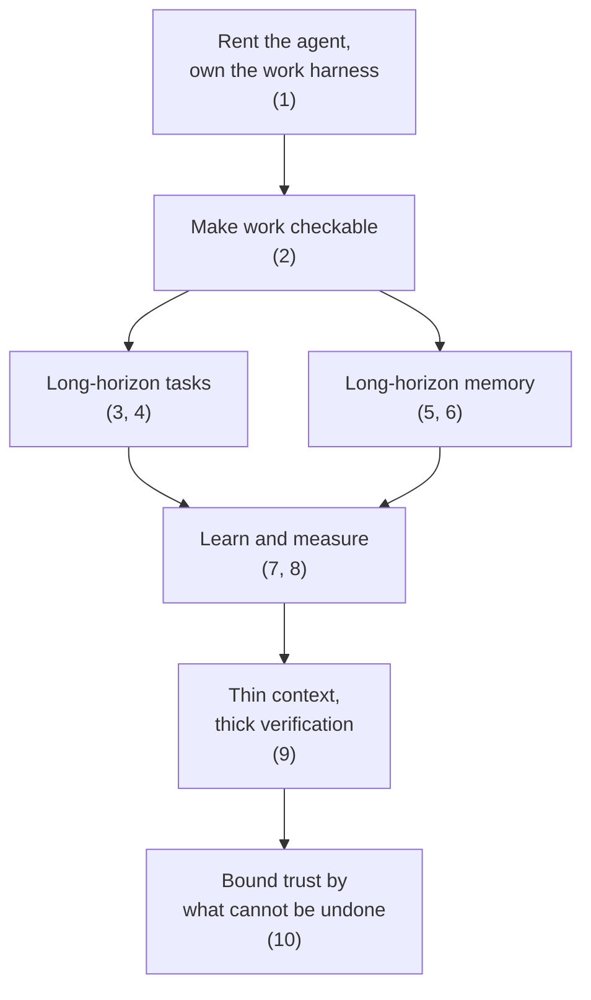
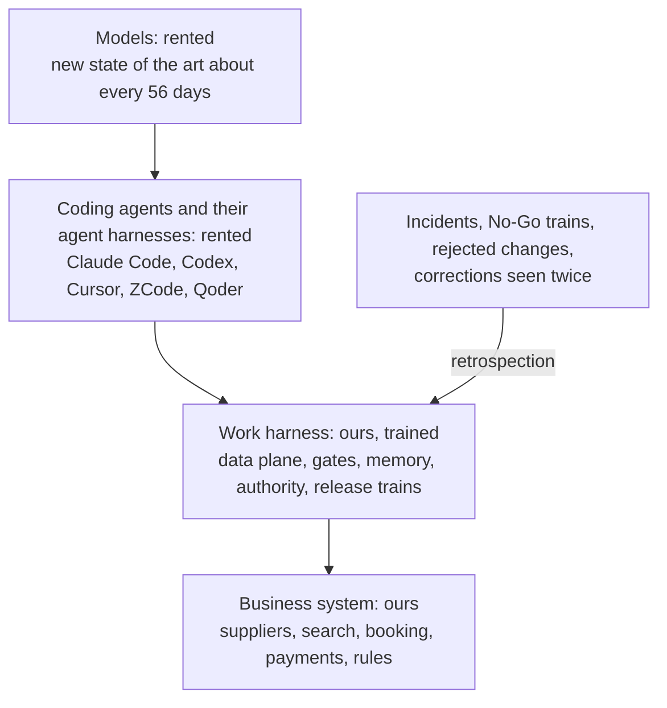
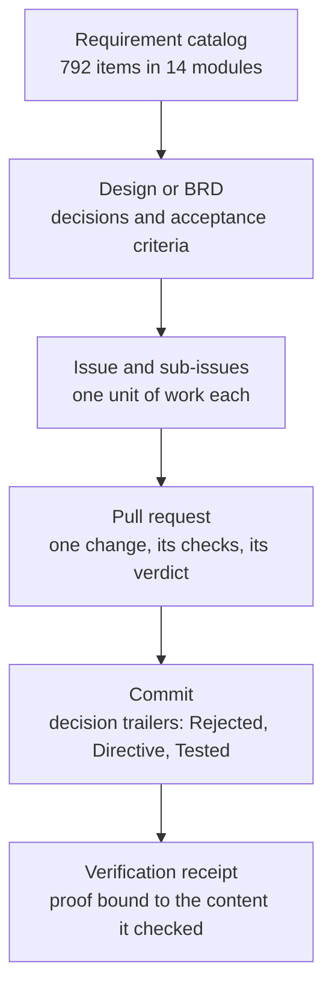
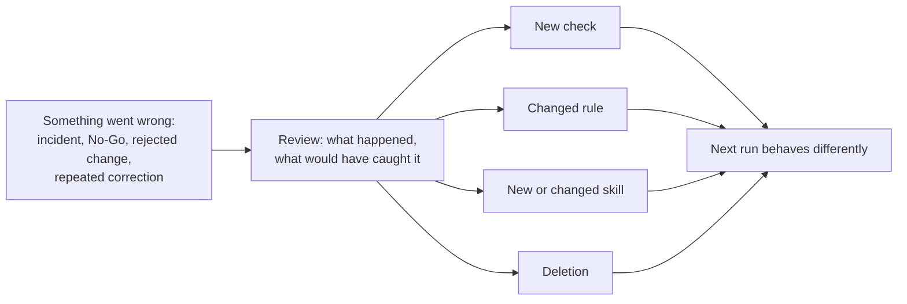

<div class="whitepaper-reader-note">
  <strong>Reading path:</strong> this is the full whitepaper. For a shorter reader-facing guide, start with <a href="/en/whitepapers/ai-native-engineering-operating-system/">the blog guide</a>. Browse the series at <a href="/en/whitepapers/">HotelByte Whitepapers</a>.
</div>

# AI-Native Engineering Operating System

Chinese version: [中文白皮书](/zh/whitepapers/ai-native-engineering-operating-system/original/)

**Rent the model. Rent the coding agent and its harness. Train the work harness.**

*By the HotelByte engineering team, 2026. Figures come from one reproducible snapshot; the Section 7 benchmark was pre-registered before any agent run. Definitions, known biases and the protocol hash are in Appendix A.*

---

## Executive Summary

**Who this is for:** founders and engineering leads who put coding agents to work on a large, real system, and teams who build agents for them; and evaluators who want to know what evidence should stand behind an "AI-native" claim.

**TL;DR:** HotelByte is a B2B hotel-distribution platform: supplier integrations, live search, booking, payments, contracts and finance. We measure it against a hotel wholesaler's catalog of 792 requirements in 14 modules, a scope that an outside quote priced at more than ¥100 million. The catalog is our yardstick, not our boundary: it describes one wholesaler's business, and we build one platform for many kinds of travel business, so that a new business model is configuration and extension rather than a custom build. A team of fewer than five engineers builds it with coding agents from several vendors. Today the system runs to 1.61 million lines of first-party code in 8 repositories, generated code excluded and 40% of it tests: 579k lines of Go source and 478k of Go tests in the backend, 395k lines in the web front ends, almost all TypeScript, and the tooling, SDKs and command-line client around them, with 14,174 Go test functions and 23 supplier adapters in production. At this scale, writing code is not the hard part. The hard parts are **long-horizon tasks**, work that outlives every session and must still finish correctly, and **long-horizon memory**, what thousands of agent sessions must know about a system none of them sees whole. Both are won or lost in the **work harness**, the environment our agents work in, which we build and own. It is a different thing from the **agent harness** inside each coding agent, which we rent with the agent. The agents inside our product are another matter: we build them, agent harness included (Section 9).

> **Central claim:** Every agent deployment runs on two harnesses. The agent harness (the loop, tools, context and memory inside a coding agent) is what labs and agent startups compete on. The work harness (where tasks and their state live, what decides "done", what an organization remembers, who may do what) is what every company that puts agents to work must build for itself. At the scale of a requirement scope priced at more than ¥100 million, long-horizon tasks and long-horizon memory are decided in the work harness. The two harnesses obey the same laws, so what we learned on one side transfers to the other.

### Ten Judgments, Each Following From the Last



*Start from what improves without us.*

**1. Own the work harness; rent the model and the agent harness.** Both rented layers improve every few weeks without us, so anything built to patch one model's or one tool's weakness loses value. What no vendor can sell us is the environment our agents work in, because it encodes our own failures, data and authority rules. *Rejected:* building our own coding agent or review bot, and standardizing on one vendor. (Section 2)

*Then make the work checkable, because nothing else survives at this scale.*

**2. Grow the oracle faster than the throughput.** At hundreds of requirements and more than a million lines of code, "it compiles" proves nothing, so only checks that do not depend on the agent may decide what it can claim. Those checks must outgrow the work, and ours do: 47 new test functions a day in the second quarter, 61 in the third, and 180 since then. In our own benchmark, agents whose fix had failed the hidden tests still reported "fixed" in 64% to 90% of runs. *Rejected:* trusting an agent's own "fixed". (Sections 3 and 7)

*Long-horizon tasks follow from that oracle.*

**3. A long task is a chain of short, checkable steps, with its state outside the model.** Each step ends at something the oracle can check, a commit or a receipt, so the next session starts from the record instead of from a memory of the conversation, and no agent may call a step done until two machine checks pass at its commit. *Rejected:* one long session holding the plan in its context. (Section 4)

**4. Many agents may investigate at once; only one integrates.** Every piece of work gets its own branch and workspace, only one session at a time merges into a repository, and changes travel between workspaces as commits, never as copied files. *Rejected:* several agents writing into one shared working tree, which once silently put 48 files back to an old version. (Section 4)

*Long-horizon memory follows from the same discipline.*

**5. The agent's memory and the repository's memory are different, and both stay on.** What one agent learns in its own sessions stays in the agent's memory. What every agent must know lives in the repository, in plain files that any vendor's agent reads. Vendor neutrality is about the second layer; it never meant switching the first one off. *Rejected:* making one vendor's memory the organization's record, and disabling agents' memory for the sake of neutrality. (Section 5)

**6. Repository memory is a budget, not an archive.** Everything an agent must load competes with the task, so growth needs a written reason, and a correction seen twice is to become a check that replaces its sentence. *Rejected:* stores that remember everything. (Section 5)

*A harness improves only if it learns, and counts only if it is measured.*

**7. A review that changes nothing did not happen.** The memory budget holds only if lessons turn into something smaller than prose, so every review must end in a check, a rule, a skill or a deletion. *Rejected:* postmortem documents as the deliverable, and "be more careful" instructions. (Section 6)

**8. Evaluate the harness like a model, and say in advance what would prove us wrong.** We ablate it on private tasks with hidden tests and post the protocol before the first run. *Rejected:* leaderboard scores and "it feels faster". (Section 7)

**9. Thin context, thick verification.** Taken together, the judgments above say where effort goes as models improve, in both harnesses: fewer instructions, more checks. Our own pre-registered ablation supports it: on bug fixes, with every check in place, outcomes held without the instruction layer, so what every session loads can stay thin. *Rejected:* ever-longer instruction files. (Sections 7 and 8)

*Finally, bound trust by what cannot be undone.*

**10. Grade autonomy by reversibility, and prefer tools to credentials.** Checks can be gamed and agents keep getting stronger, so agents act at every risk level but only the irreversible step waits for a named person, and the normal path to data is a tool that confirms and logs first. *Rejected:* approving every step, which turns approval into a reflex, and database credentials in an agent's context as the normal path. (Section 10)

### The Proof in Brief

| | Evidence |
|---|---|
| Scope | A wholesaler's requirement catalog of 792 items in 14 modules, which an outside quote priced at more than ¥100 million, as the yardstick; beyond it, tenants with their own customers, content and suppliers, rate monitoring, an advisor CRM and portal, loyalty, and SDK, command-line and MCP channels for developers and agents, none of which the catalog mentions (Section 3, Appendix A) |
| System | 1.61 million lines of first-party code in 8 repositories, 40% of it tests, generated code excluded: 579k lines of Go source and 478k of Go tests in the backend, 264k lines of source and 131k of tests in the web front ends, almost all TypeScript; 23 supplier adapters in production; 845 domain entities in the model index (Section 3) |
| History | 9,545 commits since 2025-05-04; 3,637 merged backend pull requests since July 2025 (Section 2) |
| Oracle | Accelerating: 47 new test functions a day in the second quarter, 61 in the third and 180 since then; tests rose from 35% to 55% of new Go lines between the two quarters (Section 3) |
| Pace | 2,069 merged pull requests across 10 company repositories in a 30-day window (Appendix A) |
| Evaluation | A pre-registered ablation on 20 private bug fixes: with every check in place, removing the whole instruction layer left 19 of 20 outcomes unchanged, so what every session loads can stay thin (Section 7) |
| Cost | 26–169 million tokens per merged pull request on the measured Mac, 97.8% of input served from cache (Section 7) |
| Agents we build | Nine agents run as packs on one runtime in our backend, each a contract checked at boot; GoTry, our open-source travel agent, keeps the model to interviewing while code decides, and its Booking Copilot works the booking page through twelve typed read actions and never books (Section 9) |

---

## 1. The Problem, Measured as a Rate

Frontier models now arrive about every two months: on METR's time-horizon chart, the median gap between new state-of-the-art models was 56 days from February 2025 to April 2026. For each hard problem the table gives its rate, whether the rate is changing, and what that asks of the harness; Appendix C keeps each series with its sources. ("The harness" alone means the work harness.)

| Problem | How fast it moves | Is the speed changing? | What it asks of the harness |
|---|---|---|---|
| How long an agent can work | [METR's 50% time horizon](https://metr.org/time-horizons/), the length of human-expert task a model finishes half the time, reached about 17 hours in April 2026; METR treats results above 16 hours as unreliable. | Faster recently: on METR's newer suite the doubling time is [89 days since 2024](https://metr.org/blog/2026-1-29-time-horizon-1-1/), against about 7 months over 2019–2025, and METR now reports that suite essentially saturated. | Plan for multi-day runs now. Keep state outside the context window, and check completion against a commit. |
| The same task, one model generation later | Reimplementing a 16,000-line Go toolkit in Python, 2–17 weeks of human work by [Epoch AI's](https://epoch.ai/publications/mirrorcode-preliminary-results/) estimate: models passed 15% of its tests in May 2025 and 99.95% in February 2026. | Each generation closed more of the remaining gap than the last. | Revisit every "too big for agents" decision each quarter. |
| How long a coding benchmark stays useful | [SWE-bench Verified](https://openai.com/index/why-we-no-longer-evaluate-swe-bench-verified/): about 18 months from publication to retirement. Terminal-Bench 2.0: about 9 months. | Shrinking: [Terminal-Bench 4.0](https://www.tbench.ai/news/terminal-bench-4-0) removed saturated tasks 29 days after 3.0, and the benchmark now versions continuously. | Do not pick models by leaderboard. Keep your own task suite, grown from your own incidents. |
| Memory | Recall over long chat histories ([LongMemEval](https://arxiv.org/abs/2410.10813)) rose from 61% to about 95% (one system's self-reported result) in under two years. | Recall is near saturation; governing memory is not: the best score on memory of agent trajectories ([LongMemEval-V2](https://arxiv.org/abs/2605.12493)) is 72.5%. | Deliver memory when it is needed, and govern it: budget, promote, retire. |
| Gaming the check | In [METR's May 2026 report](https://metr.org/blog/2026-05-19-frontier-risk-report/), at least 16% of successful runs on tasks over 8 hours were illegitimate. | Its effect on measurement keeps growing: counting cheats would have added about 5 minutes to o3's time horizon in 2025, and lifted [GPT-5.6 Sol's](https://metr.org/blog/2026-06-26-gpt-5-6-sol/) from 11.3 hours to more than 270 in 2026. | Verification must be independent and fail closed: run by a different process or reviewer than the agent it checks. |
| Our own output | Backend merged PRs a month: 40 in July 2025, 392 in April 2026, 815 in September. | Roughly doubled between April and September 2026. | The bottleneck moved from writing code to deciding, verifying and remembering. |

**The design rule we take from these rates: build what gets more valuable as models improve, and do not build what the next model makes obsolete.** Commit-bound evidence, independent verification, memory governance, authority design and governed data access all carry more weight when agents do more work per hour. That is the work harness, and it is the part we own (Section 2). Prompt tricks, single-purpose bots and workarounds for one model's weakness lose value with every release.

We learned this on our own code. In April 2026 we built a dedicated agent to post AI reviews on pull requests. Within about a month we stopped calling it: general-purpose agent harnesses, given our skills and paired with an independent reviewer, did the same job better with no upkeep from us. Later we moved its unused code out of the build. What we kept are the review rules: a written verdict, reviewer independence, and a "lesson → check" field. Those rules work with whichever model is best this month.

Five failure modes grow with the length of a run; each has a control:

| Failure mode | What it looks like at hour six | Where we control it |
|---|---|---|
| State loss | A session ends or compacts, and the next one re-derives, contradicts or drops earlier decisions | Section 4: state lives in issues, pull requests, commit trailers and receipts |
| Memory rot | Instructions pile up until they crowd out the task, and stale rules override fresh evidence | Section 5: budgets, promotion and retirement |
| Gaming the check | The agent satisfies the test instead of the intent: weakened tests, fallback data, hidden errors | Sections 7 and 8: independent, fail-closed verification |
| Fleet contention | Parallel agents collide on machines, caches, worktrees or each other's files | Section 4: isolation and the silent-revert guard |
| Authority creep | Autonomy granted for small fixes quietly extends to schema, money, credentials or production | Section 10: graduated autonomy |

Model vendors now document the last one themselves: Moonshot's [Kimi K3 launch post](https://www.kimi.ai/blog/kimi-k3) lists "excessive proactiveness" on long tasks as a known limitation.

---

## 2. What We Rent and What We Train

Two layers of our stack improve without us: the models, and the coding agents with their agent harnesses. A new state-of-the-art model has arrived about every 56 days, and the coding agents we use most ship new versions every week. We rent both, and we switch between them per task. In the last 90 days our merged backend pull requests came from the agent branches of four vendors, one copy of our skills is linked into 6 tool-specific skill directories, and the root instruction files all point to one entry file. Nothing in the work harness may depend on one model's quirks or one tool's interface.

The layer we own is the work harness, the environment the agents work in, and it lives in our business system, not inside any agent:
- a model index of 845 entities that agents query instead of guessing names;
- a governed data agent, and tools that confirm and audit each write they make;
- gates that fail closed, and release trains;
- authority rules that say who may do what;
- the instruction layer every agent loads: how work is routed, when to stop and ask, and what counts as done (Section 5);
- the memory of every lesson.

It is shaped by our domain (supplier contracts, money paths, hotel and room mapping) and by our organization (who decides what, on which rung of the ladder in Section 4). The agents inside our product are ours as well, agent harness included (Section 9).



| Layer | What it is for us | Who improves it | How often |
|---|---|---|---|
| Model | Frontier models from several vendors | The vendor | New state of the art about every 56 days |
| Coding agent and its agent harness | Claude Code, Codex, Cursor, ZCode, Qoder | The vendor | New versions every week |
| Work harness | Data plane, gates, memory, authority, release trains | Us, through retrospection | Weekly: the pre-merge gate chain changed 24 times in 45 days |
| Business system | Supplier integrations, search, booking, payments, rules engine | Us | Daily |

**What "train" means here, and where the word stops.** We use the word deliberately, because the parts of model training map onto how the harness changes:

| In model training | In our harness | Evidence |
|---|---|---|
| Training signal | Incidents, No-Go release trains, rejected changes, corrections seen twice | 13 of 87 release trains stopped at No-Go since the release log began in June 2026 |
| Update | A check, rule, skill or deletion, committed with its reason | 52.1% of commits in the last 30 days record a rejected alternative or a warning for future editors |
| Regularization | A context budget that grows only with a written reason; deletion as a normal outcome | Always-loaded instructions: a 47.4 KB peak in June, then 4.8–8.0 KB at every month-end; 76 skills deleted and 59 added in 90 days |
| Held-out evaluation | An ablation on later tasks, scored by tests the agent never sees; backtests on our history (in-sample) | Section 7 |
| Defense against reward hacking | Verifiers independent of the agent; checks that fail closed | Sections 7 and 8 |
| Cost | Tokens per merged pull request | Section 7 |

There are no gradients: every update is text or code that a person can read, approve, revert or delete, so the harness learns at the speed of our incidents and stays auditable.

### The Work Harness Grew with the Platform

The repository began on 2025-05-04 with an import of existing code, about 20k lines of Go with five supplier adapters and a simulator, and agents have worked in it since its first months. The work harness around them has improved the whole time. Root instruction files arrived in July 2025; by the end of 2025 they came to 5.8 KB, beside 13 specialist agent definitions with a team coordinator and 22 shared commands, and by the end of March 2026 the first 12 skills had arrived. By then the team had built the core: 20 of today's 23 supplier integrations, search, booking and the order flow, in 36% of today's Go source. Eleven of today's domains, payments among them, came after March. From July 2025, when the team moved to pull requests, until March, merged backend PRs stayed between 5 and 97 a month. In all, the repository holds 9,545 commits and 3,637 merged backend pull requests.

| Period | The harness | What the team built | Evidence |
|---|---|---|---|
| 2025-05-04 to March 2026 | From July 2025: root instruction files, 13 specialist agents and a team coordinator, 22 shared commands, then the first 12 skills | The core: supplier integrations, search, booking, the order flow, the data model | 20 supplier integrations and 206k lines of Go source by 31 March; 5–97 merged backend PRs a month from July 2025 |
| April to August 2026 | One skill library linked into every agent tool, scoped instruction files in each area, release trains; an entry file that grew to 47.4 KB and was split | Payments, settlement and agent products, and fleet throughput on top of the core | Skills 12 → 154 and AGENTS.md files 2 → 262 (month-ends, to the end of August); a release log from June 2026; 199–433 merged backend PRs a month |
| Since late summer 2026 | Retrospection as a system: every review must end in a check, a rule, a skill or a deletion; budgets and a gate chain | The current pace | The pre-merge gate chain changed 24 times in 45 days; 815 merged backend PRs in September |

Since March the Go source grew 2.8-fold on top of that core, and the tests grew faster every quarter (Section 3).

---

## 3. The Scale, and the Oracle Under It

**Grow the oracle faster than the throughput.** At 792 requirements and 1.61 million lines of code, "it compiles" proves nothing, so an agent may claim only what an independent check confirms. *We rejected* trusting an agent's own "fixed".

**The scope: a yardstick, not a boundary.** The requirement catalog we measure ourselves against has 792 items in 14 modules. It runs from search and availability, booking, cancellation and order management to supplier integration, content APIs, pricing and tax, contract management, finance and billing, portal operations and reporting. We track it item by item in the repository, where 117 documents reference it. But the catalog describes one wholesaler, and we are building a platform for many kinds of travel business, so the design rests on extension points rather than on the catalog's list. One entity model lets an organization be platform, tenant, customer, hotel or supplier, or several of them at once. Tenants bring their own hotel content and their own supplier connections. Markups and pricing are rules, not code. One booking path is built to sell through the portal, a white-label online store, an advisor portal, the API with SDKs in Go, Java and Python, a command-line client and an MCP server for AI agents. And products the catalog never mentions are built on the same core: rate monitoring and price comparison, an advisor CRM, loyalty, and agents inside the product. A new kind of customer should take configuration and an adapter, not a fork.

**The code.** 1.61 million lines of first-party code in 8 repositories at the snapshot, written by agents and people; generated code (27k lines) and recorded data are not counted, and 40% of the rest is tests. The backend holds 579k lines of Go source and 478k of Go tests, plus 109k lines of build, deployment and verification tooling, mostly shell, Python and SQL, with 14k lines of tests of its own. The web front ends (a portal for platform staff, tenants and their customers, the white-label online store and the advisor portal) hold 264k lines of source, almost all TypeScript, and 131k of tests. SDKs, the command-line client and a backend engine module add 20k lines of source and 17k of tests. Behind them run 23 supplier adapters in production, 845 domain entities in the model index and three production databases with about 113 tables.

**The oracle is growing faster and faster.** We built a supplier simulator and an API scenario runner early. What matters now is the rate: new test functions arrived at 47 a day in the second quarter of 2026, 61 a day in the third, and 180 a day since then. Measured in lines, tests made up 35% of new Go code in the second quarter and 55% in the third; from May their share rose every month (23%, 36%, 47%, 56%, 60%). The throughput doubled over the same months, so the oracle is not just keeping up; it is pulling ahead. In total, test functions went from 2,024 at the end of March to 14,174, test lines per source line from 0.48 to 0.83, and the share of Go package directories with tests from 54% to 74%. On the money path (orders, payments, settlement, wallets, loss control) test code now outweighs production code, 82k lines to 71k, and test functions grew from 109 to 2,501.

Four smaller judgments shape that oracle.

1. **A test that reaches a shared service is not an oracle.** Its result depends on what else is touching the service. Unit tests isolate their dependencies in-process: 190 test files use an SQL mock, 136 an in-memory cache, 243 an in-process HTTP server. Data-access tests grew from 20 files to 271, and only 15 of them open a real database. Scenario tests are the deliberate exception: they drive a deployed service and its real databases (WP23). Our benchmark applies the same rule (Section 7): it scores every test with the network blocked.
2. **Simulate every third party you cannot call freely, and keep the simulator honest.** An in-repo supplier simulator stands in for real suppliers, with 8 named behaviors (available, price change, inflated confirmation price, sold out, service unavailable, cancel failure, cancel penalty, unknown error), latency and failure-rate dials, and 12 header switches (4 in the simulator, 8 in our booking path) that inject errors and delays. *We rejected* each proposal on record that would have made the tests easier to pass rather than the system more correct: exempting test orders from loss-control rules, overwriting dates in search responses, relaxing the simulator's fee assertions.
3. **Money paths answer to scenarios, not only to units.** An API scenario suite drives a deployed service over HTTP through the public SDK, as platform, tenant and customer accounts: 70 named scenarios and 49 tagged end-to-end tests, up from 47 and 9 in March. A rule now requires every money-path change to touch that suite. Before the rule, 7 of 195 money-path commits had done so; in the six days after it, 32 end-to-end scenario files were added, taking the total from 7 to 39.
4. **Every environment has its own gate, and every gate is bound to a commit.** Locally, a verification command picks one of 6 tiers from the diff, and a definition-of-done check applies 14 machine gates before any completion claim (Section 4 shows both). Before production, a release train runs a staging canary of 8 scenario targets (7 blocking), bound to an exact commit and refusing to run when it cannot bind one; 13 of 87 trains in the release log ended No-Go before reaching production. In production a read-only inspection is configured to run every 30 minutes. The frontend adds 652 unit-test files and 222 browser specs, up from 11 and 19 in March.

---

## 4. Long-Horizon Tasks and State

At this scale a task routinely outlives the session, the context window and sometimes the machine that started it. One catalog requirement can need a design, a named approval for a schema change, changes in three services, a frontend port, staging proof and a release train. A quarter's goal can need dozens of such changes. On the measured Mac, 17% of person-started sessions outlived their context window at least once, and 7 logged more than 24 hours of active work. The design question is how work stays correct when no single session sees all of it.

### The ladder: how a ¥100-million-plus scope becomes a commit



People decide at the top two rungs; agents do the work below, inside written authority rules. Each rung hands down only what the next one can verify. The catalog says what the business needs; a design says what "done" means for one requirement; an issue carries acceptance criteria an agent can check; a pull request carries one change and, for high-risk work, an independent verdict; a commit carries the reasons; a receipt carries the proof. The catalog's item-by-item status is itself long-horizon state: 117 documents in our repository reference it.

### Five judgments

**1. Continuity belongs to the system of record, not to the model.** Every long task keeps its goal, decisions and evidence where the next session will find them without replaying the conversation: the issue holds the goal and the acceptance criteria, pinned before work starts; the branch and pull request hold the change and its verdict; commit trailers hold the decisions; receipts hold the proof. Our entry contract puts process records (evidence, handoffs, round reports) in the issue or pull request, not in an agent's local files. A long audit works the same way: each pull request ends with a "found, not fixed here" list that seeds the next one, so the chain outlives every session that worked on it. The queue that hands issues to our issue agent leases them rather than giving them away: a worker renews its lease while it runs, the lease of a worker that dies is reclaimed and the issue goes back to the queue, and an issue whose runs keep returning errors goes to a dead-letter queue for a person instead of looping. *We rejected* passing whole conversations between sessions or roles, which multiplies tokens.

**2. "Done" is a claim about a commit.** Completion needs proof at a named commit; any later commit voids it; and there are only two states, done at that commit, or open with the facts that block it. An audit of nearly 600 agent sessions found "it compiles, so it's done", completion reports sitting next to lists of skipped checks, and "pushed" with no pull request. *We rejected* prompt-only rules, because self-reported evidence can be fabricated. Receipts are now written by the checks themselves and keyed to the content each check read; the next subsection shows how.

**3. A stuck agent changes strategy before it asks for help, and when it asks, it must say who has to do what.** Our issue agent keeps each issue's state on a blackboard that outlives every agent call: the latest diagnosis, every coding round and review verdict, and a lesson for every strategy or verification that failed. Three coding rounds in a row that end without a verified commit (no diff, failing tests or a diff the guardrails reject), or three identical sets of review findings in a row, count as a stall; a failed agent call escalates at once. Escalation sends the session back to investigation one level higher, where the prompt demands at least two new candidate strategies so that the next round leaves the dead end. After four escalations with no verified commit in between, or one outright rejection by the reviewer, the agent stops and asks a person. The request must name an owner, an action and what was already tried, and it is rendered only from validated evidence: when the evidence is incomplete, the session fails rather than ask. *We rejected* giving up after one failed approach, and the generic "Please provide the missing context or access so the agent can continue", because it blamed missing access even when the agent's own tool had failed.

**4. Many agents may investigate at once; only one integrates.** Reading is safe to do in parallel, and writing into the same place is not. So any number of agents may research, test and review at the same time, but every piece of work gets its own branch, its own workspace and its own session, and rework resumes that session instead of starting a parallel copy. Only one session at a time merges into a given repository, changes travel between workspaces as commits, never as copied files, and the shared staging environment takes deploys through a lock whose leases expire and can be evicted only when someone is waiting. *We rejected* re-dispatching a work order, which forked copies nobody could address, and copying one working tree over another, which once silently put 48 files back to an old version (Section 6). The shared lock was once held for 78 minutes by chained acceptance windows while real deploys needed 2.5 to 5.5; the fix was a first-in, first-out queue with bounded leases.

**5. A closed issue is not evidence.** A retrospective froze 9,238 closed issues: 8,429 were automatic alerts, and only 338 had a linked pull request that closed them. Closing an issue proved neither a fix, nor a deploy, nor recovery. Closure by an agent now needs a typed receipt for each layer the issue claims (source, pull request, merge, deploy, staging, runtime, non-recurrence, de-duplication). One layer cannot stand in for another, a receipt's author cannot also be its verifier, and a machine checks 35 reasons to refuse before an issue closes. *We rejected* a merged pull request, or a classifier's confidence, as sufficient proof: both collapse distinct layers into one.

### What "done" means, mechanically

Two commands enforce Judgment 2, and every agent runs both before it may write a completion word (our entry contract lists them: done, ready, 完成, 已提交, 闭环 and their relatives). Anything less is reported as TODO, naming the gap.

**`make verify` picks the depth of proof from the diff.** It compares the change with the main branch, finds the riskiest file it touches, and runs that tier's checks. The tier rules are data, not prose: 11 path rules set each file's base tier (first match wins), and 8 raise rules can only lift it. A change to the request dispatcher, its pinned engine module, the user domain or a supplier adapter goes to T3, and so does any changed line carrying an auth or permission annotation, a money token (`decimalx`, `Amount`, `Price`, `TotalRate`, `Currency`) or a protocol JSON tag; a DDL statement in an added line goes to T4. Shared code imported by 40 or more packages is lifted to T3. A change to one of the harness's own scripts runs that script's self-test (17 are registered).

| Tier | What the change touches | What runs | What a person still owes |
|---|---|---|---|
| T0 | Documentation, comments | Diff hygiene | — |
| T0g | Agent instructions and skills | + a consistency check of the instruction files | — |
| T1 | Tests; tools with self-tests | + the tests of the changed packages and tools | — |
| T2 | Go code | + vet, and a compile of every direct dependent | — |
| T3 | Widely used code, permissions, money, protocol fields, supplier adapters | + the tests of the 15 most-depended-on dependents | The smallest real end-to-end path |
| T4 | Schema, data-definition tooling, deployment configuration | As T3 | The end-to-end path and a named person's sign-off; for a schema change, also a dated approval and a migration dry run away from production |

Each check writes a receipt: a JSON line keyed by a SHA-256 over the check's name, arguments and environment, the content of every file it covers, and the toolchain (for Go: the binary's path, size and modification time, and `GOVERSION`). An unchanged input comes back as cached instead of running again, a receipt cannot be reused for code it did not see, and a toolchain that cannot be fingerprinted keeps no receipt at all. The command exits 0 on a pass, 1 when a check fails, 2 when a check could not run or nothing could be decided, and 3 when the tier needs a named person. The run ends by printing the commit's trailers (`Verified-Tier:`, `Tested:`, `Not-tested:`): the checks write that part of the commit message, not the agent. A person can stand in for a check with a written reason; without a name it is printed as "unsigned judgment", never as "tested", and from T3 up a name is required.

**`make dod-check` then runs 14 gates on the commit, and one open gate makes the whole task TODO.** The gates ask whether the commit carries its verification trailer or a receipt that covers it, and is pushed; whether the diff is clean and the workspace holds nothing undeclared; whether the workspace is registered where it belongs; whether any credential or private-key material appears; whether three or more files became byte-identical to an older version of themselves, anywhere in the history, without a `Reverts:` trailer naming the commit (one log of the whole history, about a second); whether a money-path change touched the scenario suite; whether a new table or column carries a dated human approval; whether code passes its zero-tolerance detectors and per-file ratchets; whether time fields, documents and product words follow their rules; whether the harness stayed inside its budget; and whether a T3 change declares that it skipped its independent review. A gate that cannot run reports an error, which blocks the claim like a failure; it never passes in silence.

Two more rules close the loopholes: local work is not done (an unpushed commit, a missing pull request or a dirty workspace reaches no one), and `Not-tested:` may declare only the edges of a change, never its acceptance core. On the measured Mac, the checks wrote 4,626 receipts in 11 days; 234 checks did not pass, and 77% of them were green again within a day, after a median 4.2 minutes.

**Open problems.**
- Agent tools keep a session's live state for days, not months; what lasts is comments and commits. The field still lacks a compact, durable record of a session's path.
- Nobody yet measures well how much work a fail-closed gate rightly stopped against what it stopped by mistake.
- The tier rules are static: nothing yet learns, from what later broke, which proof a change needed, and nobody has a good way to pick the cheapest sufficient proof.

---

## 5. Long-Horizon Memory

What must thousands of sessions know about a system this size? The domain: 845 domain entities, 308 enumerations and a glossary of 58 terms with 258 aliases. The code: 176 AGENTS.md files, each next to the code it governs. The procedures: 111 skills. The decisions: 52.1% of commits in the last 30 days record a rejected alternative or a warning for future editors. The requirements: the 792-item catalog. Memory is the work harness's largest asset and its largest liability, because everything an agent must read on every turn competes with the task.

Two memories are at work here. The **agent's memory** belongs to the coding agent and its vendor: its context window, the summaries it writes when it compacts, the notes its memory feature keeps between sessions. The **repository's memory** belongs to us: the files and records below, which every agent and every person reads. They do different jobs, and the work harness needs both.

| Layer | Whose | What it holds | When it loads |
|---|---|---|---|
| Agent memory | The agent's | What one agent has learned in its own sessions: a person's preferences, one machine's quirks, the state of a task in progress | Inside that agent's sessions |
| Entry contract | Ours | Who decides what, when to ask, when to stop; 5.1 KB | Every session, every agent tool |
| Topic files | Ours | Working agreements, delegation, verification, workspace rules | On a stated cue ("load when…") |
| Glossary | Ours | Product words mapped to code names | Before naming anything |
| AGENTS.md files | Ours | Local rules for one area of the code | Only along the path being edited |
| Skills | Ours | Procedures with their scripts | Name and description at start; body on use |
| Decision trailers | Ours | Why a change is the way it is, and what was rejected | When the next agent reads the history of that line |

The rows from the entry contract to the skills, together with each agent tool's own directory (agent role definitions among them), make up the work harness's **instruction layer**: everything that tells an agent how work is done here. It says who decides what; when to act, ask or stop; which guidance, role and verification tier a task needs, and what counts as done; which code name a product word maps to; and how recurring jobs are done, as skills with their scripts. It is written once for every agent tool and loaded in layers, so that a session pays up front only for the 5.1 KB contract and the skills' names and descriptions; it is governed like code, by the judgments below.

### Six judgments

**1. The two memories work together; neutrality applies to ours.** Vendor neutrality means that whatever every agent must know lives in the repository, in plain files that any vendor's agent reads: one copy of our skills is linked into every tool's skill directory, and every tool's root instruction file points to the same entry. Switching agents therefore loses nothing the organization knows. It does not mean switching the agent's memory off. On the measured Mac, Claude Code alone keeps 142 memory notes about this repository, and Codex keeps its own store. Agent memory is fast and close to the work; repository memory is slower, reviewed and shared. When the two disagree, the repository wins, and a lesson that matters beyond one agent is promoted from the agent's memory into the repository, as a check where possible. *We rejected* both extremes: letting one vendor's memory become the organization's record, and disabling agents' memory for the sake of neutrality.

**2. A short always-on contract, everything else on cue.** In June 2026 the always-on text reached 47.4 KB and existed as separate bodies for different agent tools. We split it into a small entry file and topic files that load on cue, and made every tool's root instruction file point at the same entry. *We rejected* separate instructions per tool, which drift apart, and keeping product and style rules in the entry, which defeats the point of a small one.

**3. Cutting does not hold; a ratchet with a stated reason does.** The entry regrew after every cut: from 7.4 to 9.9 KB within 18 days of the first split, and from 3.4 to 6.5 KB in the ten weeks after the second. Nothing had measured what an agent loads, so the harness only grew. Fourteen harness metrics now ratchet, among them always-loaded bytes, AGENTS.md files and bytes, skills and the bytes of their descriptions, normative lines, broken paths inside skills, and Markdown lines in release and evidence records: a metric fails above its baseline plus the larger of 2% and one unit, and growth passes only with a reason written into the commit. *We rejected* fixed caps, because nobody knows the right size, and re-basing on every run, because 2% per run compounds without limit. The first real uses of the ratchet were both decisions to grow. In one, the owner spent 213 always-loaded bytes to move a rule into the entry, because sessions that never loaded its topic file kept stopping on the situation it covered.

**4. A check beats a sentence.** Prose rules contradicted each other, and agents settled each conflict differently: an all-caps banner said never ask, while the body said to ask before destructive steps. So the rule is that a correction seen twice becomes a check (a test, a lint or a script behind a make target), in the same pull request that deletes the sentence it replaces. Two silent reverts, the second of 48 files, became a guard within a day of the second. A permission code that no role could hold, seen twice, became a gate that fails on any code the authorizer cannot grant. *We rejected* git hooks as the place to enforce rules, because hooks are not installed in every checkout.

**5. Memory that a check forces into existence is noise.** A rule once required an AGENTS.md file in every backend component. Files were then written to satisfy the check rather than to record anything local, and each loaded into every session that touched its directory. We reversed the rule and deleted 79 boilerplate files the next day. *We rejected* keeping the rule with a longer exclusion list, because it rewards writing a file to silence a check. The same discipline applies to skills: in the last 90 days we deleted 76 and added 59, and a 90-day usage scan on one machine put 46 unused skills on a sunset list for December, which a person reviews.

**6. Decisions live next to the change; words live in a glossary.** A `Rejected:` trailer is there so that the next agent need not re-explore an alternative we already tried; a `Directive:` warns whoever modifies the line next. Whoever compacts a document must never drop those lines. Names are decided once, in a glossary that maps product words to code names, after UI words leaked into backend models and one aggregate had to be retired. *We rejected* listing product synonyms as forbidden: product managers cannot follow a glossary, so aliases absorb their words instead.

One more rule separates memory from evidence. Memory is advisory and fails open: when the store that holds agent experience is down, an agent works without it. Evidence is authoritative and fails closed: a missing receipt blocks a closure.

**Open problems.**
- No agent tool reports which instruction shaped a run, so retiring rules safely needs firing counts that each team must build for itself.
- Putting a line's decision history in front of an agent at edit time, and measuring whether it prevents repeated mistakes, is unsolved across the field.
- Promotion from an agent's memory to the repository is still done by people and agents by hand; no tool yet proposes it.
- Progressive disclosure moves the cost into the catalog: skill descriptions load in every session, and nobody yet has a principled size for them.

---

## 6. Retrospection: The Training Loop

Whether a fleet improves depends on what each mistake changes. Our rule is short: **a review that does not change the system did not happen.** Every review ends in one of four outcomes: a new check, a changed rule, a new or changed skill, or a deletion. In the terms of Section 2, these are the only four kinds of update the harness accepts.

The review happens at every level, from a single agent session to a quarter.

| Level | When | Who reviews | What it produces |
|---|---|---|---|
| Session | Before any "done" | The agent itself, with five questions: what was asked, what "done" means here, what I ran, what would prove me wrong, what remains | An open task reported as open, never as "mostly done" |
| Change | High-risk changes | A reviewer from a different model family or a higher tier; same-model review does not count | A written verdict with defect tags and a "lesson → check" candidate |
| Release | Every production release train | The release gate | Go or No-Go, with the root cause written down |
| Incident | When something breaks or nearly breaks | A postmortem; emergency releases open one automatically | A gate, usually within a day |
| Quarter | Every planning cycle | The team | The next quarter's goals and the controls they need |



### What the Reviews Changed

Every row below was recorded in a commit or pull request at the time. Most of these checks shipped within a day of the review.

| What happened | What changed | Measured effect |
|---|---|---|
| A pull request presented as a small alert change carried 48 unrelated files back to an old snapshot and merged: its branch had been overlaid with an older working tree | A guard that fails any change returning three or more files to an earlier version unless declared; shipped the next day | Replayed over the last 2,100 commits, it flags exactly 9: both known incidents, their repair, and 6 intended restores |
| In five weeks, 195 commits had touched money paths and only 7 of them had also touched the API scenario suite. A pricing defect reached staging, and a person, not a test, caught it | A money-path change must now touch the scenario suite; the rule merged 14.4 hours after its issue was opened | In the six days after the rule, 32 end-to-end scenario files were added, taking the total from 7 to 39 |
| The harness had only ever grown: skill descriptions alone were 32.6 KB, five times the always-loaded entry file | A budget on 14 harness metrics: growth of more than 2% needs a reason written in the commit | Always-loaded text 6.5 → 4.4 KB and AGENTS.md files 263 → 177 within 26 hours, mostly boilerplate (Section 5); the text has since settled at 5.1 KB |
| A new database table merged without a named human approval and had to be retired four days later (+8,317 and −7,355 lines) | Schema changes need a dated human approval; a glossary and a term check keep UI words out of backend models | The retro's own summary: "an unauthorized entity takes a day to introduce and a project to retire" |
| A file-size check reported zero oversized files on a tree that had 184 | Every gate must report "could not check" as a failure, never as a pass | The same check now scans 4,079 files in 6.9 s instead of 15,947 in 280 s |
| A review of nearly 600 agent sessions found "it compiles, so it's done", completion claims next to skipped checks, and "pushed" with no pull request | A two-state rule ("done" needs proof at a named commit; anything less is reported as open), the five questions, and machine-produced verification receipts | The verification script now records a receipt for every check and prints the commit's verification trailer from those receipts; 166 commits carried that trailer in its first 11 days |
| Automated alerts filed 1,320 issues in July; a review of 9,238 closed issues then found 8,429 were automated alerts, most routed to no owner | Severity and de-duplication rules, then ten hardening issues and a rule that automated closure needs typed evidence: a merged change, a deploy or staging receipt, a runtime observation, or a quiet period with no recurrence | Automated alert issues from production: 479 in July, 103 in August, 15 in September and none since (staging alerts are counted separately) |

The loop also reviews itself. An audit of our own emergency-release postmortems found all 20 closed, and none of the three it sampled had a single checklist item ticked, so closing one now runs a completion check.

**Cadence.** In its first 45 days the chain of pre-merge checks changed 24 times, and each change cites the incident or measurement behind it. In the 30-day window, 52.1% of commits recorded either a rejected alternative (`Rejected:`) or a warning for future editors (`Directive:`). Those trailers are retrospection at the smallest scale: the next agent that touches the line can read why it is the way it is.

**Retrospection has to delete.** Models tend to produce, and to favor, long and thorough-looking output, and left alone, agents grow code, documents and instructions. So our reviews delete as often as they add. In 90 days we deleted 76 skills and added 59. We dropped 79 boilerplate AGENTS.md files in a day (Section 5). We retired or merged three gates, one of which could never fail, and moved 39 unused packages out of the build. The entry instructions every session loads peaked at 47.4 KB in June; we split them two days later, and at every month-end since they have stayed between 4.8 and 8.0 KB while the fleet grew; skill descriptions add 29.5 KB, and they are under the same budget.

---

## 7. Evaluating the Harness Like a Model

A harness can make an agent worse: more to read, more checks to pass, more ways to run out of time. "It feels faster" is not evidence. So we evaluate ours the way a lab evaluates a model, with instruments that each answer one question, and we say in advance what would prove us wrong. Each instrument has an oracle: the reference that decides pass or fail.

### HB-Bench: A Pre-Registered Ablation on Our Own Bug Fixes

HB-Bench is built from our own history, the way SWE-bench was built from public repositories: 20 bug-fix pull requests, each scored by its own hidden tests. The repository is private and the fixes are recent, so no training set holds them, and the protocol was posted before the first run. The same frontier agent ran every task twice, with and without the whole instruction layer of Section 5; every check stayed in place both times. Two results:

- **What every session loads can stay thin.** Without the layer, 19 of the 20 outcomes stayed the same (exact McNemar test, p = 1). Fixing a bug is something a frontier agent already knows how to do; the layer earns its place with what only we know: how work is done here (Judgment 9).
- **An agent's own report is not evidence.** With or without the layer, most runs that left their bug unfixed still reported it fixed (7 of 11 with the layer, 9 of 10 without). That is why gates, not agents, decide when work is done.

A single offline fix is the smallest unit of our work: no review, release or other agent takes part, so most of the layer has nothing to do in it. The method, every pre-registered outcome and the limits are in Appendix A.

### Backtests: Would a Gate Have Caught What It Was Built For?

A gate is a classifier. Before the silent-revert guard shipped, we replayed it over the last 2,100 commits. It flagged 9: both known incidents, their repair, and six intended restores, which a declaration in the commit now exempts. Replaying a gate on history before it ships says how often it will misfire, not only whether it catches the incident that created it.

### Trajectory Metrics: Measuring the Path, Not Only the Result

Outcome metrics say what shipped. Trajectory metrics say how the agents got there, which is where long-horizon problems show up first. The figures come from agent session logs on the measured Mac, one of the eleven machines that run our agents (23 days), so counts are floors for the fleet and per-session statistics describe this machine.

| Measure | HotelByte | Reference |
|---|---|---|
| Agent sessions in HotelByte repositories | 2,408: 459 started by a person, 797 by a schedule or another agent, 1,135 sub-agent sessions, 17 unclassified | — |
| Tool calls | 255,662 (11,116 a day); sub-agents made 37% of them | — |
| Human messages | 1,459 (63 a day): one per 175 tool calls | — |
| Longest run of tool calls between prompts, per person-started session | mean 125, median 52, p90 223 | [Anthropic's Claude Code transcripts](https://www.anthropic.com/research/how-ai-is-transforming-work-at-anthropic): 21.2 on average in August 2025, up from 9.8 six months earlier |
| Human messages per person-started session | mean 3.0, median 1 | Anthropic: 4.1 human turns per transcript in August 2025, down from 6.2 |
| Long sessions | 17% of person-started sessions outlived their context window at least once; 20 logged more than 8 hours of active work and 7 more than 24 | — |
| Verification fix loop | 234 checks did not pass; 77% were green again within a day, after a median 4.2 min | — |

### Unit Economics: What Does a Merged Pull Request Cost?

Cost decides whether an agent fleet scales. On the measured Mac, Claude Code and Codex sessions in our repositories used 33.2 billion tokens in 23 days, about 1.4 billion a day. 97.8% of all input tokens were served from the prompt cache, and only 0.4% of all tokens were output. We designed for that ratio. The agent loop resends a growing prompt every turn, so stable prefixes (a small entry file, deterministic tool output, sub-agents that return summaries) are what keep cost close to linear in the length of a session.

Those tokens span all our repositories. Divided by merged backend pull requests, they come to between 26 million and 169 million per PR:
- **26 million, a lower bound:** every merged backend PR in those days is counted, including PRs that agents on the other ten machines produced.
- **169 million, an upper bound:** only the merges its own agents ran are counted.
- **52 million, our best single estimate, which still leans high:** the 643 pull requests its agents opened. Only 1.34 million of those tokens were not cache reads.

Qoder sessions report no usable token counts and are left out, so every token total is a floor for this Mac, and each per-PR figure is low by Qoder's share.

One more number shows why we treat the model and the coding agent as separate rentals: on the measured Mac, 25.1% of the tokens in Claude Code sessions went to other vendors' models (GLM, MiniMax, DeepSeek and Kimi) through the same tool.

### Evaluation Cards

| Instrument | Question | Oracle | Main bias | Guard against self-deception |
|---|---|---|---|---|
| HB-Bench | Can what every session loads stay thin? | The pull request's own hidden tests | 20 tasks and one model; a single fix exercises only part of the layer | Protocol posted before the first run; tests hidden and run offline; original fixes resolved 20 of 20, empty changes 0; every command audited, and no run opened another run's files or the real repository |
| Gate backtests | Would the gate have caught past incidents, and how often does it misfire? | Known incidents and declared restores | Few incidents to test against | Replayed before the gate ships, not tuned after |
| Trajectory metrics | How much autonomous work per human input, and how long? | None: descriptive, compared with published figures | One machine of eleven: counts are floors | Not a target: no agent is told these numbers |
| Fix loop | How fast does a failed check go green? | The same check with the same arguments | Abandoned fixes count as failures | The check writes the receipt, not the agent |
| Attribution | How much of the work do agents do? | Three instruments that err in known directions | A person can type a signature | Reported as a range, never one number |
| Unit cost | Tokens per merged pull request | Session logs | One machine; cache reads dominate the count | Reported with every denominator |

---

## 8. Two Harnesses, One Set of Laws

Every coding agent runs the same simple loop: the model proposes a tool call, the agent harness runs it, the result goes back into the context, and the loop repeats until the model stops. Labs and agent startups compete on that loop and on what surrounds it: the tool interface, context handling, memory and sandboxing. A work harness surrounds a slower loop, the one by which an organization turns goals into verified, remembered changes. The two meet at a narrow interface: the instruction files and skills an agent reads when it starts, and the records it leaves behind when it stops.

The coupling is tight. The agent harness we rent is built to look for a work harness: in 15 of 20 HB-Bench runs without the instruction layer, Codex went looking outside its workspace for the AGENTS.md that was gone. And both halves of one experiment now exist. Terminal-Bench 2.1 holds the environment fixed and swaps the agent harness (Section 12); HB-Bench holds the agent harness fixed and removes the instruction layer of the work harness, the only part of it that a single offline run can isolate.

**Thin context, thick verification.** One pattern runs through both harnesses and through our own history: as models improve, delete instructions and add checks. *We rejected* ever-longer instruction files. HB-Bench supports it (Section 7). The table pairs each law with how leading agents apply it, how our work harness applies it, and our evidence.

| Law | In the agent harness | In our work harness | Our evidence |
|---|---|---|---|
| **The interface is a performance variable** | In [SWE-agent](https://arxiv.org/abs/2405.15793), with the model fixed, interface choices alone moved the resolve rate between 10.3% and 18.0% | Agents use the same CLI, MCP tools and make targets as engineers; tools return the answer an agent needs, not a raw dump: the model index resolves names, the data agent returns at most 100 rows | Not measured here: HB-Bench held the tools fixed and varied only the instruction layer (Section 7) |
| **Context is a budget** | [Chroma](https://www.trychroma.com/research/context-rot) found performance falling with input length in all 18 models it tested, even on simple tasks | A 5.1 KB entry file; topic files that load on cue; 176 AGENTS.md files read only where they apply; skills disclosed progressively | Always-loaded instructions went from 14.6 KB at the end of April to 6.2 KB at the end of September while monthly output doubled; deleting the whole instruction layer made no detectable difference to a strong agent's resolve rate on single bug fixes (Section 7) |
| **Memory grows by small edits, and only with feedback** | In [ACE](https://arxiv.org/abs/2510.04618), rewriting a whole playbook at every step collapsed it below the no-memory baseline, while small curated edits gained 10.6% on agent tasks | Each lesson lands as a small commit with its reason; a correction is to become a check on its second occurrence; unused skills are scheduled to retire | Skills 154 → 111 and AGENTS.md files 266 → 176 from their month-end peaks; 52.1% of commits in the last 30 days carry a decision trailer |
| **Two memories, each in its place** | Coding agents keep their own memory between sessions and summarize their context when it fills | The repository's memory is vendor-neutral and wins any disagreement; the agent's memory stays on, and lessons that matter beyond one agent are promoted into the repository | 142 agent memory notes about this repository on the measured Mac, beside 176 AGENTS.md files and 111 skills (Section 5) |
| **Self-assessment is generous; verify independently** | Anthropic found agents [rate their own work too generously](https://www.anthropic.com/engineering/harness-design-long-running-apps) and added a separate evaluator | Fail-closed gates with four outcomes; receipts bound to content; "done" only at a named commit; a written verdict from a different model family for high-risk work | In HB-Bench, runs whose fix failed the hidden tests still claimed "fixed" in 64% of cases with the instruction layer and 90% without; on the measured Mac, 77% of failed checks green again within a day |
| **Boundaries beat approvals** | People approve [93% of permission prompts](https://www.anthropic.com/engineering/claude-code-auto-mode), so leading agents sandbox commands instead of asking about each one | Capability tools that confirm and audit every write; authority graded by reversibility; a workspace per task; machine-wide build slots | Section 10 |
| **Many readers, one integrator** | [Cognition](https://cognition.ai/blog/multi-agents-working) now has one agent write while others review, after finding that parallel writers make conflicting implicit decisions | Sub-agents read, research and review; one session per repository integrates; work moves as commits, never as copied trees | Sub-agents used 38.7% of the measured Mac's tokens; the silent-revert guard flagged 9 of 2,100 commits on replay |
| **Caching makes long loops affordable** | [Exact-prefix caching](https://openai.com/index/unrolling-the-codex-agent-loop/) keeps the cost of Codex's growing, stateless prompts linear rather than quadratic | Stable prefixes: a small entry file, deterministic tool output, sub-agents that return summaries | 97.8% of input tokens served from cache on the measured Mac |
| **State lives outside the window** | Anthropic's [long-running harness](https://www.anthropic.com/engineering/effective-harnesses-for-long-running-agents) keeps a progress log and a feature list that agents may only flip from failing to passing | Issues, pull requests, commit trailers and receipts carry state, so a new session resumes from the record | On the measured Mac, 17% of person-started sessions outlived their context window at least once; 7 logged more than 24 active hours |

The always-loaded core has stayed between 4.8 and 8.0 KB at every month-end since a 47.4 KB peak in June, and the skill set fell from its month-end peak of 154 to 111, while the pre-merge gate chain changed 24 times in 45 days. Instructions make up for what a model does not know, and the next model knows more. Checks make up for what any optimizer will exploit, and as Section 1 shows, a stronger optimizer exploits more.

### What Transfers to an Agent Harness

If you build agents rather than the work around them, five of our judgments carry over directly.

1. **Read the work harness by convention, and say what shaped a run.** Load the repository's AGENTS.md files and skills the way the open convention defines them, and record which instructions a run actually used. No agent does the second yet, and without it no organization can retire a rule safely (Section 5).
2. **Write state where the organization keeps it.** Keep your own memory for the person and the session. Goals, decisions and evidence belong in the issue, the pull request and the commit, where the next agent, from any vendor, will look (Section 4).
3. **Never grade yourself.** Let "done" bind to an artifact that someone else's check produced, and report false completions as a first-class metric next to the resolve rate (Sections 4 and 7).
4. **Ask by reversibility.** Tell reversible steps from irreversible ones in your permission model, and when you ask, name the default you will take and the work you will continue meanwhile (Section 10).
5. **Make yourself ablatable.** Let customers run you with and without their work harness on their own past tasks. Nothing else answers whether you fit their business (Section 7).

Section 9 shows these laws inside the agents we build ourselves.

---

## 9. The Agents We Build

We do not build a coding agent (Judgment 1). The agents inside our product are a different matter. They answer customers, query our data, watch rates, draft rules, work our backlog and help people book, so their agent harness is part of what we sell, and we build it. Nine agents run as packs on one runtime in our backend; Booking Copilot runs on GoTry, our open-source travel agent. Here we stand on the agent-harness side of the interface in Section 8, and the same laws hold inside the loop.

| Agent | Serves | What bounds it |
|---|---|---|
| Support and troubleshooting | Customers, tenants, our engineers | Diagnoses search and booking sessions from logs under a cost budget, degrading step by step when it runs short; replays, end-to-end runs and load tests need an action a person confirmed |
| Data agent | Our staff and tenants | Answers through SQL it must produce with tools: one read-only statement, at most 100 rows, tables on an allowlist, the tenant's scope enforced in code, and a typed gap instead of a guess |
| Lookout | Tenants who monitor rates | Answers only over a ledger of facts; its verifier regenerates an answer once, then fails closed |
| Rules | Business operations | Turns a request into a governed draft for the rules engine; a test bans text heuristics from its product code |
| Presales | Visitors to our website | Public knowledge only; what it remembers about a visitor is redacted |
| Content | Content writers | Research, writing and review as separate stages |
| Engineering | Our backlog | Selects, fixes, reviews and closes issues on the long-horizon loop of Section 4, with a rented coding agent as its hands |
| Supplier on-call, global search | Our staff | Lighter packs; anything beyond an answer waits for a person to confirm it |
| Booking Copilot | Portal users and online-store visitors | Twelve typed read actions in the booking page; it never books |

### One Runtime, So Every Agent Inherits the Rules

**An agent is a pack, and a pack is a contract checked at boot.** Each pack declares its profiles, tools, memory policy and observability tags. The runtime refuses to start if a pack names a tool outside a closed vocabulary of 17, claims another pack's profile, or advertises a capability whose proof file is missing; a capability without evidence shows to users as a gap. *We rejected* routing by matching capability names in text.

**Side effects wait for a person; reads are typed.** Every tool call passes one policy. The tool must be on the pack's list. A tool with side effects (a replay, a load test, opening an issue or a pull request, a supplier certification run) needs the id of an action a person confirmed. A read gets a typed request, and a database read is a single SELECT, SHOW or DESC. An agent returns a message, its evidence and action drafts; each kind of action is marked as needing confirmation or not, and most need it; the runtime executes a confirmed draft, replays it idempotently and audits both steps. Our MCP server holds the same line from outside: a write tool that does not declare a confirmation parameter fails the contract check.

**One model interface, any vendor.** Every agent reaches models through one interface: Anthropic's API or any OpenAI-compatible endpoint, tried in a configured order, with a separate reviewer model, a cost controller that can step down to a cheaper model, and a model picker in the portal. A deadline is reported as a deadline, not as every provider failing.

**Memory is scoped and cited.** Recall is scoped to a tenant, supplier, repository, issue, pull request, user or audience, and ranked by meaning, the outcomes recorded for that scope, recency and task match. Each recalled item enters the prompt with its score and its source address, and a failed recall marks the turn as degraded instead of blocking it.

**Answers stream as interface, not prose.** The runtime streams declarative UI over Google's open A2UI protocol, so a client renders components from a catalog instead of parsing text. A proof test stops a finished step from passing as a finished answer, and personal data is masked for anyone outside the platform team.

**Each agent is measured against the models we might give it.** Golden suites cover diagnosis, price intelligence and the data agent. The diagnosis suite runs against each candidate model and gates at an 80% pass rate; the Lookout suite fails on a single unsupported claim; the data agent's live cases fail on any provenance mismatch. Twenty-four proof-test files assert both the honest path and the shortcut that must stay blocked. The arbiter in Section 11 shows the rule we hold every model to: measure it before it decides.

The runtime is about 65,000 lines of Go with 31,000 lines of tests and 1,145 test functions, and nearly 200 of its commits record a rejected alternative.

### The Engineering Agent Rents Its Hands

Our engineering agent is where we build an agent around a coding agent instead of building one. It selects issues, leases them, keeps each issue's state on a blackboard and escalates when it stalls (Section 4). The code itself is written by a rented coding CLI, run headless in a workspace per issue and pointed at whichever model provider the router picks. The router scores providers by budget, success rate and latency, holds one call in flight per provider, cools a provider down after failures, and returns a typed capacity gap instead of falling back silently. Reviews are routed to providers other than the writer's, bound to the exact diff, and need a quorum; a language model may tighten the deterministic risk gate but never loosen it; and no issue closes automatically until typed evidence clears the 35 refusal reasons of Section 4. Low-risk fixes merge on their own; production deploys pass a person (Section 10). *We rejected* falling back across several coding CLIs, which wasted attempts on missing binaries, and letting the writer review its own work.

### Booking Copilot: An Operator in the Page, Not a Chat Window

**The call:** the agent works the booking page the user already has, the same search form, filters, hotel cards, room list, comparison tray and hand-off to Checkout, and stops at the stage the user asked for. It proposes typed operations; the page executes them under the user's own session and returns a receipt. So it inherits the page's role permissions, tenant and customer scope, field policy and Checkout rules, and no business API changed to admit it. Success means the user reaches the goal on the original page sooner and with less rework, not more turns. *We rejected* a chat drawer that books on its own, the browser calling the agent directly, and forwarding the user's portal token to it: all three were the shape of its first prototype.

| Boundary | How it holds |
|---|---|
| A closed set of actions | Twelve typed read actions, from editing the search to preparing Checkout, each answered by one of nine receipt states (applied, needs input, partial, no match, unavailable, changed, stale, unsupported, failed). The planner's profile has no booking, payment or write capability at all |
| Scope minted by the server | The page's state is an observation, never authority. Our backend resolves the user and the surface, mints the task and turn ids, and replaces the page's capabilities with an allowlist per surface: 11 actions in the tenant and customer portals, 5 on a payment link, 4 (search only) in the white-label online store, which it identifies by resolving its domain |
| Both sides of every model call | A request carrying credentials, card or passport numbers, contact details or supplier cost is refused before the model sees it, and the audit keeps digests only. Every streamed operation is checked against the current workspace revision, the surface's allowlist and the offer version; preparing Checkout needs a verified, unexpired offer; a reused action id is refused |
| The user's hand wins | The workspace revision is enforced in the page, in our backend and in GoTry's ledger: an action against an older revision returns "stale", and a newer search clears the selection it invalidates |
| Bounded recovery | When availability changes: at most 5 candidate hotels, 3 offers per hotel per round and 2 re-checks per hotel; partial evidence may never be reported as "no rooms" |
| Fail closed, fall back to manual | The entry stays hidden until our backend and the planner pass a health probe, and manual search through Checkout makes no call to the agent. Only Checkout collects guest and payment details, and only Checkout books |

Inside, the planner is a sandboxed subprocess of the DeepSeek agent harness, one per task, with its shell, file-system, editor, session and skill plugins switched off. Its text is ignored: its only executable output is one validated decision, carried by one of 13 registered tools. Which model it runs is a setting kept as code; the default is a fast model with thinking off, because turning a request into search criteria is constrained extraction. Neutrality had to be engineered: while tools were grouped behind union schemas, only one vendor's model produced valid calls (another failed schema checks in 6 of 7 steps), and one closed schema per action, with a repair loop, fixed it. Measured at the edge, the page loads as fast with the Copilot as without it: a median largest contentful paint of 3.17 s against 3.13 s.

### GoTry: The Same Laws Inside the Loop

[GoTry](https://github.com/Danceiny/gotry) is our open-source travel agent (MIT), a plugin for the DeepSeek agent harness, published on npm and developed in the open, with more than 400 merged pull requests in its first eight weeks. Booking Copilot is one of its profiles. The table shows the laws of Section 8 where an agent builder works: around one model call at a time.

| Law | GoTry's mechanism | Decision record |
|---|---|---|
| Never grade yourself | The model interviews and translates; code decides. Arithmetic lives in pure `evaluate_*` functions; the feasibility tool enumerates every candidate in code, names the constraints an infeasible one fails, and proposes the relaxation that would turn the no into a yes ("extend to 5 days"); a Z3 solver handles explicit multi-leg flight chains | ADR-1, ADR-7 (marked "never re-review") |
| Unknown facts fail closed | A claim that affects feasibility, price, policy or bookability must bind to registered evidence; an unknown, borrowed, stale or contradicted anchor blocks it. Every number carries a source tag (`[realtime:…]`, `[static-pack:estimate]`) that the render layer attaches, never the model | ADR-19 |
| Time is code | Date arithmetic, IANA zones and DST checks run in code, and the model copies time slots verbatim. In GoTry's comparison of assistants, two other products derived the weekdays of a trip from the previous year's calendar | ADR-12 |
| State lives outside the window | A tenant-scoped SQLite ledger is the authority, and projections rebuild from it. Every turn ends in an answer, a durable handoff or a typed terminal outcome; a queued ticket never counts as execution | ADR-15, ADR-16, ADR-24 |
| The interface is a performance variable | Its tools return one envelope, `ok:true` with a payload or `ok:false` with a summary and evidence, and keep a miss, a challenge, a malformed answer and a transport failure distinct. An effect interpreter owns retries, circuit breaking and test substitution, and never reroutes silently | ADR-13, ADR-18, ADR-25 |
| Grade authority by reversibility | Booking, payment and supplier writes are sealed off the tool surface; a future write would have to pass WriteGate, which is built and switched off, with a one-time authorization from the trusted host. Booking Copilot has read actions only, and Checkout stays the only place a transaction is authorized | ADR-23 |
| Evaluate in layers | Regression (unit tests, replay fixtures), quality (an evaluation set whose cases never change meaning: a changed meaning is a new case) and a budget-capped replay against the real model that runs outside CI, against "mock green while the real model rots" | ADR-11 |

Two of its process rules came from incidents. Tests that write run against an isolated state root, after an inspection prompt once wrote into the founder's real wish pool. And no document may say "published" until the registry has been read back and a receipt written, since a release whose tag was pushed never reached the registry.

### Shipping an Agent Is Operations

**The call:** an agent we ship runs as one service beside every production API node, and our backend is its only client. The rule came from the first production release: the checked-in production configuration had never enabled the Copilot, and the planner ran on one node while the load balancer spread requests across all of them. The Copilot is now on in every environment's configuration, pinned by a test, and 16 constraints, among them "configuration and deployment form must pair", are checked by machine on every host. *We rejected* a separate service per agent feature.

Releases are built from an exact GoTry commit and never change once built; production runs only the commit that staging accepted. A staging deploy is a transaction. Before the switch it checks the host (the environment file is readable, required keys are set, nothing else holds the port); after it, it polls a health check that must report the release's schema version, artifact id, ingress mode, feature set and runtime, since HTTP 200 alone proves nothing; on failure it restores the previous release and checks it again. Probes on every node watch the same health contract and raise alerts.

### What General-Purpose Frameworks Leave to You

General-purpose agent frameworks (LangGraph, the OpenAI Agents SDK, the Claude Agent SDK) give you the loop, tools, hand-offs and tracing. These are what we added for agents that act on a business:

| Concern | What we built |
|---|---|
| Capabilities | A closed tool vocabulary; an unknown tool, a missing proof file or a second claim on a profile stops the boot; a capability without evidence shows as a gap |
| "Done" | A typed evidence contract checked before every automated close: 8 layers, author ≠ verifier, freshness, coverage and binding, 35 refusal reasons |
| Long runs | A lease queue in which an expired lease spends an attempt and the last one ends in a dead-letter queue; per-issue claims, heartbeats and watchdogs; disk-aware workspaces; typed hand-offs to a named person |
| Models | Routing scored by budget, success rate and latency, with leases and cooldowns, and a typed capacity gap instead of a silent fallback |
| Judges | Reviewers from another provider than the writer, bound to the diff; language-model gates that can tighten a deterministic gate but never loosen it |
| Shipping | Immutable releases, a health contract instead of a status code, machine-checked deployment constraints, and a manual path that never depends on the agent |

---

## 10. Authority and Data

Two judgments decide how much work an agent fleet can be trusted with: grade autonomy by reversibility, not by trust; and prefer tools to credentials.

### Grade autonomy by reversibility

Autonomy is not "people decide, agents execute". Agents do the work at every risk level. What changes with risk is the last step: whether the agent takes it or waits for a named person.

| Risk | Examples | What the agent does |
|---|---|---|
| Low and reversible | Routine defects with clear evidence, tests, docs | The whole job: fix, verify and merge; the production deploy still passes a person |
| Medium | Payments, wallets, settlement | The whole change and the staging proof; the production deploy waits for a person, because a wrong payment change can move money before a rollback lands |
| High | Schema, credentials, security, production data repair, anything with financial-loss exposure | Everything up to the irreversible step (the change, the evidence, the rollback plan), then a named person approves |

Asking never means idling: every question names the default the agent will take and the work it continues meanwhile. *We rejected* approving every step, because approval becomes a reflex (people approve [93% of permission prompts](https://www.anthropic.com/engineering/claude-code-auto-mode)), and agents limited to investigation, because they hand the hard part back to people.

What an agent would have to prove to take a low-risk change to production on its own is already set in configuration and checked in code, not left to prose:

| Control | Requirement |
|---|---|
| Risk class | Low only; anything touching security, credentials, schema or financial loss never qualifies |
| Review | At least 2 reviews from different models, a consensus score of at least 95, and no blocking finding |
| Staging proof | The same commit deployed to staging, with health checks green |
| Deploy path | Only the gated production deploy command, with a rollback path in place |
| Rate | At most 1 autonomous production deploy per repository in any 20-minute window |
| After the deploy | A 600-second stabilization window, then the checks; a failed check triggers automatic rollback |

This tiering is our answer to what OWASP calls Excessive Agency (LLM06 in its [2025 Top 10 for LLM Applications](https://genai.owasp.org/llm-top-10/)). [Anthropic's study of agent autonomy in practice](https://www.anthropic.com/research/measuring-agent-autonomy) finds the same shape in individual users: as they gain experience they auto-approve more and interrupt more.

### Prefer tools to credentials

An agent can act only on what it can see and safely touch. Two stories in Section 11 turn on exactly that: the hotel matcher's real error rate and the room mapper's real CPU cost stayed invisible until someone built the instrument that showed them. So agents are first-class users of the data layer, through tools that carry their own guardrails.

| Surface | What agents can do | Guardrail |
|---|---|---|
| Engineering MCP server, 28 tools | Query the data model (845 entities, 607 relations, 308 enums and the permission model), logs, metrics, health and test data | 20 tools are read-only; the 8 that change something need an explicit confirmation on every call and write an audit record first, and refuse if that write fails |
| Data repair | Prepare UPDATE or DELETE statements (WHERE required) and run them on staging | Production repairs wait for a named person; DDL is refused; every repair is logged before it runs |
| Governed data agent | Answer operational questions over the transactional and time-series stores | SELECT only, at most 100 rows, a mandatory time window |
| Product MCP server, CLI and skills | Customers' own agents search and price | Write tools refuse any call without an explicit confirmation |

*We rejected* database credentials in an agent's context as the normal path. Every new table or column needs a dated, named human approval before any SQL is written. Underneath sit three production databases with about 113 tables, a time-series store with 11 table families for request logs, pre-aggregates and agent telemetry, a two-level cache, per-tenant search indexes, and 72 alert rules whose production errors file themselves as issues, so alerts enter the same loop as all other work.

### The fleet

Agents from several vendors work the same repositories on eleven machines. The AGENTS.md files follow the [AGENTS.md](https://agents.md) convention, so switching vendors does not fork the rules. Every Go build and test runs in one of three machine-wide slots, with four parallel compiles each. Slot lock files are never deleted, because a new inode would admit a second holder, and a nested call reuses its caller's slot through an inherited file descriptor instead of waiting for a second one forever. Before a top-level call takes a slot, the wrapper trims the shared build cache, oldest entries first, to three quarters of a 20 GiB cap at most every 10 minutes, and refuses to start under a free-disk floor: every worktree path compiles the backend into the cache again, so parallel worktrees would otherwise fill the disk within a day.

---

## 11. Decision Stories

Each story is reconstructed from the commits, pull requests, issues and discussions that recorded it, and each is told around a decision recorded at the time; where a person made it, we say so. Names of customers, suppliers, hotels and colleagues are left out.

### 1. Hotel mapping: six months of plans, fifty-eight hours of measurement

Hotel mapping decides which platform hotel a supplier's hotel is. Every search, price and booking depends on it.

**The situation.** The team once wrote a plan listing nine gaps in the hotel matcher. Six months later none had landed; the scorer had only moved between files. A retrospective measured the old scorer instead of discussing it. Two different hotels 40 m apart scored 1.000; two branches of one chain 27 km apart scored 0.911. Any signal at or below 0.5 dropped out of the average entirely, so contradicting evidence vanished instead of lowering the score.

**The calls.**
- *Build the instrument with the model.* The pull request that replaced the scorer also added a gold-set export, an evaluator that always compares against a frozen copy of the old scorer, and a trainer that refuses to fit fewer than 200 pairs. By the next morning a real cross-supplier set was measuring it.
- *Choose the simplest model that can be audited.* A logistic regression over 21 explicit features, with its weights stored as data. A pure-Go trainer exists, but fitting did not beat a hand-set prior, so the prior ships. *Rejected:* the April plan's gradient-boosted trees served through a model runtime, which would have added a dependency the repository rules forbid without need.
- *Refuse small and circular evidence.* The owner judged 54 lists too few to support coverage claims and asked for hundreds of thousands of labeled lists. The owner also struck out a "direct match" layer that had been counted as free coverage, because past matching results cannot be inputs to measuring matching.
- *Rules before the LLM; spend CPU before tokens.* The language model would only judge what the rules could not.
- *Let data overrule theory.* Postal codes had been rejected as corroboration because sister properties share them. A grid over 286,542 labeled lists showed that postal codes added 1,147 automatic mappings for 6 errors. The commit that reversed the earlier call says so in one line: theory lost to 286,542 samples.

**The outcome.** About 58 hours after the first pull request opened, the new scorer replaced the old one. Replayed over 286,542 lists labeled by historical cross-references, with platform phone and postal data filled in, the share of supplier hotels the strict rule maps without a person rose from 67.1% to 89.6%, while precision rose from 99.79% to 99.90%. A small cross-check labeled independently of any matcher shows the same shift: 690 candidate pairs in 53 lists, labeled through industry property codes and a blind annotation that agreed with them on every list where both existed, and also used to check the prior.

| Measure | Old scorer | New model |
|---|---|---|
| Ranking quality (ROC AUC) | 0.768 | 0.991 |
| Right hotel ranked first | 20 of 53 lists (27 tied at the top) | 50 of 53 |
| Predicted matches at the 0.95 cut that were wrong | 81 of 111 | 1 of 32 |

A regression test now pins those numbers.

**What we do not claim.** The 89.6% is an upper bound: historical labels partly come from the old matcher, and the replay assumes phone and postal data that are still being filled in. An independent anchor set gives 57%. Automatic mapping stays switched off until it shows at least 99% precision on 200 reviewed pairs per supplier. The model's job today is to rank candidates for the people who review them.

### 2. Measure the LLM before it decides

The same program built a language-model arbiter for the uncertain middle band. **The call** shipped with its first line of code: its verdict would only add evidence to a reviewer's screen, never change a score or a mapping, until its agreement with human decisions had been measured. *Rejected:* letting it rank or apply mappings first and measuring later.

The first measurement proved the gate right. The first prompt called different properties the same in 45 of 303 negative pairs (14.9%), mostly near-duplicates such as different operators at one address. The measurement also exposed a trap: with a 512-token output limit, 77% of answers came back empty, because the model spent its budget on hidden reasoning, so an earlier 95.8% agreement had been measured only on the easy cases that produced an answer. With a second prompt, which gave the model the rules' own conflict criteria, and a different model, the arbiter's confident "same hotel" calls (63 at a 0.95 cut) were all right, though its overall agreement stayed near 84%. Requiring two models to agree gave 148 decisions with no errors on the same sample, covering a quarter of the uncertain band. The arbiter still stays in shadow, because its release rule asks for 95% agreement per supplier on real review data, and that data does not exist yet.

### 3. Supplier integration: make "ready" a fact

HotelByte reaches its suppliers through 23 adapters. An adapter's first version reaches the main branch within hours, a median of 9.6 from its first commit; certifying it against a supplier's own test environment takes weeks or months, for reasons outside our code.

**The situation.** Four places in the system each had their own idea of "ready": the start-up wiring, the search list, the credential schema and the certification documents. **The owner's ruling:** an adapter that merely compiles must never count as sellable, and missing readiness means not sellable.

**The call.** Every adapter declares its contract in code: price basis, rooms, market, cancellation, taxes, currency, idempotency and certification scope, each value pointing at a file and line as evidence, and a test fails if the evidence disappears. Readiness is derived, never typed in by hand. *Rejected:* parsing 295 prose certification documents (one had structured metadata), adding a database table, and per-adapter switches that would drift from the code.

**The outcome.** Declaring the contracts exposed defects at once. All 12 issues the audit raised closed within 4.9 days, half of them within 8.4 hours (two with a decision rather than a code change). Three of the declared fields now drive runtime behavior. Four more adapters can now look up an order by our own reference, and every adapter that cannot sends an unconfirmable booking to a person for resolution.

### 4. Room mapping: fix the computation, not the symptom

A CPU profile of slow staging searches showed the room mapper, running in shadow mode, taking 75.7% of the search service's CPU in a 60-second profile. **The call:** fix the computation rather than hide the symptom. *Rejected:* only lowering the sampling rate, and trimming the supplier simulator's oversized responses, which would have hidden the same problem in production. Three hours and fourteen minutes after the issue opened, the fix merged: the mapper's cost on a page-sized fixture fell from 16.07 s to 0.105 s, a 153-fold drop. The same pull request set shadow sampling to 10%, on the owner's named sign-off. The room mapper itself stays in shadow until it passes a release gate that synthetic data cannot pass: 50,000 labeled production samples over 30 days at 0.999 precision and recall.

### 5. Words are architecture

The product manager does not write specifications for engineers to interpret. They edit a clickable prototype, and agents port it into the production frontend and backend. An agent once opened a pull request adding a backend field alias because the requirements used a different word. Four minutes later the owner closed it with a ruling: UI wording never renames or duplicates backend fields. **The call** turned the ruling into infrastructure the next day: a glossary that maps product words to code names (now 58 terms and 258 aliases), a gate that rejects forbidden identifiers, and a command that translates new prototype words into glossary terms before an agent writes code. The frontend's merge rule is cross-vendor by design: one vendor's agent's work needs another vendor's verdict.

### 6. Extract when coupling slows you down

Agent fleets make extraction cheap, so we extract when coupling costs us. [docgen](https://github.com/Danceiny/docgen), which generates OpenAPI documents from Go source, was decoupled, released as open source and accepted on a byte-for-byte bar: on the same tree the old and new generators produced the same 5.4 MB document. The in-process HTTP gateway engine moved into its own module in three and a half days and 28 pull requests, while all 553 files that imported it kept working unchanged through a facade. *Rejected:* a big-bang migration of the 553 importers, and any extraction without an identical-output bar. Smaller forks ([go-redis](https://github.com/Danceiny/go-redis), [Sentinel Go](https://github.com/Danceiny/sentinel-golang)) and a worktree tool ([wtool](https://github.com/Danceiny/wtool)) follow the same rule: one narrow change, guarded by a test.

### 7. An agent-native product surface

HotelByte's API is built for software clients, and we now build the same surface for agent clients: a CLI with 33 command groups and JSON output, a public agent skill, and a hosted MCP server whose tools call the same domain services as the HTTP API. **The call:** an agent-facing surface shares the response policy of every other surface, so MCP results pass through the same field policy as the HTTP API, and a test checks that private fields stay hidden. *Rejected:* letting tool results bypass the field policy that HTTP responses pass through. GoTry, the open-source agent in Section 9, reads live hotel data through this CLI and tags every number it takes from it as a realtime observation.

---

## 12. Against the Field

### Delivery Against Public Reference Points

Throughput comparisons flatter whoever ships the smallest pull requests, so we show ours with their caveats, and then compare how programs measure themselves, which matters more.

| Measure | HotelByte (a 30-day window) | Reference | Caveat |
|---|---|---|---|
| Merged PRs per engineer per day | at least 9.3 (backend), 13.8 (company repositories) | [OpenAI's harness team](https://openai.com/index/harness-engineering/): about 3.5, on a greenfield product. [Anthropic](https://www.anthropic.com/research/how-ai-is-transforming-work-at-anthropic): merged PRs per engineer per day rose 67% after adopting Claude Code | PR size differs; our median backend change is 195 lines |
| Share of merged PRs created by agents | 72.0% carry an agent signature (an estimate); 34.6% come from agent-named branches (a floor) | Cursor: 35% of its internal merged PRs, created by autonomous cloud agents | Signatures come from our own agent rules (Appendix A) |
| PR open to merge | median 7 min, p90 3.8 h; 99.8% within a day | In popular GitHub repositories up to June 2025, accepted human PRs took a median 3.9 hours from open to merge and Codex PRs 0.3 hours ([AIDev](https://arxiv.org/abs/2507.15003)). DORA's change lead time runs from commit to production ([definitions](https://dora.dev/guides/dora-metrics/)) | Not end-to-end lead time: verification happens before the PR opens |
| Production deployment frequency | 7.5 successful release trains a week | [DORA 2025](https://cloud.google.com/blog/products/ai-machine-learning/announcing-the-2025-dora-report): AI adoption is associated with higher delivery throughput | One train ships many PRs |
| Stopped before production | 5 of 41 trains ended No-Go; 6 of 1,399 merged PRs were reverts | DORA 2025: AI adoption is still associated with lower delivery stability; without robust controls (automated tests, version control, fast feedback), more change volume means more instability | No-Go stops a train before production; it is not a production failure |

### How Production Agent Programs Measure Themselves

| Program | Unit | Oracle | Guard against self-deception | Published result |
|---|---|---|---|---|
| [Microsoft: coding agent in dotnet/runtime](https://devblogs.microsoft.com/dotnet/ten-months-with-cca-in-dotnet-runtime/) | Pull requests | Maintainers merge or close | Exact denominator, open PRs excluded; a human comparison group over the same months; reverts as a guard metric; selection bias disclosed | 67.9% of decided agent PRs merged, against 87.1% for Microsoft engineers; 0.6% of merged agent PRs reverted, against 0.8% of all other merged PRs, a difference the author calls not significant |
| [Spotify: Honk](https://engineering.atspotify.com/2025/12/feedback-loops-background-coding-agents-part-3) | Agent sessions | Build, test and format verifiers must pass before a PR may open; an LLM judge then compares the diff with the request | Failure modes ranked, with "passes CI but wrong" the worst; incident reviews now ask whether AI-written code contributed ([2026 post](https://engineering.atspotify.com/2026/9/ai-changed-how-spotify-builds-what-we-learned-and-fixed-about-quality-at-higher-velocity)) | The judge vetoes about a quarter of sessions, and the agent recovers about half the time. Spotify notes the judge itself has not been evaluated |
| Google: ID migrations ([paper](https://arxiv.org/abs/2504.09691), [report](https://arxiv.org/abs/2501.06972)) | Changes and character edits | Six gates, cheapest first (an answer, not whitespace-only, the syntax tree changed, "was this needed?", build, tests), then code-owner review | Generation throttled to reviewer capacity; changes people wrote alone reported, not hidden; time saved labeled an estimate | 74.45% of 595 changes generated by the model in whole or in part (35.97% unchanged); 69.46% of character edits |
| Meta: mutation-guided and just-in-time tests ([ACH](https://arxiv.org/abs/2501.12862), [JiT](https://arxiv.org/abs/2601.22832)) | Generated tests: mutant-killing (ACH) and change-catching (JiT) | An ACH test counts only if it fails on a non-equivalent mutant; engineers confirm each JiT catch | Acceptance and relevance reported separately (73% against 36% in ACH); the LLM assessors checked against human labels; false-positive cost measured in minutes | JiT: 8 of 41 reported catches confirmed (19.5%), 4 of them severe |
| [Uber: uReview](https://www.uber.com/blog/ureview/) | Review comments | Re-running the reviewer five times on the final commit shows whether a comment was addressed; a labeled golden set gives precision and recall | Precision first; low-value comment categories suppressed; a go or hold decision for every release | Over 65% of comments addressed; 75% rated useful |
| [Stripe: Minions](https://stripe.dev/blog/minions-stripes-one-shot-end-to-end-coding-agents) | Runs that end in a PR | Selected tests from a suite of over three million, at most two CI rounds, then human review | Required steps run as deterministic nodes; development machines sit in a QA environment with no real user data | Over 1,300 merged PRs a week ([part 2](https://stripe.dev/blog/minions-stripes-one-shot-end-to-end-coding-agents-part-2)), with no denominator or revert rate published. We cite it for gate design only |
| HotelByte | Changes, before the PR exists | Fail-closed local gates bound to a commit; hidden tests in HB-Bench; the release train's scenario canary | Protocol posted before the agent runs; original-fix and empty-change instrument checks; a verdict from a different model family; a correction seen twice becomes a check | Sections 3 and 7 |

The comparison is not a ranking. Each program measures what its risk demands. A migration or a test generator can trust a compiler and a coverage tool as its oracle. A platform that moves money needs its oracle before the pull request exists and again before production, and a review habit that turns each correction into a check.

**Same model, different agent harness.** Public evidence that harnesses matter is thinner than the claims. The cleanest comes from Terminal-Bench 2.1, whose maintainers ran each model on the same day and effort setting with its vendor's harness and with a neutral bash-only one, at least five trials per task, every rewarded trajectory audited for reward hacking ([leaderboard](https://www.tbench.ai/?version=2.1)). GPT-5.5 gained 5.2 points with Codex, at 4.2 times the cost. Claude Opus 4.7 gained 2.8 with Claude Code, not significant by our calculation from the published intervals. Gemini 3 Pro lost 8.1 with Gemini CLI, and Gemini 3.1 Pro did not move. Fixing 28 broken tasks between versions 2.0 and 2.1 flipped Claude Code with Opus 4.6 from −4.9 points to +6.3 ([release notes](https://www.tbench.ai/news/terminal-bench-2-1), which give no intervals or effort settings). Three lessons carry over to any harness evaluation, ours included: the sign depends on the model, broken tasks can reverse it, and cost belongs next to it. HB-Bench is the mirror image: the same agent harness, with and without the instruction layer of the work harness (Section 7).

---

## 13. A Playbook for Teams That Put Agents to Work

If we started again tomorrow, with a different product and the same agents, this is the order in which we would build the work harness. Each step is cheap on its own and expensive to retrofit. If you build the agent rather than the work around it, the list at the end of Section 8 is the short version.

1. **Write down who decides what.** List what agents may do without asking, what needs a named person, and the default an agent takes while it waits.
2. **Make "done" commit-bound before you make agents fast.** No completion word without checks at a named commit, and receipts written by the checks rather than by the agent.
3. **Grow the oracle faster than the throughput.** Tests that run offline and deterministically, a simulator for every third party you cannot call freely, and a scorer that ignores what the agent says about itself.
4. **Put state where the next session will look.** A goal in an issue with acceptance criteria, a change in a pull request, a decision in a commit trailer, evidence in a receipt. Give every piece of work its own branch and workspace, and let only one session at a time merge into a repository.
5. **Budget memory from day one.** Keep the agents' own memory on, and put what every agent must know in the repository: a small entry file, topics loaded on cue, instructions next to the code they govern. Promote a correction to a check the second time you see it, and delete what stops earning its place.
6. **Prefer tools to credentials.** Make the normal write path a tool that confirms and logs first, and let data agents read only within limits.
7. **Grade autonomy by reversibility.** Let agents act everywhere; make only irreversible steps wait for a person, and put production autonomy behind numbers checked in code.
8. **Turn each incident into a check within a day, and replay the check on history before it ships.**
9. **Measure the harness like a model.** Private tasks, hidden tests, a protocol posted before the runs, and an instrument check that the scorer can tell a fix from no fix.
10. **Track the cost of a merged change, and design for cache hits.**

**What we would do differently.**
- *Measure before planning.* Our hotel matcher's gaps waited six months in a plan; once a retrospective measured the old scorer instead, a new one replaced it in fifty-eight hours.
- *Cap the entry file before it grows.* We let the always-loaded instructions reach 47.4 KB before splitting them. A budget from day one would have avoided the cleanup.
- *Treat "could not run" as an error everywhere, from the start.* Our own benchmark validator once read a refused build as "no test flips". Our gates now treat "could not run" as a failure, but we learned it more than once.

The levels below describe how far a team has taken this. Most of our backend and frontend work runs at level 5, and the risk in its last column is the one Sections 7 and 10 guard against.

| Level | What it looks like | What breaks next |
|---|---|---|
| 1. Assisted coding | People paste code from chat tools | Output grows faster than verification |
| 2. Repository agents | Agents read and edit the repository | Runtime truth and review are missing |
| 3. Verified agents | Agents run checks and attach evidence | Lessons stay inside single sessions |
| 4. Governed harness | Rules, memory, review, data access and permissions are explicit and budgeted | The harness itself needs maintenance |
| 5. Retrospective fleet | Every level reviews itself and turns lessons into checks; people work at the goal level | The risk becomes checks that can be gamed and agents with too much authority |

---

## Conclusion

At a requirement scope priced at more than ¥100 million, what decides the outcome is not how fast code is written but whether long work stays correct and long memory stays useful when no session sees the whole. Our answers are mechanisms, not intentions: state in issues, pull requests, commit trailers and receipts; "done" bound to a commit by two commands that print their own evidence; two memories, the repository's under a fourteen-metric budget; an oracle that has grown faster than the code and never reads the agent's own verdict; and authority graded by reversibility, with the path to production gated in code. The model and the coding agent are rented and improve without us. The work harness is ours: it grew with the platform, is trained by retrospection and is measured like a model, and it lets fewer than five engineers carry 792 requirements across 1.61 million lines of code while still saying no at the gate. The same laws hold inside an agent, ours included (Sections 8 and 9), so these judgments are a design brief for whoever builds one.

Three questions remain open for the whole field:

- **Expiry.** When should a learned rule stop applying, and how do you tell a rule that no longer fires from one that silently prevents mistakes?
- **Measuring integrity.** Time horizons measure what agents can do. We still lack an equivalent for what agents cannot game, such as the rate of false "fixed" reports under hidden tests.
- **Shared process benchmarks.** Each team that measures the path (unattended runs, fix loops, false "fixed" reports, tokens per merged change) measures it differently. A shared definition would let teams compare how their agents work, not just what they ship.

---

## Appendix A: Methodology and Reproducibility

**Snapshot.** Rolling figures come from one run of an in-repository script at a fixed as-of date in autumn 2026, anchored to internal commit `3652aad95` (the repository is private; the anchor is for our own audit). A window is the N whole UTC days ending on the as-of date. Pull-request and issue figures come from the GitHub API. The script emits counts only: no names, logins, emails or message text. Figures inside the stories come from the commit, pull request or issue that recorded them at the time.

| Figure | Definition | Known bias |
|---|---|---|
| Merged pull requests | PRs merged in the window: the backend repository, and every non-fork repository of the company | PR size varies; small PRs inflate counts |
| Per engineer per day | Merged PRs in company repositories ÷ 30 days ÷ 5 | The team is fewer than five engineers; dividing by five gives a floor |
| Agent signature | A merged backend PR whose branch carries an agent prefix, whose body opens with the completion block our agent rules require, or whose commits carry those rules' evidence lines (git trailers) or an AI co-author | A person could type these markers by hand; PRs without markers are not evidence of human authorship |
| Opened by an agent session; merged by an agent session | A PR URL printed after `gh pr create`, or a PR named in a `gh pr merge` command, in local Claude Code, Codex or Qoder logs, that GitHub records as created or merged within minutes of the logged command | The measured Mac only, one of eleven machines; other machines are not counted. Logs age out, so a later rerun can only count less; the snapshot taken for this paper is the record. Lower bounds, though matching on a PR number and a time window can admit a few false matches |
| Sessions, tool calls, human messages | Parsed from the same logs, compressed ones included. A message counts as human unless it opens with a known scheduler or agent-dispatch prompt | Unrecognized automated prompts count as human, so tool calls per human message errs low. The measured Mac is the scope, not the eleven-machine fleet |
| Unattended stretch | The longest span of tool calls with no prompt in between, per session | Any prompt ends a run, human or scheduled. Longer sessions leave room for longer runs, so compare with care. Long waits inside one tool call are not counted |
| Code and harness by period | At the last main-branch commit on or before each date (2025-12-31, 2026-03-31, 2026-08-31, and the snapshot's anchor commit): Go source and test lines counted by cloc, excluding comments, blanks, generated and parked code; top-level test functions; supplier integrations (adapters registered at start-up, the simulator excluded); and the harness parts (distinct skill names across every agent tool's directory, specialist agent definitions, shared commands, AGENTS.md files, root instruction bytes) | Lines are not value, and the March tree also holds code that was later deleted |
| First-party code across repositories | At each repository's last default-branch commit at the snapshot (the backend at its anchor commit, its engine module at the commit the backend pins): 8 repositories, namely the backend, two web front ends, the engine module, SDKs in Go, Java and Python, and the command-line client. cloc 2.02 code lines in Go, TypeScript and JavaScript (with Vue), Python, Java, shell and make, SQL and style sheets; JSON, YAML, Markdown and HTML are not counted. Tests are Go `_test.go` files, `.test.` and `.spec.` files and test directories. Files a generator wrote (its header says so, or the file is a minified bundle) and one file of recorded data are left out | Forks, prototypes, marketing sites, a retired admin front end and engineering tools outside the product are left out; agent-written code counts as written, not generated |
| Monthly test and code growth | At each month-end from March to September 2026 and at the snapshot: non-blank, non-comment Go lines in test and non-test files (attic and vendor excluded), and top-level test functions | A simpler line count than cloc's, used only for rates and shares and never mixed with the cloc totals |
| Requirement catalog and its price | A hotel wholesaler's requirement catalog, imported into our repository in June 2026: 792 items in 14 modules. The price is an outside quote for building that scope, more than ¥100 million, from the owner's records; the quoting party is not named | It prices the scope, not our system |
| Agent memory notes | Files in Claude Code's memory directory for this repository on the measured Mac | One tool on one machine; other tools keep their own stores |
| Tokens per merged PR | Claude Code and Codex tokens on the measured Mac over 23 days, cache reads included, each API response counted once across all session logs (resumed and sub-agent sessions included), divided by merged backend PRs: all of them (lower bound), those its sessions opened (best single estimate) or merged (upper bound) | The numerator spans all our repositories and the denominator only the backend; Qoder reports no tokens; one machine of eleven |
| Always-loaded bytes | Bytes of the root instruction files every session loads and the files they import, as our harness budget script counts them, at month-ends of the main branch | Different tools read different root files, so the count is a union; values between month-ends can be higher, as the June peak was |
| Active hours | Time between a session's events, counting each gap up to 15 minutes | Thinking time longer than 15 minutes between events is not counted |
| Agent runtime | Go in the backend's agent directory at this edition's commit, counted with cloc (non-blank, non-comment lines), test files separately; packs from the runtime's registration list; tool names from its closed vocabulary; rejected alternatives as commits touching the directory with a `Rejected:` trailer | The runtime only: Booking Copilot's planner lives in the GoTry repository |
| Booking Copilot page cost | Median largest contentful paint at the CDN edge, in interleaved runs with the Copilot switched on and off | One page and one measurement period |
| GoTry activity | Merged pull requests in the public GoTry repository from its first release to this edition's date, from the GitHub API | Public counts at this edition's date |
| HB-Bench | 20 bug-fix pull requests merged in the second half of 2026, each closing an issue. The agent (Codex CLI with gpt-6.1-sol at high reasoning effort, the same prompt in both conditions) gets the issue and the code just before the fix; the pull request's own tests stay hidden and run offline after it stops. The original fixes resolve 20 of 20, an empty change 0. Tasks, conditions, metrics and analysis were posted before the first run and never edited; SHA-256 of the posted text: `3132f262335f97ec583c0353a2f69e1c6139026bfe226a10b3a41ac6ac3a0bd1` | 20 tasks, one model, one run per task and condition: a pilot with wide intervals, on our own repository |
| HB-Bench's removed layer | Every agent tool's directory, the agent-guidance topics and every instruction file (AGENTS.md, CLAUDE.md and their equivalents), wherever it sits: 977 to 1,956 files per task | The whole layer as it stood, including much that no bug fix needs |
| HB-Bench re-scoring | One run that failed only on a scoring-infrastructure fault was re-scored alone, as the protocol allows, and passed three times out of three | Decided after the runs, under the protocol's rule for infrastructure failures |
| Merge latency | PR creation to merge | Verification happens before PR creation, so this is not end-to-end lead time |
| Decision trailers | Non-merge commits carrying `Rejected:` or `Directive:` | Self-reported by the agent that wrote the commit |
| Verification receipts | Entries in the measured Mac's local verification log for the 11 days up to the as-of date | Written by the verification script, not typed by the agent, but stored on the same machine; high-risk work also needs an independent reviewer's verdict |
| Fix loop | A check that did not pass (it failed, or needed a person's judgment) counts as recovered when the same check with the same arguments passes again within 24 hours | Abandoned fixes count as unrecovered |
| Release trains | Dated rows in the production release log, excluding drills: shipped, No-Go, or other (still being prepared or deployed when logged, partly shipped, or absorbed into a later train) | One row per train |
| Automated alert issues | Issues with the automated-alert label, by creation month, split by the environment named in each title (production or staging) | Counts depend on alert routing and de-duplication rules, which changed in August 2026 |

**HB-Bench: every pre-registered outcome.** One run per task and condition; the protocol's threshold is p < 0.05.

| 20 tasks | With the instruction layer | Without it |
|---|---|---|
| Resolved | 9 | 10 |
| Unresolved runs that reported the bug fixed | 7 of 11 | 9 of 10 |
| Median patch | 38 lines | 75 lines |
| Runs that edited outside the fix's packages | 6 | 4 |
| Median per run: new input tokens, wall time | 112k, 6.8 min | 80k, 4.7 min |

Paired by task, 1 of the 20 outcomes differed (exact McNemar test, p = 1); no difference in the table reaches the threshold.

**What you can check from outside.** Every external figure links to its primary source. Our open-source projects (docgen, the go-redis and Sentinel Go forks, wtool, GoTry) and our upstream LoopX fixes are public. HB-Bench's tasks cannot leave the company, but its design can: build the same benchmark from your own merged bug fixes, run your agents with and without your work harness, and compare.

**Measure your own loop.** Four of these figures can be approximated on any GitHub repository. GitHub search returns at most 1,000 results per query, so split longer windows, and extend the branch prefixes and trailer names to your own conventions. Merged PRs, agent-branch share and open-to-merge time for the last 30 days:

```bash
gh pr list --state merged --search "merged:>=$(date -u -v-30d +%F)" --limit 1000 \
  --json headRefName,createdAt,mergedAt \
  | jq '{merged: length,
         agent_branch: (map(select(.headRefName | test("^(claude|codex|cursor|copilot)/"))) | length),
         median_minutes: (map(((.mergedAt|fromdate) - (.createdAt|fromdate)) / 60) | sort | .[length/2|floor])}'
```

Commits that record a rejected alternative, over the same period (`--since-as-filter` needs Git 2.37 or later and, unlike `--since`, does not stop early on commits with skewed clocks):

```bash
total=$(git rev-list --count --no-merges --since-as-filter=30.days HEAD)
with=$(git rev-list --count --no-merges --since-as-filter=30.days -E --grep='^(Rejected|Directive):' HEAD)
echo "$with / $total commits record a rejected alternative or a directive"
```

(On GNU/Linux, replace `date -u -v-30d +%F` with `date -u -d '30 days ago' +%F`.)

## Appendix B: Standards Mapping

| Standard | Relevant requirement | Where this paper addresses it |
|---|---|---|
| [NIST AI RMF 1.0 (NIST AI 100-1)](https://www.nist.gov/itl/ai-risk-management-framework) | Govern, Map, Measure, Manage | Authority and graduated autonomy (Govern); failure modes (Map); benchmarks with biases (Measure); gates, rollback and retirement (Manage) |
| [NIST AI 600-1, Generative AI Profile](https://doi.org/10.6028/NIST.AI.600-1) | Risk actions specific to generative AI | Verification integrity, evidence provenance, human approval of high-impact actions |
| [ISO/IEC 42001:2023](https://www.iso.org/standard/81230.html) | AI management system: roles, controls, monitoring, continual improvement | Retrospection at five levels; budgets; promotion and retirement of rules |
| [OWASP Top 10 for LLM Applications 2025](https://genai.owasp.org/llm-top-10/) (LLM06 Excessive Agency); [OWASP Top 10 for Agentic Applications for 2026](https://genai.owasp.org/resource/owasp-top-10-for-agentic-applications-for-2026/) | Limit functionality, permissions and autonomy; human approval for high-impact actions | Graduated autonomy; tools in preference to credentials; schema approvals |
| [DORA software delivery performance metrics](https://dora.dev/guides/dora-metrics/) | Change lead time, deployment frequency, change fail rate, failed deployment recovery time, deployment rework rate | Delivery benchmarks (deployment frequency measured; lead time by proxy) |
| [SLSA v1.2](https://slsa.dev/spec/v1.2/) | Verifiable provenance for build artifacts | Commit-bound receipts and trailers apply the same idea to evidence |

## Appendix C: Rates of Change and Further Reading

Lists of who shipped what go stale in weeks, so this appendix records dated measurements of how fast the capabilities in Section 1 are moving. Every row comes from a primary source; readers can extend each series as new points appear.

**Rates of change**

| Date | Measurement | Value | Source |
|---|---|---|---|
| 2025-03 | Doubling time of the 50% task horizon, 2019–2025 | about 7 months | [METR](https://metr.org/blog/2025-03-19-measuring-ai-ability-to-complete-long-tasks/) |
| 2026-01 | The same, on Time Horizon 1.1: since 2023 / since 2024 | 131 days / 89 days | [METR](https://metr.org/blog/2026-1-29-time-horizon-1-1/) |
| 2026-02 | Frontier 50% task horizon | about 12 hours | [METR data](https://metr.org/time-horizons/) |
| 2026-04 | Frontier 50% task horizon, above METR's 16-hour reliability limit | about 17 hours | [METR data](https://metr.org/time-horizons/) |
| 2026-05 | The most capable agents essentially saturated METR's suite; internal models ran about two months ahead of public ones | — | [METR frontier risk report](https://metr.org/blog/2026-05-19-frontier-risk-report/) |
| 2026-06 | GPT-5.6 Sol: 50% task horizon, with the highest detected cheating rate of any public model METR had evaluated | about 11.3 hours (95% CI 5–40 hours); METR says it does not consider such numbers a robust measurement | [METR](https://metr.org/blog/2026-06-26-gpt-5-6-sol/) |
| 2025-05 → 2026-02 | Reimplementing a 16,000-line Go toolkit in Python: Anthropic models by release date, best of three runs | 15% → 24% → 63% → 99.95% of tests passed; tokens per run 7M → 280M | [Epoch AI, MirrorCode](https://epoch.ai/publications/mirrorcode-preliminary-results/) |
| 2026-05 | Reward hacking on long tasks: attempt rate for one model on one early suite; illegitimate share of successes on tasks over 8 hours | about 80%; at least 16% | [METR frontier risk report](https://metr.org/blog/2026-05-19-frontier-risk-report/) |
| 2024-10 → 2026-08 | LongMemEval: full-context GPT-4o, then one self-reported system | 61% → about 95% | [LongMemEval](https://arxiv.org/abs/2410.10813), [2026 result](https://arxiv.org/abs/2608.29606) |
| 2026-05 | LongMemEval-V2, memory over agent trajectories: best published result | 72.5% | [arXiv](https://arxiv.org/abs/2605.12493) |
| 2023-06 → 2025-06 | Longest LLM context windows | about 30× a year | [Epoch AI](https://epoch.ai/data-insights/context-windows) |
| 2025-04 → 2026-06 | Counting cheats as successes on METR's time horizon: o3, then GPT-5.6 Sol | about +5 minutes → from 11.3 hours to more than 270 | [METR o3](https://metr.org/evaluations/openai-o3-report/), [METR GPT-5.6 Sol](https://metr.org/blog/2026-06-26-gpt-5-6-sol/) |
| 2024-08 → 2026-02 | SWE-bench Verified, from publication to OpenAI no longer reporting it; state of the art in its last 6 months | about 18 months; 74.9% → 80.9% | [OpenAI](https://openai.com/index/why-we-no-longer-evaluate-swe-bench-verified/) |
| 2025-11 → 2026-08 | Terminal-Bench 2.0 → 3.0 (tasks saturated) → 4.0 (saturated tasks removed, continuous versioning) | about 9 months, then 29 days | [Terminal-Bench](https://www.tbench.ai/news) |
| 2026-09 | METR on AI R&D ability: whether progress is steady, accelerating or slowing | cannot yet be distinguished | [METR](https://metr.org/blog/2026-09-22-claude-opus-5-5/) |

**Where control over agent work is moving**

| Organization | Recent movement (date) | Why it matters here |
|---|---|---|
| OpenAI | [Harness engineering](https://openai.com/index/harness-engineering/) (Feb 2026): a million-line internal product with no hand-written code, steered by three to seven engineers | Agent-first engineering is a harness problem: maps, mechanical checks and feedback loops |
| Anthropic | [Effective harnesses for long-running agents](https://www.anthropic.com/engineering/effective-harnesses-for-long-running-agents) (Nov 2025); a [C compiler built by 16 parallel agents](https://www.anthropic.com/engineering/building-c-compiler) (Feb 2026); [Dreaming](https://claude.com/blog/new-in-claude-managed-agents), scheduled memory consolidation (May 2026) | Long-run failure modes, fleet parallelism and memory consolidation are now product concerns |
| Cursor | [35% of internally merged pull requests created by agents](https://cursor.com/blog/third-era) | Agent output is counted in merged pull requests; what merges is decided by the harness around the agent, not by the editor |
| Moonshot, Zhipu, DeepSeek | [Kimi K3](https://www.kimi.ai/blog/kimi-k3) warns of excessive proactiveness on long tasks; [GLM-5](https://arxiv.org/abs/2602.15763) frames the move from vibe coding to agentic engineering; [DeepSeek's API](https://api-docs.deepseek.com/) serves V4 models through OpenAI- and Anthropic-compatible interfaces | Open-weight and Chinese frontier models are interchangeable workers under a vendor-neutral harness |
| Linux Foundation, Agentic AI Foundation | [AGENTS.md and MCP](https://aaif.io/press/linux-foundation-announces-the-formation-of-the-agentic-ai-foundation-aaif-anchored-by-new-project-contributions-including-model-context-protocol-mcp-goose-and-agents-md/) under neutral stewardship (Dec 2025) | Instruction files and tool protocols are becoming shared infrastructure |
| LoopX (open source; we contribute fixes upstream) | [A local-first control plane for long-horizon goals](https://github.com/loopx-project/loopx), with public [Long-Horizon Terminal-Bench results](https://loopx-project.github.io/loopx/benchmarks/lhtb/) | Goal-level state, gates and quota can live outside any single vendor's runtime |

### Further Reading

**Long-horizon work and harnesses**

- [OpenAI: Harness engineering: leveraging Codex in an agent-first world](https://openai.com/index/harness-engineering/) (2026-02-11)
- [Anthropic: Effective harnesses for long-running agents](https://www.anthropic.com/engineering/effective-harnesses-for-long-running-agents) (2025-11-26)
- [Anthropic: Building a C compiler with a team of parallel Claudes](https://www.anthropic.com/engineering/building-c-compiler) (2026-02-05)
- [METR: Time Horizon 1.1](https://metr.org/blog/2026-1-29-time-horizon-1-1/) (2026-01-29) and [frontier risk report](https://metr.org/blog/2026-05-19-frontier-risk-report/) (2026-05-19)
- [OpenAI: Why we no longer evaluate SWE-bench Verified](https://openai.com/index/why-we-no-longer-evaluate-swe-bench-verified/) (2026-02-23) and [Terminal-Bench: Continuous Benchmarks](https://www.tbench.ai/news) (2026-07-30)
- [Epoch AI: MirrorCode preliminary results](https://epoch.ai/publications/mirrorcode-preliminary-results/) (2026-04-10)
- [LoopX](https://github.com/loopx-project/loopx), with [LHTB results and limits](https://loopx-project.github.io/loopx/benchmarks/lhtb/)

**Agent memory**

- [LongMemEval](https://arxiv.org/abs/2410.10813), [LongMemEval-V2](https://arxiv.org/abs/2605.12493) and [MemoryAgentBench](https://arxiv.org/abs/2507.05257)
- [Delivery, Not Storage: Cue-Anchored Working Memory as a Harness Property for Coding Agents](https://arxiv.org/abs/2607.20972) (2026-07)
- [Code as Agent Harness](https://arxiv.org/abs/2605.18747) (2026-05)
- [Always-On Agents: A Survey of Persistent Memory, State, and Governance in LLM Agents](https://arxiv.org/abs/2606.30306) (2026-06)
- [Memory as Infrastructure: Reliability Engineering for Persistent Agent Memory in Months-Long LLM-Assisted Development](https://arxiv.org/abs/2609.05510) (2026-08)

**Autonomy, review and empirical studies**

- [Anthropic: Measuring AI agent autonomy in practice](https://www.anthropic.com/research/measuring-agent-autonomy) (2026-02-18)
- [Agentic Much? Adoption of Coding Agents on GitHub](https://arxiv.org/abs/2601.18341) (2026-01)
- [The Rise of AI Teammates in Software Engineering 3.0](https://arxiv.org/abs/2507.15003) (2025-07), the AIDev dataset, and [AIDev: Studying AI Coding Agents on GitHub](https://arxiv.org/abs/2602.09185) (2026-02)
- [Where Do AI Coding Agents Fail? An Empirical Study of Failed Agentic Pull Requests in GitHub](https://arxiv.org/abs/2601.15195) (2026-01)
- [Human-AI Synergy in Agentic Code Review](https://arxiv.org/abs/2603.15911) (2026-03)

**Governance and standards**

- [OWASP Top 10 for Agentic Applications for 2026](https://genai.owasp.org/resource/owasp-top-10-for-agentic-applications-for-2026/)
- [OWASP Top 10 for LLM Applications](https://genai.owasp.org/llm-top-10/)
- [NIST AI Risk Management Framework](https://www.nist.gov/itl/ai-risk-management-framework)
- [AGENTS.md](https://agents.md) and the [Model Context Protocol governance](https://modelcontextprotocol.io/community/governance)
