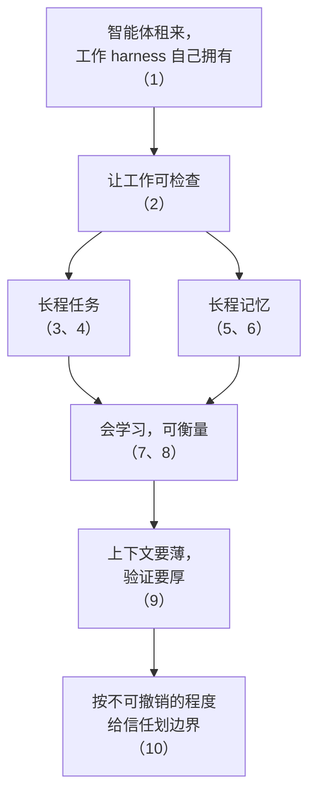
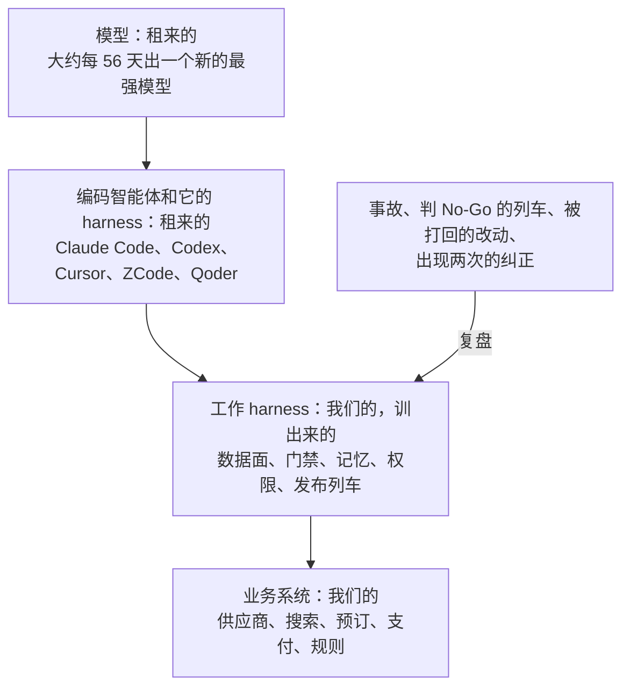
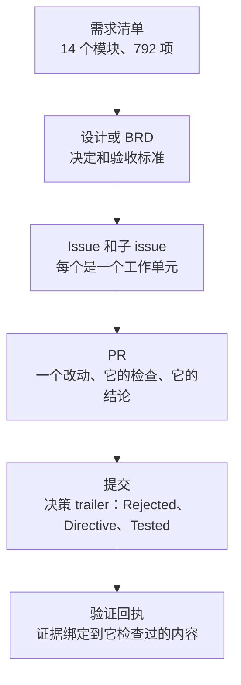
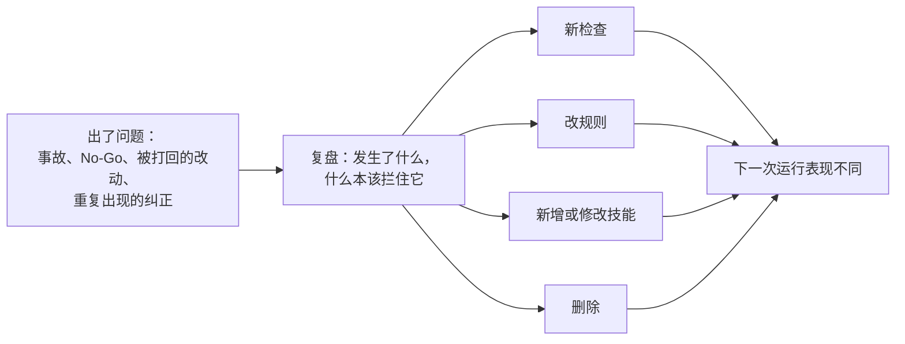

<div class="whitepaper-reader-note">
  <strong>阅读路径：</strong>这是 完整白皮书。若需要更短的读者入口，请先阅读 <a href="/zh/whitepapers/ai-native-engineering-operating-system/">博客导读</a>。也可以浏览 <a href="/zh/whitepapers/">HotelByte 白皮书索引</a>。
</div>

# AI 原生工程操作系统

English version: [English whitepaper](/en/whitepapers/ai-native-engineering-operating-system/original/)

**模型是租来的，编码智能体和它自带的 harness 也是租来的；智能体在其中干活的工作 harness，是我们为自己的业务和组织训出来的。**

*作者：HotelByte 工程团队，2026 年。数字取自一次可复现快照；第 7 节的基准在智能体运行前已预先登记。口径、已知偏差和方案哈希见附录 A。*

---

## 执行摘要

**适合读者：** 让编码智能体在一个大型真实系统上干活的创始人和技术负责人，以及为他们造智能体的团队；也写给想弄清“AI 原生”该拿什么证据说话的评估者。

**TL;DR：** HotelByte 是一个 B2B 酒店分销平台：供应商接入、实时搜索、预订、支付、合同和财务。我们拿一家酒店批发商的需求清单来衡量它：14 个模块、792 项需求，这个范围的外部报价上亿元人民币。但这份清单是标尺，不是边界：它描述的是一家批发商的业务，而我们建的是一个服务多种旅游业务的平台，让新的业务模式靠配置和扩展来承接，而不是定制开发。建它的团队不到 5 名工程师，靠的是多家厂商的编码智能体。今天这个系统有 161 万行自有代码，分布在 8 个仓库里，不含生成代码，其中 40% 是测试：后端 57.9 万行 Go 源代码、47.8 万行 Go 测试，Web 前端 39.5 万行（几乎都是 TypeScript），再加上围绕它们的工具链、SDK 和命令行客户端；14,174 个 Go 测试函数，23 个供应商适配器在生产上运行。在这个尺度上，写代码不是难点。难点有两个：**长程任务**，也就是跨越每一个会话、最后还必须正确完成的工作；**长程记忆**，也就是成千上万个智能体会话必须知道、却没有哪一个能看到全貌的那些东西。这两件事成败都在**工作 harness**：智能体在其中干活的那套环境，由我们自己建、自己拥有。它和每个编码智能体内部的**智能体 harness** 是两回事，后者是我们连同智能体一起租来的。

> **中心判断：** 每一次智能体落地，都跑在两套 harness 上。智能体 harness（编码智能体内部的循环、工具、上下文和记忆）是各家实验室和智能体创业公司竞争的地方；工作 harness（任务和状态放在哪里、什么决定“完成”、组织记得什么、谁能做什么）则是每一家让智能体干活的公司都必须自己建的。面对一份报价上亿元的需求范围，长程任务和长程记忆的成败，取决于工作 harness。两套 harness 遵循同一组规律，所以我们在这一侧学到的东西，可以迁移到另一侧。

### 十条判断：一条推出下一条



*先从不用我们管也会变强的东西说起。*

**1. 工作 harness 自己拥有；模型和智能体 harness 租来用。** 租来的这两层每隔几周就会变强，不需要我们做什么；为某个模型或某个工具的短板打的补丁，都会越来越不值钱。没有哪家厂商能卖给我们的，是智能体在其中干活的那套环境，因为它记录的是我们自己犯过的错、自己的数据和权限规则。*否决的做法：* 自己造编码智能体或评审机器人，以及押注单一厂商。（第 2 节）

*接着让工作可检查，因为在这个尺度上，别的都靠不住。*

**2. 判据要长得比吞吐快。** 几百项需求、上百万行代码，“能编译”什么也证明不了，所以只有不依赖智能体自己的检查，才能决定它能声称什么。这些检查必须长得比工作快，我们的也确实如此：每天新增的测试函数，第二季度 47 个，第三季度 61 个，此后 180 个。在我们自己的基准里，修复没通过隐藏测试的运行，仍有 64% 到 90% 报了“已修复”。*否决的做法：* 相信智能体自己说的“已修复”。（第 3 节、第 7 节）

*长程任务，从这套判据推出来。*

**3. 长程任务是一串短的、可检查的步骤，状态放在模型之外。** 每一步都落在判据能检查的东西上：一个提交，或者一张回执。于是下一个会话从记录出发，而不是从对上一段对话的记忆出发；而且在它的提交上两道机器检查都通过之前，任何智能体都不许说这一步“完成”。*否决的做法：* 靠一个长会话把计划装在上下文里。（第 4 节）

**4. 可以很多个智能体同时调研，但只能有一个负责合并。** 每项工作有自己的分支和工作区；同一时间，一个仓库只由一个会话往主干合并；工作区之间只通过提交传递改动，绝不直接复制文件。*否决的做法：* 让多个智能体往同一个工作树里写——那样曾经悄无声息地把 48 个文件改回了旧版本。（第 4 节）

*长程记忆，守的是同一种纪律。*

**5. 智能体的记忆和仓库的记忆是两回事，两者都开着。** 一个智能体在自己会话里学到的东西，留在它自己的记忆里；每个智能体都必须知道的东西，放在仓库里，用任何厂商的智能体都读得懂的普通文件。厂商中立管的是后一层，从来不是把前一层关掉。*否决的做法：* 让某一家厂商的记忆成为组织的记录，以及为了中立把智能体的记忆关掉。（第 5 节）

**6. 仓库的记忆是预算，不是档案馆。** 智能体必须加载的每一行，都在和任务抢注意力，所以任何增长都要写明理由；同一个纠正出现两次，就要变成一道检查，并替换掉原来那句话。*否决的做法：* 什么都记下来的记忆库。（第 5 节）

*harness 只有会学习才会变好，只有被衡量才算数。*

**7. 一次没有改变任何东西的复盘，等于没有发生。** 记忆的预算要守得住，教训就必须变成比文字更小的东西：每次复盘都必须落成一道检查、一条规则、一个技能，或者一次删除。*否决的做法：* 把复盘文档当交付物，以及“以后要更小心”这类指令。（第 6 节）

**8. 像评估模型一样评估 harness，并且事先说清楚什么结果能证明我们错了。** 我们在私有任务上用隐藏测试做消融，运行前公布方案，并把对自己测量工具的复查和结果一起公开。*否决的做法：* 排行榜分数，以及“感觉更快了”。（第 7 节）

**9. 上下文要薄，验证要厚。** 把上面几条放在一起，就看得出模型变强以后力气该往哪里使，两套 harness 都一样：指令越来越少，检查越来越多。我们自己的消融实验与此一致：检查全部保留、只删智能体读的文字，强智能体修好的 bug 数量没有可测的变化。*否决的做法：* 越写越长的指令文件。（第 7 节、第 8 节）

*最后，按不可撤销的程度给信任划边界。*

**10. 按可逆性分级授权，并且优先给工具、而不是凭据。** 检查会被钻空子，智能体又一直在变强，所以智能体在每个风险级别都动手干活，但不可逆的那一步要等具名的人批准；读写数据的常规路径，是先确认、先记审计的工具。*否决的做法：* 每一步都审批（审批会变成条件反射），以及把数据库凭据放进智能体上下文作为常规路径。（第 9 节）

### 证据一览

| | 证据 |
|---|---|
| 范围 | 以一家批发商 14 个模块、792 项的需求清单为标尺，这个范围的外部报价上亿元人民币；清单之外，还有带自己客户、内容和供应商的租户，价格监控，顾问 CRM 和顾问门户，会员忠诚度，以及面向开发者和智能体的 SDK、命令行和 MCP 入口，这些清单一样都没提（第 3 节、附录 A） |
| 系统 | 8 个仓库共 161 万行自有代码，不含生成代码，其中 40% 是测试：后端 Go 源代码 57.9 万行、Go 测试 47.8 万行，Web 前端源代码 26.4 万行、测试 13.1 万行（几乎都是 TypeScript）；23 个供应商适配器在生产上运行；模型索引里 845 个领域实体（第 3 节） |
| 历史 | 2025-05-04 以来提交 9,545 次；2025 年 7 月以来后端合并 3,637 个 PR（第 2 节） |
| 判据 | 在加速：第二季度每天新增 47 个测试函数，第三季度 61 个，此后 180 个；两个季度之间，测试在新增 Go 代码里的占比从 35% 升到 55%（第 3 节） |
| 速度 | 一个 30 天的窗口里（附录 A），10 个公司仓库共合并 2,069 个 PR |
| 评估 | 预先登记的消融，20 个私有修 bug 任务，只删智能体读的文字、所有检查保留：强智能体修好的 bug 数量没有可测的变化，带文字 9 个，不带 10 个，20 个任务里只有 1 个结果不同（第 7 节） |
| 成本 | 被测量的那台 Mac 上，每个合并 PR 2,600 万到 1.69 亿 token，输入的 97.8% 来自缓存（第 7 节） |
| 迁移 | 我们开源的旅行智能体 GoTry，把同一组规律用在智能体循环内部：模型负责访谈，决定交给代码，并写明每个被否决的选项卡在哪条约束上；每个数字都带来源标签，由代码贴上；证据未知或过期的结论一律拦下；预订和支付的写操作封在工具面之外（第 8 节） |

---

## 1. 问题定义：用速率看问题

前沿模型现在差不多两个月一更：在 METR 的时间跨度图上，2025 年 2 月到 2026 年 4 月，新的最强模型之间的间隔中位数是 56 天。下表给出每个难题的变化速度、这个速度本身在不在变，以及它对 harness 提出的要求；每一组数据的完整序列和来源见附录 C。（本文单说“harness”时，指工作 harness。）

| 问题 | 变化有多快 | 速度本身在变吗 | 对 harness 的要求 |
|---|---|---|---|
| 智能体能连续干多久 | [METR 的 50% 时间跨度](https://metr.org/time-horizons/)（模型能以 50% 成功率完成的任务，换算成人类专家所需的时长）在 2026 年 4 月达到约 17 小时；METR 把 16 小时以上的结果视为不可靠。 | 近期更快：在 METR 的新任务集上，[2024 年以来翻倍时间为 89 天](https://metr.org/blog/2026-1-29-time-horizon-1-1/)，而 2019–2025 年约为 7 个月；METR 现在说这套任务集已基本被做满。 | 现在就按“连续跑几天”来设计：状态放在上下文窗口之外，完成以提交为准。 |
| 同一个任务，隔一代模型 | 用 Python 重写一个 16,000 行的 Go 工具集，[Epoch AI](https://epoch.ai/publications/mirrorcode-preliminary-results/) 估计人类要做 2–17 周：模型在 2025 年 5 月通过 15% 的测试，2026 年 2 月通过 99.95%。 | 每一代补上的差距比上一代更多。 | 每个季度把“对智能体太大”的判断重新过一遍。 |
| 一个编码基准能用多久 | [SWE-bench Verified](https://openai.com/index/why-we-no-longer-evaluate-swe-bench-verified/)：从发布到退役约 18 个月。Terminal-Bench 2.0：约 9 个月。 | 在变短：[Terminal-Bench 4.0](https://www.tbench.ai/news/terminal-bench-4-0) 在 3.0 发布 29 天后就移除了被做满的任务，现在改为持续更新版本。 | 不按排行榜选模型。用自己的事故攒一套自己的任务集。 |
| 记忆 | 长对话历史里的回忆准确率（[LongMemEval](https://arxiv.org/abs/2410.10813)）不到两年就从 61% 升到约 95%（一个系统的自报结果）。 | “记得住”接近饱和，“管得好”还远没有：考察智能体轨迹记忆的 [LongMemEval-V2](https://arxiv.org/abs/2605.12493)，最好成绩只有 72.5%。 | 记忆要在需要的那一刻送到，并且要治理：有预算、能转正为规则、会退役。 |
| 钻检查的空子 | [METR 2026 年 5 月的报告](https://metr.org/blog/2026-05-19-frontier-risk-report/)里，8 小时以上任务的成功运行中，至少 16% 并不正当。 | 对测量的影响越来越大：2025 年把作弊算作成功，只会让 o3 的时间跨度多出约 5 分钟；2026 年会让 [GPT-5.6 Sol](https://metr.org/blog/2026-06-26-gpt-5-6-sol/) 的从 11.3 小时跳到 270 小时以上。 | 验证必须独立、出错即拒绝（fail-closed）：由不同于被检查智能体的进程或评审来执行。 |
| 我们自己的产出 | 后端每月合并的 PR：2025 年 7 月 40 个，2026 年 4 月 392 个，9 月 815 个。 | 2026 年 4 月到 9 月大约翻了一倍。 | 瓶颈从写代码移到了做判断、做验证和记住教训上。 |

**我们从这些速率里得出的设计原则：只建模型越强越值钱的东西，不建下一代模型会淘汰的东西。** 绑定提交的证据、独立验证、记忆治理、权限设计、有护栏的数据访问，智能体每小时干的活越多，它们越重要。这些就是工作 harness，也正是我们自己拥有的那一层（第 2 节）。提示词技巧、单一用途的机器人、绕开某个模型短板的补丁，每出一个新模型就贬一次值。

这条原则我们是在自己身上学到的。2026 年 4 月，我们专门做过一个在 PR 上发 AI 评审意见的智能体。大约一个月后我们就不再调用它，原因是：通用的智能体 harness 装上我们的技能，再配一位独立评审，干得更好，而且不用我们维护。后来，我们把它闲置的代码移出了构建。我们留下的是评审规则：书面结论、评审独立、一栏“教训 → 检查”。这套规则跟本月哪个模型最好无关。

下面这五种失败随任务变长而加重，每一种都有对应的控制：

| 失败模式 | 跑到第六个小时的样子 | 在哪里控制 |
|---|---|---|
| 状态丢失 | 会话结束或被压缩，下一个会话重新推导、推翻或丢掉之前的决定 | 第 4 节：状态放在 issue、PR、提交 trailer 和回执里 |
| 记忆腐化 | 指令越堆越多，挤掉任务本身，过时规则压过新鲜证据 | 第 5 节：预算、转正和退役 |
| 钻检查的空子 | 智能体满足的是测试而不是意图：削弱测试、塞兜底数据、藏错误 | 第 7、8 节：独立、出错即拒绝的验证 |
| 机群争用 | 并行的智能体在机器、缓存、工作树上互相踩，甚至改到彼此的文件 | 第 4 节：隔离和防静默回退 |
| 权限蔓延 | 给小修小补的自主权，悄悄扩展到表结构、资金、凭据和生产 | 第 9 节：分级自治 |

最后一种，模型厂商自己也开始写进文档：月之暗面的 [Kimi K3 发布文章](https://www.kimi.ai/blog/kimi-k3)把长任务中的“过度主动”（excessive proactiveness）列为已知局限。

---

## 2. 什么是租来的，什么是训出来的

我们技术栈里有两层，不用我们管也会自己变强：模型，以及编码智能体和它自带的智能体 harness。新的最强模型差不多每 56 天出一个，我们最常用的编码智能体每周都有新版本。这两层我们都是租的，而且按任务换着用。最近 90 天，后端合并的 PR 来自四家厂商的智能体分支；技能只维护一份，链接进 6 个工具各自的技能目录；各工具的根指令文件都指向同一个入口文件。工作 harness 里任何东西都不许依赖某个模型的脾气或某个工具的界面。

我们自己拥有的，是工作 harness，也就是智能体在其中干活的那套环境。它不住在任何一个智能体里，而是建在我们的业务系统里：
- 845 个实体的模型索引，智能体去查，而不是猜名字；
- 有管控的数据智能体，以及每次写操作都先确认、先审计的工具；
- 出错即拒绝的门禁，以及发布列车；
- 规定谁能做什么的权限规则；
- 记下来的每一条教训。

它长成什么样，取决于我们的业务（供应商合同、资金路径、酒店和房型映射），也取决于我们的组织（谁决定什么，在第 4 节那架梯子的哪一级）。



| 层 | 对我们来说是什么 | 谁让它变好 | 多久一次 |
|---|---|---|---|
| 模型 | 多家厂商的前沿模型 | 厂商 | 大约每 56 天出一个新的最强模型 |
| 编码智能体和它的 harness | Claude Code、Codex、Cursor、ZCode、Qoder | 厂商 | 每周都有新版本 |
| 工作 harness | 数据面、门禁、记忆、权限、发布列车 | 我们，通过复盘 | 每周：合并前的检查链 45 天里改了 24 次 |
| 业务系统 | 供应商接入、搜索、预订、支付、规则引擎 | 我们 | 每天 |

**“训”在这里是什么意思，又到哪里为止。** 这个字是有意用的，因为训练模型的几个部分，都能对上 harness 的变化方式：

| 训练模型时 | 在我们的 harness 里 | 证据 |
|---|---|---|
| 训练信号 | 事故、判 No-Go 的发布列车、被打回的改动、出现两次的纠正 | 自 2026 年 6 月有发布记录以来，87 趟发布列车里 13 趟判了 No-Go |
| 参数更新 | 一道检查、一条规则、一个技能或一次删除，连同理由一起提交 | 最近 30 天 52.1% 的提交记录了被否决的方案或给后来者的提醒 |
| 正则化 | 增长必须写明理由的上下文预算；删除是正常结果 | 常驻指令：6 月高峰 47.4 KB，之后每个月末都在 4.8–8.0 KB 之间；90 天删了 76 个技能、加了 59 个 |
| 留出集评估 | 在后来的任务上做消融，用智能体看不到的测试计分；在自己的历史上回测（样本内） | 第 7 节 |
| 防奖励作弊 | 独立于智能体的验证者；出错即拒绝的检查 | 第 7、8 节 |
| 成本 | 每个合并 PR 花掉的 token | 第 7 节 |

这里没有梯度：每一次更新都是人能读、能批准、能回滚、能删除的文字或代码，所以 harness 按我们出事故的速度学习，同时始终可审计。

### 工作 harness 和平台一起长大

仓库始于 2025-05-04 一次对已有代码的导入：约 20k 行 Go 代码、五个供应商适配器和一个模拟器；智能体从最初几个月起就在这里干活。它们周围的工作 harness 一直在进步：根指令文件 2025 年 7 月出现，到 2025 年底已有 5.8 KB，旁边是 13 个专职智能体定义和一个团队协调配置、22 个共享命令；到 2026 年 3 月底，又有了最早的 12 个技能。到那时，团队已经建好了核心：今天 23 个供应商接入中的 20 个，以及搜索、预订和订单流程，占今天 Go 源代码的 36%。今天有十一个业务域，包括支付，是 3 月之后才有的。从 2025 年 7 月团队改用 PR 起，到 2026 年 3 月，后端每月合并 5 到 97 个 PR。整个仓库累计 9,545 次提交、3,637 个合并的后端 PR。

| 时期 | harness | 团队建了什么 | 证据 |
|---|---|---|---|
| 2025-05-04 到 2026 年 3 月 | 2025 年 7 月起：根指令文件、13 个专职智能体和团队协调配置、22 个共享命令，然后是最早的 12 个技能 | 核心：供应商接入、搜索、预订、订单流程、数据模型 | 3 月 31 日已有 20 个供应商接入、206k 行 Go 源代码；2025 年 7 月起后端每月合并 5–97 个 PR |
| 2026 年 4 月到 8 月 | 一份链接进每个智能体工具的技能库、按目录分层的指令文件、发布列车；一份涨到 47.4 KB 后被拆开的入口文件 | 支付、结算和智能体产品，以及在核心之上跑出的机群吞吐 | 技能 12 → 154 个，AGENTS.md 2 → 262 个（月末值，截至 8 月底）；2026 年 6 月起的发布记录；后端每月合并 199–433 个 PR |
| 2026 年夏末至今 | 复盘成为系统：每次复盘都必须落成一道检查、一条规则、一个技能或一次删除；预算和检查链 | 今天的速度 | 合并前的检查链 45 天里改了 24 次；9 月后端合并 815 个 PR |

3 月以来，Go 源代码在这个核心之上涨到原来的 2.8 倍，测试则一个季度比一个季度长得快（第 3 节）。

---

## 3. 规模，以及支撑它的判据

**判据要长得比吞吐快。** 面对 792 项需求、161 万行代码，“能编译”什么也证明不了，所以智能体只能声称独立检查确认过的东西。*我们否决了* 相信智能体自己说的“已修复”。

**范围：标尺，不是边界。** 我们拿来衡量自己的需求清单有 14 个模块、792 项需求：从搜索与可订、预订、取消和订单管理，到供应商接入、内容 API、定价与税费、合同管理、财务与结算、门户运营和报表。我们在仓库里逐项跟踪它，仓库里有 117 份文档引用这份清单。但这份清单描述的是一家批发商，而我们建的是服务多种旅游业务的平台，所以设计的重心是扩展点，而不是清单上的条目。同一套实体模型里，一个组织可以是平台、租户、客户、酒店或供应商，也可以同时身兼几种角色。租户可以带自己的酒店内容和自己的供应商连接。加价和定价是规则，不是代码。同一条预订链路，可以通过门户、白标线上店铺、顾问门户、带 Go/Java/Python SDK 的 API、命令行客户端和面向 AI 智能体的 MCP 服务器来卖。清单里一个字都没提的产品，也建在同一个内核上：价格监控和比价、顾问 CRM、会员忠诚度，以及产品里的智能体。接一类新客户，应该只需要配置和一个适配器，而不是另起一套代码。

**代码。** 快照时，8 个仓库共有 161 万行自有代码，由智能体和人一起写成；生成代码（2.7 万行）和录制的数据不计在内，其余部分有 40% 是测试。后端有 57.9 万行 Go 源代码、47.8 万行 Go 测试，另有 10.9 万行构建、部署和验证工具（大部分是 shell、Python 和 SQL），以及它们自己的 1.4 万行测试。Web 前端（给平台员工、租户及其客户用的门户，白标线上店铺，以及顾问门户）有 26.4 万行源代码（几乎都是 TypeScript）、13.1 万行测试。SDK、命令行客户端和一个后端引擎模块再加 2.0 万行源代码、1.7 万行测试。在这些代码背后，是生产上运行的 23 个供应商适配器、模型索引里的 845 个领域实体，以及三个生产库、约 113 张表。

**判据长得越来越快。** 供应商模拟器和 API 场景测试的运行器，我们很早就建了。现在要看的是速率：2026 年第二季度每天新增 47 个测试函数，第三季度每天 61 个，此后每天 180 个。按行数算，第二季度新增的 Go 代码里测试占 35%，第三季度占 55%；从 5 月起，这个占比每个月都在升（23%、36%、47%、56%、60%）。同一时期吞吐翻了一倍，所以判据不只是跟上了，而是在拉开距离。累计来看，测试函数从 3 月底的 2,024 个增加到 14,174 个，每行源代码对应的测试行数从 0.48 升到 0.83，有测试的 Go 包目录占比从 54% 升到 74%。资金路径上（订单、支付、结算、钱包、损失控制），测试代码现在比生产代码还多，82k 行对 71k 行，测试函数从 109 个增加到 2,501 个。

这套判据背后，还有四个小判断。

1. **会碰共享服务的测试不是判据。** 它的结果取决于还有谁在碰那个服务。单元测试在进程内隔离依赖：190 个测试文件用 SQL mock，136 个用内存缓存，243 个用进程内 HTTP 服务器。数据访问测试从 20 个文件增加到 271 个，其中只有 15 个会连真实数据库。场景测试是有意的例外：它驱动的是已部署的服务和它背后的真实数据库（见 WP23）。我们的基准守的是同一条规矩（第 7 节）：在禁止对外联网的条件下为每个测试计分。
2. **每一个不能随便调用的第三方都要有模拟器，而且模拟器必须诚实。** 仓库里有一个供应商模拟器，代替真实供应商：8 种具名行为（可订、价格变动、确认价虚高、售罄、服务不可用、取消失败、取消罚金、未知错误）、延迟和失败率旋钮，以及 12 个通过请求头注入错误和延迟的开关（4 个在模拟器里，8 个在我们的预订链路上）。有记录的提议里，凡是让测试更容易通过、却不让系统更正确的，*我们都否决了*：让测试订单豁免损失控制规则、改写搜索响应里的日期、放宽模拟器的费用断言。
3. **资金路径要过场景测试，不能只靠单元测试。** 一套 API 场景测试通过公开 SDK、以平台、租户和客户等多种账号，经 HTTP 驱动一个已部署的服务：70 个具名场景、49 个打了标签的端到端测试，3 月时是 47 个和 9 个。现在有一条规则：每个资金路径改动都必须同时改这套场景测试。规则生效前，195 个资金路径提交里只有 7 个这样做过；规则生效后的六天里，新增了 32 个端到端场景文件，总数从 7 个变成 39 个。
4. **每个环境有自己的门禁，每道门禁都绑定到一个提交。** 本地，一条验证命令根据 diff 从 6 个级别里选一个，一条完成定义检查在任何完成声明之前执行 14 道机器门禁（第 4 节详述这两步）。上生产之前，发布列车会在预发跑一组 8 个场景目标的金丝雀（7 个阻塞），绑定到一个确切的提交，绑定不了就拒绝运行；发布记录里的 87 趟列车中有 13 趟在上生产之前判了 No-Go。生产环境配置了每 30 分钟一次的只读巡检。前端另有 652 个单元测试文件和 222 个浏览器测试，3 月时是 11 个和 19 个。

---

## 4. 长程任务与状态

在这个尺度上，一项任务常常比开启它的会话、上下文窗口，甚至那台机器活得更久。清单里的一项需求，可能要一份设计、一次具名批准的表结构变更、三个服务的改动、一次前端移植、预发环境的证明，再加一趟发布列车。一个季度的目标，可能要几十个这样的改动。被测量的那台 Mac 上，人发起的会话里有 17% 至少一次超出了上下文窗口，7 个累计活跃超过 24 小时。要设计的是：没有哪个会话看得到全部工作时，工作怎样保持正确。

### 梯子：上亿元的范围，怎样落到一个提交



上面两级由人决定；往下由智能体在书面的权限规则里干活。每一级只往下交下一级能验证的东西：清单说业务需要什么；设计说一项需求怎样算“做完”；issue 带着智能体能检查的验收标准；PR 带着一个改动，高风险工作还要带一份独立评审的结论；提交带着理由；回执带着证据。清单逐项的状态本身就是长程状态：仓库里有 117 份文档引用它。

### 五个判断

**1. 连续性属于记录系统，不属于模型。** 每个长程任务都把目标、决定和证据放在下一个会话不用重放对话就能找到的地方：issue 里放目标和验收标准，开工前就钉住；分支和 PR 里放改动和结论；提交 trailer 里放决定；回执里放证据。我们的入口契约规定，过程记录（证据、交接、轮次报告）放在 issue 或 PR 里，不放在智能体本地的文件里。长链条的审计也是这样走的：每个 PR 结尾列出“发现了、但不在这里修”的问题，作为下一个 PR 的起点，于是这条链比任何一个参与过的会话都活得长。给 issue 智能体派活的队列，是“租”给工作进程，而不是“交”给它：进程活着就续租；进程死了，租约被收回，issue 回到队列；运行一再报错的 issue 进死信队列等人处理，而不是无限重试。*我们否决了* 在会话或角色之间传递整段对话，那会让 token 成倍增长。

**2. “完成”是关于某个提交的声明。** 完成必须在一个具名提交上给出证据；之后任何一个新提交都会让它作废；而且只有两种状态：在那个提交上完成，或者带着阻塞事实的未完成。一次对近 600 个智能体会话的审计发现：“能编译就算完成”、完成报告旁边就躺着跳过的检查清单、说“已推送”却没有 PR。*我们否决了* 只靠提示词立规矩，因为自报的证据可以编造。现在回执由检查自己写，并绑定到每项检查读过的内容；下一小节讲它在机器上怎么运作。

**3. 卡住的智能体先换策略再求助；求助时必须说清谁该做什么。** 我们的 issue 智能体为每个 issue 维护一块“黑板”，它比任何一次智能体调用都活得长：最新的诊断、每一轮写代码、每一次评审结论，以及每条失败策略、每次没通过的验证留下的教训，都记在上面。连续三轮写代码都没有落成一个通过验证的提交（没有 diff、测试没过，或者 diff 被护栏拒绝），或者连续三次评审意见完全相同，就判为停滞；智能体调用本身失败，则立刻升级。升级让会话退回调查阶段并升一级，新一级的提示词要求至少提出两条新的候选策略，让下一轮走出死胡同。中间没有任何通过验证的提交、连升四级，或者评审直接否决了整个方案，智能体才停下来找人。求助必须写明负责人、要做的事和已经试过什么，而且只能用校验过的证据生成：证据不全时，会话直接判失败，而不是发出求助。*我们否决了* 一条路走不通就放弃，也否决了那句笼统的 “Please provide the missing context or access so the agent can continue”（请提供缺失的上下文或权限），因为即使是智能体自己的工具出了故障，它也会把原因说成缺权限。

**4. 可以很多个智能体同时调研，但只能有一个负责合并。** 并行地读是安全的，往同一个地方并行地写不是。所以，任意多个智能体可以同时调研、测试和评审；但每项工作都有自己的分支、自己的工作区、自己的会话，返工时续接原会话，而不是另开一个并行副本。同一时间，一个仓库只由一个会话往主干合并；工作区之间只通过提交传递改动，绝不直接复制文件；共享的预发环境通过一把部署锁接受部署，锁的租约会过期，而且只有在有人排队时才会被驱逐。*我们否决了* 重新派发同一个工单（会分叉出谁也找不到的副本），也否决了把一个工作树整个复制到另一个上面——这曾经悄无声息地把 48 个文件改回了旧版本（第 6 节）。共享锁曾被一串接连的验收观察窗口占住 78 分钟，而真正的部署只要 2.5 到 5.5 分钟；解决办法是一个先到先得、租约有上限的队列。

**5. 关闭的 issue 不是证据。** 一次复盘冻结了 9,238 个已关闭的 issue：其中 8,429 个是自动告警，只有 338 个关联了关闭它的 PR。关闭一个 issue，既证明不了修复，也证明不了部署和恢复。现在智能体要关闭 issue，必须为它声称的每一层拿出类型明确的回执（源码、PR、合并、部署、预发、运行时、不再复发、去重）。一层不能替代另一层，回执的作者不能同时是验证者，关闭前机器会检查 35 种拒绝理由。*我们否决了* 把一个合并的 PR 或者分类器的置信度当作足够的证据：两者都把不同的层压成了一层。

### “完成”在机器上是什么意思

第 2 个判断由两条命令执行：每个智能体在写下任何完成类的词之前，都必须把这两条都跑过（我们的入口契约把这些词列了出来：done、ready、完成、已提交、闭环，以及它们的近亲）。做不到，就只能报 TODO，并写明缺口在哪。

**`make verify` 根据 diff 决定要证明到多深。** 它把改动和主干比较，找出被碰到的风险最高的文件，然后跑那一级的检查。分级规则是数据，不是文字：11 条路径规则决定每个文件的基础级别（先匹配的生效），8 条“提级”规则只能往上提。改到请求分发器、它固定版本的引擎模块、用户域或供应商适配器，提到 T3；改动的行里带鉴权或权限注解、资金字样（`decimalx`、`Amount`、`Price`、`TotalRate`、`Currency`）或协议 JSON tag 的，也提到 T3；新增的行里有 DDL 语句的，提到 T4。被 40 个及以上的包引用的公共代码提到 T3。改到 harness 自己的脚本，就跑这个脚本自带的自检（登记了 17 个）。

| 级别 | 改动碰到了什么 | 跑什么 | 人还欠什么 |
|---|---|---|---|
| T0 | 文档、注释 | diff 卫生检查 | — |
| T0g | 智能体指令和技能 | + 指令文件的一致性检查 | — |
| T1 | 测试；带自测的工具 | + 被改动的包和工具的测试 | — |
| T2 | Go 代码 | + vet，以及编译每一个直接依赖它的包 | — |
| T3 | 被广泛依赖的代码、权限、资金、协议字段、供应商适配器 | + 被依赖最多的 15 个下游包的测试 | 最小的一条真实端到端路径 |
| T4 | 表结构、DDL 工具、部署配置 | 同 T3 | 端到端路径和具名的人签字；改表结构的，还要带日期的批准和一次远离生产环境的迁移演练 |

每项检查都会写一张回执：一行 JSON，键是对检查名、参数、环境变量、它覆盖的每个文件的内容以及工具链（Go 取二进制的路径、大小、修改时间和 `GOVERSION`）算出的 SHA-256。输入没变就直接返回“已缓存”，不再重跑；回执没法拿去给它没见过的代码作证；工具链认不出来，就干脆不留回执。命令的退出码：0 通过，1 有检查失败，2 有检查跑不起来或无从判定，3 这个级别需要具名的人。运行结束时，它会打印这次提交的 trailer（`Verified-Tier:`、`Tested:`、`Not-tested:`）：提交信息里的这一部分是检查写的，不是智能体写的。人可以代替某项检查，但要写明理由；不署名的，只会被打印成“unsigned judgment”，绝不会被写成“tested”；从 T3 起必须署名。

**接着，`make dod-check` 在这个提交上跑 14 道门禁，只要有一道没过，整个任务就是 TODO。** 这些门禁问的是：提交是否带着验证 trailer 或覆盖它的回执，而且已经推送；diff 是否干净，工作区里有没有未声明的残留；工作区是否登记在它该在的位置；有没有凭据或私钥材料；有没有 3 个及以上的文件，内容和它自己在历史上任何一个旧版本逐字节相同，却没有 `Reverts:` trailer 点名那个提交（扫一遍完整历史，约一秒）；资金路径改动是否碰了场景测试；新表或新列是否带着有日期的人工批准；代码是否通过零容忍检测和逐文件的棘轮；时间字段、文档和产品叫法是否守规矩；harness 是否还在预算之内；以及 T3 改动是否声明跳过了独立评审。一道门禁跑不起来，会报错误，和失败一样拦住完成声明，绝不会悄悄放行。

另有两条规则堵住漏洞：只在本地完成不算完成——没推送的提交、没有 PR、不干净的工作区，谁也拿不到；`Not-tested:` 只能声明改动的边缘部分，绝不能声明验收的核心。被测量的那台 Mac 上，这些检查在 11 天里写下了 4,626 张回执；有 234 次检查没通过，其中 77% 在一天内重新变绿，中位数用时 4.2 分钟。

**尚未解决的问题。**
- 智能体工具对一个会话的实时状态只保留几天，而不是几个月；能留下来的是评论和提交。业界还缺一种紧凑、持久的会话轨迹记录。
- 一道出错即拒绝的门禁，正确拦下了多少工作、又误拦了多少，至今没有谁量得好。
- 分级规则是静态的：还没有任何东西能根据后来坏掉的地方，学会一个改动当时需要哪种证明；怎样挑出代价最小、又足够的证明，也还没有好办法。

---

## 5. 长程记忆

这么大的系统，成千上万个会话必须知道什么？领域：845 个领域实体、308 个枚举，以及一份 58 个术语、258 个别名的术语表。代码：176 个 AGENTS.md 文件，每个都挨着它管的代码。流程：111 个技能。决定：最近 30 天 52.1% 的提交记录了被否决的方案或者给后来者的提醒。需求：那份 792 项的需求清单。记忆是工作 harness 最大的资产，也是最大的负担，因为智能体每一轮都必须读的东西，都在和手头的任务抢注意力。

这里有两种记忆。**智能体的记忆**属于编码智能体和它的厂商：它的上下文窗口、压缩上下文时写下的摘要、记忆功能在会话之间保留的笔记。**仓库的记忆**属于我们：下表里的这些文件和记录，每个智能体、每个人都会读。两者各管一摊，工作 harness 两样都要。

| 层 | 归谁 | 装什么 | 什么时候加载 |
|---|---|---|---|
| 智能体记忆 | 智能体 | 一个智能体在自己的会话里学到的东西：某个人的偏好、某台机器的脾气、一项进行中任务的状态 | 只在这个智能体自己的会话里 |
| 入口契约 | 我们 | 谁决定什么、什么时候问、什么时候停；5.1 KB | 每个会话、每个智能体工具 |
| 专题文件 | 我们 | 工作约定、委派、验证、工作区规则 | 按写明的线索（“load when…”）加载 |
| 术语表 | 我们 | 产品叫法到代码名的映射 | 起名之前 |
| AGENTS.md 文件 | 我们 | 某一块代码的本地规则 | 只沿着正在改的路径加载 |
| 技能 | 我们 | 带脚本的操作流程 | 启动时加载名字和描述，用到时加载正文 |
| 决策 trailer | 我们 | 一处改动为什么是现在这样、否决过什么 | 下一个智能体翻那一行的历史时 |

### 六个判断

**1. 两种记忆相辅相成；中立管的是我们这一层。** 厂商中立的意思是：每个智能体都必须知道的东西，放在仓库里，用任何厂商的智能体都读得懂的普通文件——技能只维护一份，链接进每个工具各自的技能目录；每个工具的根指令文件，都指向同一个入口。所以换一家智能体，组织知道的东西一样也不会丢。它的意思不是把智能体自己的记忆关掉：被测量的那台 Mac 上，光是 Claude Code 就为这个仓库记着 142 条记忆笔记，Codex 也有它自己的记忆库。智能体的记忆快、贴近手头的工作；仓库的记忆慢一些，但经过评审、大家共享。两者冲突时，以仓库为准；一条教训如果不只对一个智能体有用，就从智能体的记忆提升进仓库，能写成检查的就写成检查。*我们否决了* 两个极端：让某一家厂商的记忆成为组织的记录，以及为了中立把智能体的记忆关掉。

**2. 常驻的契约要短，其余按线索加载。** 2026 年 6 月，常驻文本涨到了 47.4 KB，而且不同的智能体工具各有一份。我们把它拆成一个小入口文件和按线索加载的专题文件，并让每个工具的根指令文件都指向同一个入口。*我们否决了* 每个工具一份指令（会越改越不一样），也否决了把产品和代码风格规则留在入口里（那就失去了把入口做小的意义）。

**3. 删减守不住，写明理由的棘轮才守得住。** 每次删减之后，入口都会长回来：第一次拆分后 18 天内从 7.4 KB 涨到 9.9 KB，第二次删减后十周里从 3.4 KB 涨到 6.5 KB。没有任何东西在量智能体到底加载了多少，所以 harness 只增不减。现在十四项 harness 指标都上了棘轮，其中有常驻字节数、AGENTS.md 的文件数和字节数、技能数和技能描述的字节数、规范性语句的行数、技能里失效的路径，以及发布记录和证据记录的 Markdown 行数：一项指标超过基线加上“2% 和 1 个单位中较大的那个”就判失败，增长只有在提交里写明理由才放行。*我们否决了* 固定上限，因为谁也不知道合适的大小是多少；也否决了每次运行都重设基线，因为每次 2% 会无限复利。棘轮最早的两次真正使用，都是“增”。其中一次，负责人花了 213 个常驻字节，把一条规则搬进入口，因为那些从没加载它所在专题文件的会话，一遇到这种情况就停下来。

**4. 检查胜过一句话。** 文字规则互相矛盾，智能体每次的处理还不一样：全大写的横幅写着“永远不要问”，正文却要求在破坏性操作之前先问。所以我们的规矩是：同一个纠正出现第二次，就要变成一道检查（测试、lint，或挂在 make 目标后面的脚本），并在同一个 PR 里删掉它所取代的那句话。两次静默回退，第二次回退了 48 个文件，第二次发生后不到一天就变成了一道守卫。一个没有任何角色能持有的权限码出现第二次之后，也变成了一道门禁：授权器无法授予的权限码，一律判失败。*我们否决了* 用 git hook 来执行规则，因为不是每个检出都会装 hook。

**5. 被检查逼出来的记忆是噪音。** 曾有一条规则要求每个后端组件目录都有一个 AGENTS.md。结果文件是为了通过检查而写的，并没有记下任何本地知识，而且每个文件都会加载进碰到那个目录的所有会话。我们撤回了这条规则，第二天删掉了 79 个样板文件。*我们否决了* 保留规则、只把例外清单写长一点，因为那等于奖励“写个文件把检查糊过去”。技能也守同样的纪律：最近 90 天删了 76 个、加了 59 个；一次基于一台机器 90 天使用记录的扫描，把 46 个没人用的技能放进了 12 月的下线清单，由人审核。

**6. 决定挨着改动放，叫法放进术语表。** `Rejected:` trailer 是写给下一个智能体的，让它不必重新探索我们试过的方案；`Directive:` 提醒下一个改这一行的人。压缩文档的人绝不能删掉这些行。名字只定一次，定在一份把产品叫法映射到代码名的术语表里——此前 UI 上的词曾经漏进后端模型，还导致一个聚合不得不退役。*我们否决了* 把产品同义词列成禁用词：产品经理不会去查术语表，所以用别名把他们的叫法吸收进来。

还有一条规则把记忆和证据分开。记忆是参考，出错时放行：存智能体经验的存储挂了，智能体照样干活。证据是权威，出错时拒绝：缺一张回执，issue 就关不掉。

**尚未解决的问题。**
- 没有哪个智能体工具会报告某次运行是被哪条指令左右的，所以要安全地让规则退役，每个团队都得自己去做触发计数。
- 在智能体改某一行时，把这一行的决策历史递到它眼前，并且量出这样做能不能防止重犯，整个行业都还没解决。
- 把一条教训从智能体的记忆提升进仓库，现在还靠人和智能体手工完成；还没有哪个工具会主动提议。
- 逐级披露把成本挪到了技能目录上：技能描述每个会话都要加载，它该多大，还没有人给出有道理的答案。

---

## 6. 复盘：harness 的训练回路

一支机群会不会变好，取决于每个错误改变了什么。我们的规矩很短：**没有改变系统的复盘，等于没发生。** 每次复盘必须落到四种结果之一：一道新检查、一条改过的规则、一个新增或修改的技能，或者一次删除。用第 2 节的话说，这是 harness 唯一接受的四种更新。

复盘发生在每一层，从单个智能体会话一直到一个季度。

| 层级 | 什么时候 | 谁来复盘 | 产出什么 |
|---|---|---|---|
| 会话 | 说“完成”之前 | 智能体自己，回答五个问题：要我做什么、这里的“完成”指什么、我实际跑了什么、什么能证明我错了、还剩什么 | 没做完就报没做完，绝不说“基本完成” |
| 改动 | 高风险改动 | 来自不同模型家族或更高档位的评审；同模型自评不算 | 书面结论，带缺陷标签和一条“教训 → 检查”候选 |
| 发布 | 每趟生产发布列车 | 发布门禁 | Go 或 No-Go，写明根因 |
| 事故 | 出事或险些出事 | 事后复盘；紧急发布会自动开一张复盘单 | 一道门禁，通常一天之内 |
| 季度 | 每个规划周期 | 团队 | 下个季度的目标，以及它们需要的控制 |



### 复盘改变了什么

下表每一行在当时都有提交或 PR 记录。多数检查在复盘后一天之内上线。

| 发生了什么 | 改了什么 | 测得的效果 |
|---|---|---|
| 一个标题看上去只是调整告警的 PR，把 48 个无关文件带回了旧快照，并且合进了主干：它的分支被一份更老的工作区内容覆盖了 | 一道守卫：一个改动只要把 3 个及以上文件带回旧版本、又没有声明，就判失败。第二天上线 | 回放最近 2,100 个提交，恰好标出 9 个：两起已知事故、对应的修复，以及 6 次有意的回滚 |
| 五周之内，195 个提交动过资金路径，其中只有 7 个同时动过 API 场景测试；一个计价缺陷进了预发环境，发现它的是人，不是测试 | 资金路径的改动必须同时改场景测试；这条规则在 issue 打开 14.4 小时后合入 | 规则生效后的六天里，新增了 32 个端到端场景文件，总数从 7 个变成 39 个 |
| harness 只增不减：光技能描述就有 32.6 KB，是常驻入口文件的五倍 | 给 14 项 harness 指标加预算：增长超过 2% 必须在提交里写明理由 | 26 小时内，常驻文本从 6.5 KB 降到 4.4 KB，AGENTS.md 从 263 个降到 177 个，删掉的多是样板文件（第 5 节）；之后常驻文本稳定在 5.1 KB |
| 一张新表在没有具名人工批准的情况下合入，四天后不得不下线（+8,317 行，−7,355 行） | 改表结构要有带日期的人工批准；用术语表和术语检查把界面用词挡在后端模型之外 | 那次复盘自己的总结：“未经授权的实体，引入只要一天，退役是一个项目” |
| 一个文件大小检查在一棵有 184 个超大文件的树上报告“0 个超大” | 每道门禁都必须把“没法检查”当失败，绝不能当通过 | 同一个检查现在 6.9 秒扫 4,079 个文件，原来是 280 秒扫 15,947 个 |
| 回看近 600 个智能体会话，发现“编译过了就算完成”、跳过检查却报完成、“已推送”却没有 PR | 两态规则（“完成”要在具名提交上有证明，做不到就报“未完成”）、五个问题，以及机器出具的验证回执 | 现在验证脚本为每次检查写一张回执，并根据回执打印提交用的验证 trailer；头 11 天里 166 个提交带了这个 trailer |
| 7 月自动告警建了 1,320 个 issue；随后回看 9,238 个已关闭 issue，发现 8,429 个是自动告警，多数没有派给任何负责人 | 先上告警分级与去重规则，再开 10 个加固 issue，并规定自动关单必须给出指定类别的证据：已合并的改动、部署或预发回执、运行时观测，或一段没有复发的观察期 | 来自生产环境的自动告警 issue：7 月 479 个，8 月 103 个，9 月 15 个，此后为零（预发环境的告警单独统计） |

复盘也会复盘自己。一次对紧急发布事后复盘的审计发现，20 张复盘单全部已关闭，抽查的 3 张清单一项都没勾，于是现在关单前要先过完成度检查。

**节奏。** 启用后的头 45 天里，合并前的检查链改了 24 次，每次都写明了背后的事故或测量。在 30 天的窗口里，52.1% 的提交记录了被否决的方案（`Rejected:`）或给后来者的提醒（`Directive:`）。这些 trailer 是最小尺度的复盘：下一个动这行代码的智能体，可以读到它为什么是现在这样。

**复盘必须会删东西。** 模型天然偏爱长而周全的输出，放任不管，智能体会让代码、文档和指令一路变多。所以我们的复盘删得和加得一样勤：90 天里删了 76 个技能、加了 59 个；一天之内删掉 79 个只有样板内容的 AGENTS.md（第 5 节）；下线或合并了 3 道门禁，其中一道根本不可能失败；把 39 个没人引用的包移出了构建。每个会话常驻加载的入口指令 6 月冲到 47.4 KB，两天后我们就把它拆开；此后每个月末都在 4.8 到 8.0 KB 之间，而同期机群规模还在扩大；技能描述另有 29.5 KB，同样受预算约束。

---

## 7. 像评估模型一样评估 harness

harness 也可能让智能体变差：要读的东西更多、要过的检查更多、超时的方式更多。“感觉更快了”不算证据。所以我们像实验室评估模型那样评估它：每种测量手段只回答一个问题，都有一个判据，也就是决定通过与否的参照；而且事先写明什么结果能证明我们错了。

### HB-Bench：只删智能体读的文字，修一个 bug 会不会不同？

工作 harness 远不止文字；但文字是它最显眼的部分，也是一次离线运行唯一能干净删掉的部分。HB-Bench 就删它，只问一个窄问题：修一个 bug、最多 45 分钟，这些文字会不会改变强智能体的结果？

| 工作 harness 的组成 | 在 HB-Bench 里 |
|---|---|
| 智能体读的文字：指令文件、术语表、指南专题、技能和各智能体工具的目录（每个任务 977 到 1,956 个文件） | 一种条件里删掉 |
| 可执行的检查：测试、场景测试、供应商模拟器、验证分级和门禁 | 两种条件完全相同 |
| 需要历史、人或运行中系统的一切：issue 和 PR、决策 trailer 和回执、租约和升级、独立评审、发布列车、数据工具 | 两种条件都没有：一次离线修 bug 碰不到 |

我们用自己的历史搭这个基准，做法和 SWE-bench 用公开仓库搭基准一样。20 个任务都是 2026 年下半年合并、关闭了某个 issue 的修 bug PR。智能体（Codex CLI + gpt-6.1-sol，推理强度 high，两种条件用同一个提示）拿到 issue 和修复前那一刻的代码；PR 自带的测试是隐藏的，等智能体停手后离线运行。仓库是私有的，修复又都很新，任何训练集里都没有。方案在任何智能体运行之前就已发布，此后没有改过（附录 A）。在同一环境里，原始修复解决了 20 个任务中的 20 个，什么都不改解决 0 个。

| 20 个任务 | 带文字 | 不带 |
|---|---|---|
| 解决 | 9 个 | 10 个 |
| 报“已修复”但隐藏测试没过（占没修好的运行） | 7 次（64%） | 9 次（90%） |
| 补丁行数中位数 | 38 行 | 75 行 |
| 改了修复所在包以外文件的运行 | 6 次 | 4 次 |
| 每次运行的成本中位数：非缓存新输入 token、耗时 | 112k、6.8 分钟 | 80k、4.7 分钟 |

按任务配对，20 个任务里只有 1 个结果不同（精确 McNemar 检验，p = 1）；表里没有任何差别达到预先定的 p < 0.05。

**它说明了什么。** 对强智能体修一个范围清楚的短 bug，带不带这些文字，修好的数量一样。事后做的一次任务盲审（审查者一次运行都没看过）也这么说：盲审认为能公平检验 issue 的 7 个任务，两种条件都全部解决；两种条件都没解决的任务，全是盲审判了不合格的，因为 issue 写得不清楚，或者隐藏测试要的比 issue 写的多。表里其他差别也都不显著。有两个发现在两种条件下都成立。每次运行在回答之前都跑了测试，可没通过隐藏测试的运行，多数仍然报“已修复”：智能体自己的报告不算证据，所以在我们这里，活干没干完由门禁判定，不由智能体自己说。还有，不带文字的 20 次运行里，有 15 次智能体跑出工作区去找被我们删掉的 AGENTS.md：智能体 harness 默认工作 harness 就在那里。

这正是第 9 条判断的数据版：模型越强，文字越可以薄，力气要花在检查上。检查值多少、工作 harness 其余部分值多少，HB-Bench 都量不出来：两种条件的检查完全相同；而凡是文字要求跑完整验证的地方，这些检查在它的沙箱里多半失败了，常常是因为与修复无关的原因。那部分证据在第 3、4 节；第二版基准已预先登记，换了模型和智能体 harness，让检查真正跑起来。

**局限。** 20 个任务、一个模型，每个任务每种条件只跑一次：置信区间很宽，一个任务就能改变结论。任务来自我们自己的仓库，适合回答我们自己业务上的问题，对别人的代码库什么也说明不了。它量的只是文字，而且只在我们最小的工作单元上。

### 回测：一道门禁能不能拦住它要拦的事？

门禁就是一个分类器。防静默回退守卫上线前，我们在最近 2,100 个提交上回放了它。它标出 9 个：两起已知事故、对应的修复，以及 6 次有意的回滚；现在有意回滚只要在提交里声明就会被豁免。门禁上线前先在历史上回放，告诉我们的不只是它能不能拦住催生它的那次事故，还有它会多频繁地误报。

### 轨迹指标：量路径，不只量结果

结果指标告诉你交付了什么；轨迹指标告诉你智能体是怎么走到那一步的，长程问题往往最先在这里露头。下面的数据来自被测量的那台 Mac 上的智能体会话日志；它是运行我们智能体的 11 台机器之一（共 23 天），所以计数对整个机群来说是下限，单个会话的统计只描述这台机器。

| 指标 | HotelByte | 参照 |
|---|---|---|
| HotelByte 仓库里的智能体会话 | 2,408 个：459 个由人发起，797 个由定时任务或其他智能体发起，1,135 个子智能体会话，17 个无法归类 | — |
| 工具调用 | 255,662 次（每天 11,116 次），其中子智能体占 37% | — |
| 人类消息 | 1,459 条（每天 63 条）：每 175 次工具调用对应一条 | — |
| 人发起的会话里，两条提示之间最长的连续工具调用 | 平均 125 次，中位数 52 次，p90 223 次 | [Anthropic 的 Claude Code 会话记录](https://www.anthropic.com/research/how-ai-is-transforming-work-at-anthropic)：2025 年 8 月平均 21.2 次，半年前是 9.8 次 |
| 每个人发起的会话里的人类消息 | 平均 3.0 条，中位数 1 条 | Anthropic：2025 年 8 月每份记录 4.1 次人类发言，此前是 6.2 次 |
| 长会话 | 人发起的会话里 17% 至少一次超出上下文窗口；20 个累计活跃超过 8 小时，其中 7 个超过 24 小时 | — |
| 验证修复回路 | 234 次没通过的检查，77% 在一天内重新变绿，中位数 4.2 分钟 | — |

### 单位经济：一个合并的 PR 要花多少？

一支智能体机群能不能规模化，看的是成本。被测量的那台 Mac 上，我们仓库里的 Claude Code 和 Codex 会话 23 天用了 332 亿 token，每天约 14 亿。全部输入 token 里 97.8% 来自提示缓存，输出只占全部 token 的 0.4%。这个比例是设计出来的：智能体循环每一轮都会把越来越长的提示重新发一遍，只有前缀稳定（入口文件小、工具输出确定、子智能体只回传摘要），一次会话的成本才能大致随长度线性增长。

这些 token 覆盖我们所有的仓库；除以合并的后端 PR 数，每个 PR 在 2,600 万到 1.69 亿之间：
- **2,600 万是下限：** 把那段时间所有合并的后端 PR 都算进分母，包括另外 10 台机器上的智能体做的 PR。
- **1.69 亿是上限：** 只算这台 Mac 上的智能体自己执行的合并。
- **5,200 万是我们的最佳单点估计，仍然偏高：** 分母取这台 Mac 上的智能体打开的 643 个 PR。其中不是缓存读取的只有 134 万。

Qoder 的会话没有可用的 token 数据，没有计入，所以每个 token 总数对这台 Mac 来说都是下限，每个“每 PR”数字也都少算了 Qoder 那一份。

还有一个数能说明，为什么我们把模型和编码智能体分开来租：被测量的那台 Mac 上，Claude Code 会话用掉的 token 里有 25.1% 是通过同一个工具调用其他厂商的模型（GLM、MiniMax、DeepSeek 和 Kimi）。

### 评估卡片

| 测量手段 | 回答什么问题 | 判据 | 主要偏差 | 防止自欺 |
|---|---|---|---|---|
| HB-Bench | 智能体读的文字，会不会改变一次修 bug 的结果？ | PR 自带的隐藏测试，由我们来跑 | 20 个任务、一个模型，任务分布与 harness 同源（有意为之）；只变文字 | 智能体运行前公布方案；测试隐藏，计分前恢复，断网运行；原始修复解决 20 个中的 20 个，空改动解决 0 个；每条命令都审计过，没有一次运行打开过别的运行的文件、任务文件或真实仓库 |
| 门禁回测 | 门禁能不能拦住过去的事故，误报多不多？ | 已知事故和声明过的回滚 | 可供检验的事故很少 | 上线前回放，而不是上线后调参 |
| 轨迹指标 | 每次人类输入换来多少、多长的自主工作？ | 无：描述性指标，对照公开数据 | 11 台机器只量了 1 台：计数是下限 | 不当目标：不告诉任何智能体这些数字 |
| 修复回路 | 失败的检查多快变绿？ | 同样的检查、同样的参数 | 放弃的修复算失败 | 回执由检查写，不由智能体写 |
| 归因 | 多少工作是智能体做的？ | 三把偏差方向已知的尺子 | 人也能手写签名 | 只报区间，不报单个数 |
| 单位成本 | 每个合并 PR 花多少 token | 会话日志 | 只量了一台机器；缓存读取占了大头 | 每个分母都列出来 |

---

## 8. 两套 harness，同一组规律

所有编码智能体跑的都是同一个简单循环：模型提出一次工具调用，智能体 harness 执行它，结果回到上下文，循环往复，直到模型停下。各家实验室和智能体创业公司竞争的，正是这个循环和它周围的东西：工具接口、上下文管理、记忆和沙箱。工作 harness 包着的是另一个更慢的循环：一个组织把目标变成经过验证、被记住的改动。两者之间的接口很窄：智能体启动时读的指令文件和技能，以及它停下时留下的记录。

两者咬合得很紧。我们租来的智能体 harness，天生就会去找工作 harness：在我们拿掉了智能体所读文字的 20 次基准运行里，有 15 次 Codex 跑到工作区外面去找那份已经不在的 AGENTS.md（第 7 节）。同一个实验的两半，现在也都有了：Terminal-Bench 2.1 固定环境、换智能体 harness（第 11 节）；HB-Bench 固定智能体 harness、拿掉工作 harness 里给智能体读的文字，这是单次离线运行唯一能单独拿出来测的部分。

**上下文要薄，验证要厚。** 两套 harness 里，还有我们自己的历史里，都贯穿着同一个规律：模型越强，删掉的指令越多，加上的检查越多。*我们否决了* 越写越长的指令文件。HB-Bench 与此一致：检查全部保留、只删智能体读的文字，强智能体修好的 bug 数量没有可测的变化（第 7 节）。下表把每条规律放在一起对照：领先的智能体怎么做，我们的工作 harness 怎么做，以及我们的证据。

| 规律 | 在智能体 harness 里 | 在我们的工作 harness 里 | 我们的证据 |
|---|---|---|---|
| **接口本身就是性能变量** | 在 [SWE-agent](https://arxiv.org/abs/2405.15793) 里，模型固定，只改接口设计，解决率就在 10.3% 到 18.0% 之间变化 | 智能体用的就是工程师用的 CLI、MCP 工具和 make 目标；工具回答的是决定所需的信息，而不是一股脑的原始数据：模型索引负责解析名字，数据智能体最多返回 100 行 | 这里没有测：HB-Bench 固定了工具，只改变文字（第 7 节） |
| **上下文是预算** | [Chroma](https://www.trychroma.com/research/context-rot) 测的 18 个模型无一例外：输入越长，表现越差，哪怕任务很简单 | 5.1 KB 的入口文件；专题文件按需加载；176 个 AGENTS.md，只在对应目录生效；技能逐级披露 | 常驻指令从 4 月末的 14.6 KB 降到 9 月末的 6.2 KB，同期月度产出翻倍；把智能体读的文字全部删掉，强智能体修单个 bug 的解决率也没有可测的变化（第 7 节） |
| **记忆靠小步修改来长，而且要有反馈** | 在 [ACE](https://arxiv.org/abs/2510.04618) 里，每一步都整篇重写的打法手册，跌到了比不用记忆还差；经过筛选的小步修改，在智能体任务上提升 10.6% | 每条教训都是一个写明理由的小提交；同一个纠正第二次出现就要变成检查；不用的技能排期退役 | 技能从月末高峰 154 个降到 111 个，AGENTS.md 从 266 个降到 176 个；最近 30 天 52.1% 的提交带有决策 trailer |
| **两种记忆，各归其位** | 编码智能体在会话之间保留自己的记忆，上下文快满时自己写摘要 | 仓库的记忆保持厂商中立，冲突时以它为准；智能体的记忆照常开着，不只对一个智能体有用的教训，提升进仓库 | 被测量的那台 Mac 上，这个仓库有 142 条智能体记忆笔记，旁边是 176 个 AGENTS.md 和 111 个技能（第 5 节） |
| **自我评估偏宽松，要独立验证** | Anthropic 发现智能体[给自己的工作打分偏高](https://www.anthropic.com/engineering/harness-design-long-running-apps)，于是加了一个单独的评估者 | 出错即拒绝、有四种结果的门禁；回执绑定内容；“完成”只认具名提交；高风险工作要另一个模型家族的书面结论 | HB-Bench 里，修复没通过隐藏测试的运行，带文字时仍有 64% 报了“已修复”，不带时 90%；被测量的那台 Mac 上，失败的检查有 77% 在一天内变绿 |
| **划边界胜过逐条审批** | 人会批准 [93% 的权限请求](https://www.anthropic.com/engineering/claude-code-auto-mode)，所以领先的智能体用沙箱隔离命令，而不是每条都问 | 每次写操作都先确认、先审计的能力型工具；按可逆性分级授权；每个任务一个工作区；全机共享的构建槽 | 第 9 节 |
| **多个读者，一个集成者** | [Cognition](https://cognition.ai/blog/multi-agents-working) 发现并行的写者会做出互相冲突的隐含决定，现在改成一个智能体写、其他智能体评审 | 子智能体负责读、调研和评审；每个仓库只有一个会话负责集成；工作以提交的形式流转，绝不复制目录 | 子智能体用掉了被测量那台 Mac 38.7% 的 token；防静默回退守卫在回放 2,100 个提交时标出 9 个 |
| **缓存让长循环用得起** | [精确前缀缓存](https://openai.com/index/unrolling-the-codex-agent-loop/)让 Codex 越来越长的无状态请求，成本随长度线性增长，而不是平方增长 | 稳定的前缀：入口文件小、工具输出确定、子智能体只回传摘要 | 被测量的那台 Mac 上，97.8% 的输入 token 来自缓存 |
| **状态放在上下文窗口之外** | Anthropic 的[长程 harness](https://www.anthropic.com/engineering/effective-harnesses-for-long-running-agents) 维护一份进度日志和一个功能清单，后续智能体只能把某项从“失败”改成“通过” | 状态放在 issue、PR、提交 trailer 和回执里，新会话从记录接着干 | 被测量的那台 Mac 上，人发起的会话里有 17% 至少一次超出上下文窗口；7 个累计活跃超过 24 小时 |

常驻核心在 6 月冲到 47.4 KB 之后，每个月末都在 4.8 到 8.0 KB 之间；技能从月末高峰 154 个降到 111 个；同期，合并前的检查链 45 天里改了 24 次。指令弥补的是模型不知道的东西，而下一代模型知道得更多；检查防的是任何优化器都会去钻的空子，而第 1 节说明，优化器越强，钻得越狠。

### 能迁移到智能体 harness 的经验

如果你造的是智能体，而不是智能体周围的工作环境，我们的判断里有五条可以直接拿走。

1. **按约定读工作 harness，并且说清是什么左右了这次运行。** 按开放约定加载仓库里的 AGENTS.md 和技能，并记下一次运行实际用到了哪些指令。后一件事今天还没有哪个智能体在做，而没有它，任何组织都没法安全地让一条规则退役（第 5 节）。
2. **把状态写到组织存放它的地方。** 你自己的记忆，留给那个人和那次会话；目标、决定和证据，属于 issue、PR 和提交——下一个智能体，不管来自哪家厂商，都会去那里找（第 4 节）。
3. **永远不要给自己打分。** 让“完成”能绑定到一份由别人的检查产出的工件上，并把“假报完成”和解决率并列，作为一等指标来报（第 4、7 节）。
4. **按可逆性来提问。** 在你的权限模型里区分可逆和不可逆的步骤；需要提问时，写明你会先采用的默认做法，以及等待期间继续做的事（第 9 节）。
5. **让自己可以被消融。** 让客户能在他们自己的历史任务上，分别带和不带他们的工作 harness 来跑你。只有这样，才回答得了你适不适合他们的业务（第 7 节）。

### 同一组规律，用在我们自己做的智能体上：GoTry

[GoTry](https://github.com/Danceiny/gotry) 是我们开源的旅行智能体（MIT 协议），一个 DeepSeek 智能体 harness 的插件；它的 Booking Copilot 设计成嵌进我们门户和白标在线商店的预订工作台。它把上面这组规律放在造智能体的人干活的地方：循环内部，每一次模型调用的前后。

| 规律 | GoTry 的机制 | 决策记录 |
|---|---|---|
| 永远不要给自己打分 | 模型负责访谈和翻译，决定交给代码。算术只在纯函数 `evaluate_*` 里；可行性工具在代码里逐个枚举候选，写明不可行的候选卡在哪几条约束上，并给出能把“不行”变成“行”的放宽条件（比如“延长到 5 天”）；明确的多段航班链交给 Z3 求解器 | ADR-1、ADR-7（标为“永不复审”） |
| 未知的事实一律拒绝 | 凡是影响可行性、价格、政策或可订性的说法，都必须绑定到已登记的证据；锚点未知、借来的、过期的或互相矛盾的，一律拦下。每个数字都带来源标签（`[realtime:…]`、`[static-pack:estimate]`），由渲染层附上，绝不由模型附上 | ADR-19 |
| 时间是代码 | 日期运算、IANA 时区和夏令时检查都在代码里做，模型只原样抄写时间槽。GoTry 对比各家助手时，另外两款产品都按前一年的日历推出了行程的星期几 | ADR-12 |
| 状态放在上下文窗口之外 | 按租户隔离的 SQLite 账本是唯一权威，各种投影都能从它重建。每一轮都以一个答案、一次持久的交接或一个带类型的终态结束；排进队列的工单永远不算已执行 | ADR-15、ADR-16、ADR-24 |
| 接口本身就是性能变量 | 它的 12 个工具都返回同一种信封：成功是 `ok:true` 加载荷，失败是 `ok:false` 加摘要和证据；“没查到”、遇到人机验证、返回格式错误和传输失败各自分开。一个效果解释器负责重试、熔断和测试替身，而且从不悄悄换路由 | ADR-13、ADR-18、ADR-25 |
| 按可逆性分级授权 | 预订、支付和供应商写操作都封在工具面之外；将来任何写操作都要过 WriteGate，并拿到可信宿主的一次性授权。Booking Copilot 只有读操作（搜索、比价并核对报价、准备 Checkout），每一步都按工作台版本号校验，迟到的响应覆盖不了更新的状态；Checkout 仍是唯一能授权交易的地方 | ADR-23 |
| 分层评估 | 回归层（单元测试、回放夹具）、质量层（只增不改的评估集：改了一个用例的含义，就算一个新用例），以及在 CI 之外、有花费上限的真实模型回放，专门对付“mock 全绿、真模型却在退化” | ADR-11 |

它有两条流程规则来自事故。会写入的测试必须跑在隔离的状态目录上，因为曾有一次巡检提示词把数据写进了创始人真实的心愿池。没有从制品仓库回读、写下回执之前，任何文档都不许说“已发布”，因为有一次发版推了标签，包却根本没进仓库。

---

## 9. 权限与数据

一支智能体机群能被托付多少工作，取决于两个判断：按可逆性分级授权，而不是按信任分级；优先给工具，而不是凭据。

### 按可逆性分级授权

自治不是“人决定、智能体执行”。在每个风险级别上，干活的都是智能体；随风险变化的只是最后一步：智能体自己迈出去，还是等一个具名的人批准。

| 风险 | 例子 | 智能体做什么 |
|---|---|---|
| 低且可逆 | 证据清楚的常规缺陷、测试、文档 | 全部做完：修复、验证、合并；也可以部署到生产，但只能通过下面这些门槛 |
| 中 | 支付、钱包、结算 | 做完整个改动和预发证明；生产部署等人批准，因为错误的支付改动可能在回滚生效前就把钱转走 |
| 高 | 表结构、凭据、安全、生产数据修复、任何可能造成资金损失的事 | 把不可逆那一步之前的事全做完（改动、证据、回滚方案），再由具名的人批准 |

提问从来不等于停工：每个问题都写明智能体会先采用的默认做法，以及等待期间继续做的事。*我们否决了* 每一步都审批，因为审批会变成条件反射（人会批准 [93% 的权限请求](https://www.anthropic.com/engineering/claude-code-auto-mode)）；也否决了只让智能体做调查，因为那等于把最难的部分又推回给人。

低风险工作的生产自治写在配置里、由代码检查，而不是停留在文字上。

| 控制项 | 要求 |
|---|---|
| 风险级别 | 只限低风险；涉及安全、凭据、表结构或资金损失的，永远不符合 |
| 评审 | 至少 2 份来自不同模型的评审，综合评分不低于 95，且没有阻塞问题 |
| 预发证明 | 同一个提交已部署到预发，健康检查全绿 |
| 部署路径 | 只能走有门禁的生产部署命令，且回滚路径已就绪 |
| 频率 | 每个仓库在任意 20 分钟窗口内，最多 1 次自治生产部署 |
| 部署之后 | 观察 600 秒健康状况；任何红色信号都会触发自动回滚 |

这套分级是我们对 OWASP 所说“过度代理”（Excessive Agency，见其 [2025 年 LLM 应用十大风险](https://genai.owasp.org/llm-top-10/)中的 LLM06）的回答。[Anthropic 对实际使用中智能体自治的研究](https://www.anthropic.com/research/measuring-agent-autonomy)在个人用户身上看到了同样的形态：随着经验增加，人自动批准得更多，打断得也更多。

### 优先给工具，而不是凭据

智能体只能对它看得见、又能安全碰到的东西采取行动。第 10 节有两个故事就卡在这里：酒店匹配器真实的错误率、房型映射器真实的 CPU 开销，在有人造出把它们照出来的测量工具之前，一直看不见。所以智能体是数据层的一等用户，通过自带护栏的工具来用它。

| 入口 | 智能体能做什么 | 护栏 |
|---|---|---|
| 工程 MCP 服务器，28 个工具 | 查询数据模型（845 个实体、607 个关系、308 个枚举和权限模型）、日志、指标、健康状态和测试数据 | 20 个工具只读；会改动东西的 8 个，每次调用都要显式确认，并先写审计记录，审计写失败就拒绝执行 |
| 数据修复 | 准备 UPDATE 或 DELETE 语句（必须带 WHERE），在预发执行 | 生产修复等具名的人批准；拒绝 DDL；每次修复执行前先记日志 |
| 有管控的数据智能体 | 在交易库和时序库上回答运营问题 | 只能 SELECT，最多 100 行，必须带时间窗口 |
| 产品 MCP 服务器、CLI 和技能 | 客户自己的智能体搜索和报价 | 写工具没有显式确认一律拒绝 |

*我们否决了* 把数据库凭据放进智能体的上下文作为常规路径。每加一张表或一个字段，都要在写任何 SQL 之前拿到带日期的具名人工批准。底下是三个生产库、约 113 张表，一个有 11 个表族（请求日志、预聚合、智能体遥测）的时序库，两级缓存，每个租户一套搜索索引，以及 72 条告警规则——生产错误会自己变成 issue，告警和其他工作走同一个闭环。

### 机群

多家厂商的智能体在 11 台机器上处理同一批仓库。AGENTS.md 文件遵循 [AGENTS.md](https://agents.md) 约定，换厂商不会让规则分叉。每一次 Go 构建和测试都跑在全机共享的 3 个槽位之一，每个槽位同时编译 4 个包。槽位的锁文件从不删除，因为一个新的 inode 会放进第二个持有者；嵌套调用通过继承来的文件描述符沿用调用方的槽位，而不会永远等第二个槽位。顶层调用拿槽位之前，包装脚本最多每 10 分钟整理一次共享构建缓存，从最旧的条目删起，删到 20 GiB 上限的四分之三；剩余磁盘低于下限就拒绝启动。每个工作树路径都会把后端重新编译进缓存一次，不这样做，并行的工作树一天之内就能把磁盘写满。

---

## 10. 决策故事

下面每个故事都根据当时记录它的提交、PR、issue 和讨论复原，并且都围绕一个当时记录在案的决定来讲；决定出自人的，我们会写明。客户、供应商、酒店和同事的名字一律略去。

### 1. 酒店映射：计划了六个月，测量用了五十八个小时

酒店映射决定供应商的某家酒店对应平台上的哪家酒店。每一次搜索、报价和预订都依赖它。

**当时的情况。** 团队曾写过一份计划，列出酒店匹配器的九个缺口。半年过去，一个都没落地，评分逻辑只是在文件之间搬来搬去。一次复盘没有再讨论，而是先把旧评分器量了一遍：两家相距 40 米的不同酒店，得分 1.000；同一品牌相距 27 公里的两家分店，得分 0.911。任何低于等于 0.5 的信号会被整个剔出平均值，于是互相矛盾的证据不是拉低分数，而是直接消失了。

**做出的决定。**
- *测量工具和模型一起造。* 替换评分器的那个 PR，同时加上了金标集导出、一个永远拿冻结的旧评分器做对照的评估器，以及一个样本少于 200 对就拒绝训练的训练器。第二天早上，一个真实的跨供应商数据集就已经在量它了。
- *选最简单、可审计的模型。* 21 个明确特征上的逻辑回归，权重作为数据保存。纯 Go 的训练器是有的，但训练出来的权重没能胜过一组人工设定的先验权重，所以上线的是先验。*否决了* 4 月计划里的梯度提升树加模型运行时，那会引入仓库规则不允许无故增加的依赖。
- *拒绝太小的证据，也拒绝循环论证的证据。* 负责人认为 54 个候选列表太少，撑不起覆盖率的结论，要求几十万条带标注的列表；还删掉了一层被当成“免费覆盖率”计算的“直接匹配”——过去匹配出来的结果，不能拿来当衡量匹配的输入。
- *先规则，后大模型；先花 CPU，后花 token。* 语言模型只判断规则判断不了的部分。
- *让数据推翻理论。* 邮编原本被认为不能作为佐证，因为姐妹酒店往往共用一个邮编。但在 286,542 条带标注列表上跑的一组网格实验显示：加上邮编，多出 1,147 个自动映射，只多 6 个错误。推翻原判断的那个提交里写了一句话：理论输给了 286,542 个样本。

**结果。** 第一个 PR 打开约 58 小时后，新评分器替换了旧的。在 286,542 条用历史交叉引用标注的列表上回放（补齐了平台的电话和邮编数据），严格规则无需人工就能映射的供应商酒店，占比从 67.1% 升到 89.6%，同时精确率从 99.79% 升到 99.90%。一个独立于任何匹配器标注的小规模交叉验证集，也显示出同样的变化：53 个候选列表里的 690 对，标注来自行业通用的酒店编码，外加一次盲标，两者在都有标注的列表上全部一致；这个集合也被用来检查过先验权重。

| 指标 | 旧评分器 | 新模型 |
|---|---|---|
| 排序质量（ROC AUC） | 0.768 | 0.991 |
| 正确酒店排在第一 | 53 个列表中 20 个（其中 27 个并列第一） | 53 个中 50 个 |
| 0.95 阈值以上判为匹配、实际错误的 | 111 个中 81 个 | 32 个中 1 个 |

现在有一个回归测试把这些数字钉住。

**我们不声称的。** 89.6% 是上限：历史标注有一部分本来就出自旧匹配器，而回放假设的电话和邮编数据还在补齐中。在一个独立的锚点集上，这个数字是 57%。自动映射保持关闭，直到它在每个供应商至少 200 对人工复核样本上做到 99% 以上的精确率。模型今天的工作，是给复核的人排好候选。

### 2. 先测量大模型，再让它做决定

同一个项目还做了一个语言模型仲裁器，用来处理不确定的中间地带。**这个决定**随第一行代码一起上线：它的结论只能作为证据出现在复核人员的屏幕上，在测出它和人工决定的一致率之前，绝不能改变分数或映射。*否决了* 先让它排序或直接应用映射、事后再测。

第一次测量就证明这道门是对的。第一版提示词在 303 对“不是同一家”的样本里，有 45 对被判成同一家（14.9%），多数是近似重复的酒店，比如同一地址的不同经营方。测量还揭出一个陷阱：输出上限设成 512 个 token 时，77% 的回答是空的，因为模型把预算花在了隐藏推理上；此前 95.8% 的一致率，其实只是在那些答得出来的简单样本上量出来的。换上把规则自己的冲突判据交给模型的第二版提示词，再换一个模型之后，仲裁器有把握的“同一家”判断（0.95 阈值以上 63 次）全部正确，不过整体一致率仍在 84% 左右。要求两个模型一致时，同一批样本上 148 个决定零错误，覆盖了不确定地带的四分之一。仲裁器仍然只在影子模式运行，因为它的上线规则要求在真实复核数据上做到每个供应商 95% 的一致率，而这样的数据还不存在。

### 3. 供应商接入：让“可售”成为一个事实

HotelByte 通过 23 个适配器连接供应商。一个适配器的第一版，从第一个提交到合入主干只要几个小时，中位数 9.6 小时；在供应商自己的测试环境里完成认证，却要几周甚至几个月，原因在我们的代码之外。

**当时的情况。** 系统里有四个地方，各自对“可以卖了”有一套标准：启动时的注册、搜索的供应商列表、凭据结构，以及认证文档。**负责人的裁定是：** 只是能编译的适配器，绝不能算可售；没有就绪证据，就是不可售。

**做出的决定。** 每个适配器都在代码里声明自己的契约：价格口径、房间、市场、取消、税费、币种、幂等和认证范围，每一项都指向一个文件和行号作为证据，证据一旦消失测试就会失败。是否就绪由推导得出，从不手工填写。*否决了* 解析 295 份散文体的认证文档（其中只有一份有结构化元数据）、新增数据库表，以及会和代码越走越远的逐个适配器开关。

**结果。** 声明契约这件事本身就立刻暴露了缺陷。审计提出的 12 个 issue 全部在 4.9 天内关闭，其中一半在 8.4 小时内（有两个是以一项决定、而不是代码修改来关闭的）。声明里的三个字段现在已经在驱动运行时行为。又有四个适配器现在能用我们自己的订单号查询订单；做不到的适配器，遇到无法确认的预订时，会转给人来处理。

### 4. 房型映射：修计算，不掩盖症状

对一次慢速预发搜索做的 CPU 分析显示，以影子模式运行的房型映射器，在 60 秒的采样里占了搜索服务 75.7% 的 CPU。**决定是：** 修计算本身，不掩盖症状。*否决了* 只降低采样率，也否决了裁剪供应商模拟器过大的响应——那会把同样的问题藏到生产里。issue 打开 3 小时 14 分钟后，修复合入：映射器在一个页面大小的样本上的耗时从 16.07 秒降到 0.105 秒，降为原来的 1/153。同一个 PR 还把影子采样率定为 10%，由负责人署名同意。房型映射器本身仍然只在影子模式运行，直到它通过一道合成数据过不了的上线门槛：30 天内 50,000 个带标注的生产样本，精确率和召回率都达到 0.999。

### 5. 叫法就是架构

产品经理不写需求文档让工程师去理解，而是直接改一个可点击的原型，再由智能体把它移植进生产前端和后端。有一次，一个智能体因为需求里用了另一个词，开了一个给后端字段加别名的 PR。四分钟后，负责人关掉了它，并定下规矩：UI 上的叫法永远不能给后端字段改名或复制字段。**这个决定**第二天就变成了基础设施：一份把产品叫法映射到代码名的术语表（现在 58 个术语、258 个别名），一道拒绝禁用标识符的门禁，以及一个在智能体写代码之前先把原型里的新词翻译成术语的命令。前端的合并规则有意设计成跨厂商：一家厂商的智能体做的工作，需要另一家厂商给出结论。

### 6. 耦合拖慢我们时，就把它拆出去

有了智能体机群，拆分变得便宜，所以耦合一旦拖慢我们就拆。[docgen](https://github.com/Danceiny/docgen) 从 Go 源码生成 OpenAPI 文档，它被解耦、开源，验收标准是逐字节一致：在同一份代码上，新旧生成器产出的 5.4 MB 文档完全相同。进程内 HTTP 网关引擎用三天半、28 个 PR 拆成了独立模块，引用它的 553 个文件一行没改，通过一层门面继续工作。*否决了* 一次性改完 553 个引用方的大爆炸式迁移，也否决了任何没有“输出完全一致”这道标准的拆分。几个更小的分叉（[go-redis](https://github.com/Danceiny/go-redis)、[Sentinel Go](https://github.com/Danceiny/sentinel-golang)）和一个工作区工具（[wtool](https://github.com/Danceiny/wtool)）遵循同一条规矩：只做一个窄改动，并用一个测试守住。

### 7. 面向智能体的产品入口

HotelByte 的 API 是为软件客户端设计的，现在我们为智能体客户端做同样的入口：一个有 33 个命令组、全部支持 JSON 输出的 CLI，一个公开的智能体技能，以及一个托管的 MCP 服务器，它的工具调用的是和 HTTP API 相同的领域服务。**决定是：** 面向智能体的入口和其他入口共用同一套响应策略，所以 MCP 的结果要经过和 HTTP API 相同的字段策略，并有测试确保私有字段不会外泄。*否决了* 让工具结果绕过 HTTP 响应要经过的那套字段策略。第 8 节那个开源智能体 GoTry 就通过这个 CLI 读实时酒店数据，并把从这里拿到的每个数字都标成实时观测。

---

## 11. 和业界对照

### 交付：对照公开参照

吞吐的比较总是偏向 PR 切得最碎的一方，所以我们把自己的数字连同注意事项一起列出来，然后再比较各家怎么衡量自己——那才是更重要的。

| 指标 | HotelByte（一个 30 天的窗口） | 参照 | 注意 |
|---|---|---|---|
| 每名工程师每天合并的 PR | 后端至少 9.3，公司仓库至少 13.8 | [OpenAI harness 团队](https://openai.com/index/harness-engineering/)：约 3.5，从零起步的新项目。[Anthropic](https://www.anthropic.com/research/how-ai-is-transforming-work-at-anthropic)：采用 Claude Code 后，每名工程师每天合并的 PR 增加 67% | PR 粒度不同；我们后端改动的中位数是 195 行 |
| 智能体创建的合并 PR 占比 | 72.0% 带智能体签名（估计值）；34.6% 来自智能体命名的分支（下限） | Cursor：内部合并 PR 的 35%，由自主运行的云端智能体创建 | 签名来自我们自己的智能体规则（附录 A） |
| PR 从打开到合并 | 中位数 7 分钟，p90 3.8 小时；99.8% 在一天内合并 | 截至 2025 年 6 月的热门 GitHub 仓库里，被接受的人类 PR 从打开到合并的中位数是 3.9 小时，Codex 的 PR 是 0.3 小时（[AIDev](https://arxiv.org/abs/2507.15003)）。DORA 的变更前置时间从提交算到上线（[定义](https://dora.dev/guides/dora-metrics/)） | 不是端到端交付时长：验证在开 PR 之前已经做完 |
| 生产部署频率 | 每周 7.5 趟成功的发布列车 | [DORA 2025](https://cloud.google.com/blog/products/ai-machine-learning/announcing-the-2025-dora-report)：AI 的采用与更高的交付吞吐相关 | 一趟列车带很多个 PR |
| 生产前被拦下 | 41 趟列车里 5 趟判 No-Go；1,399 个合并 PR 里 6 个是回滚 | DORA 2025：AI 的采用仍与更低的交付稳定性相关；没有可靠的控制（自动化测试、版本控制、快速反馈），改动越多越不稳定 | No-Go 是在生产之前拦下列车，不是生产故障 |

### 生产级智能体项目怎么衡量自己

| 项目 | 计量单位 | 判据 | 防止自欺 | 公开结果 |
|---|---|---|---|---|
| [微软：dotnet/runtime 里的编码智能体](https://devblogs.microsoft.com/dotnet/ten-months-with-cca-in-dotnet-runtime/) | PR | 维护者合并或关闭 | 分母精确，未决 PR 不计；同期人类 PR 作对照组；回滚率作护栏指标；披露了选择偏差 | 已有结论的智能体 PR 合并率 67.9%，微软工程师为 87.1%；合并后被回滚的比例：智能体 PR 0.6%，其他所有合并 PR 0.8%，作者说差异不显著 |
| [Spotify：Honk](https://engineering.atspotify.com/2025/12/feedback-loops-background-coding-agents-part-3) | 智能体会话 | 开 PR 之前必须通过构建、测试和格式化校验器；之后由 LLM 评审对照需求检查 diff | 失败模式排了序，“CI 通过但做错了”最严重；事故复盘新增一问：AI 写的代码有没有促成事故（[2026 年的文章](https://engineering.atspotify.com/2026/9/ai-changed-how-spotify-builds-what-we-learned-and-fixed-about-quality-at-higher-velocity)） | 评审否决约四分之一的会话，被否决后约一半能自行纠正；Spotify 自己也说明，这个评审本身还没有被评估过 |
| Google：ID 迁移（[论文](https://arxiv.org/abs/2504.09691)、[报告](https://arxiv.org/abs/2501.06972)） | 变更和字符级编辑 | 六道门禁，便宜的先跑（有输出、不只改空白、语法树确实变了、“这个改动有必要吗”、构建、测试），之后由代码 owner 评审 | 生成速度按评审能力限流；纯人工完成的变更照实报告；节省的时间标注为估计值 | 595 个变更中 74.45% 全部或部分由模型生成（35.97% 原样合入）；字符级编辑的 69.46% 来自模型 |
| Meta：变异引导测试与即时捕获测试（[ACH](https://arxiv.org/abs/2501.12862)、[JiT](https://arxiv.org/abs/2601.22832)） | 生成的测试：杀死变异体的（ACH）和捕获改动问题的（JiT） | ACH 的测试必须在非等价的变异体上失败才算数；JiT 的每次捕获都由工程师确认 | 接受率和相关性分开报（ACH 里是 73% 对 36%）；LLM 评估器用人工标注校验过；误报成本按分钟计 | JiT：报出的 41 次捕获中 8 次被确认（19.5%），其中 4 次严重 |
| [Uber：uReview](https://www.uber.com/blog/ureview/) | 评审评论 | 在最终提交上把评审器重跑五次，判断评论是否已被处理；另用带标注的黄金集算精确率和召回率 | 精确率优先；低价值的评论类别直接屏蔽；每次发版都要做“继续”或“暂停”的决定 | 超过 65% 的评论被处理；75% 被评为有用 |
| [Stripe：Minions](https://stripe.dev/blog/minions-stripes-one-shot-end-to-end-coding-agents) | 以 PR 结束的运行 | 从 300 多万个测试里选跑，最多两轮 CI，之后人工评审 | 必经步骤由确定性节点执行；开发机放在 QA 环境，没有真实用户数据 | 每周合并 1,300 多个 PR（[第二篇](https://stripe.dev/blog/minions-stripes-one-shot-end-to-end-coding-agents-part-2)），但没有公布分母或回滚率；我们只引用它的门禁设计 |
| HotelByte | 变更，在 PR 出现之前 | 绑定提交、出错即拒绝的本地门禁；HB-Bench 的隐藏测试；发布列车的场景金丝雀 | 智能体运行前公布方案；用原始修复和空改动做工具自检；高风险工作由另一个模型家族给出书面结论；同一纠正出现两次就变成检查 | 见第 3、7 节 |

这不是排名。每个项目衡量的，是它的风险要求它衡量的东西。代码迁移或测试生成可以信任编译器和覆盖率工具作为判据；一个动钱的平台，在 PR 出现之前就需要判据，上线之前还要再来一次，还需要一个把每次纠错都变成检查的复盘习惯。

**同一个模型，换一个智能体 harness。** “harness 很重要”这句话，公开证据比说法少得多。最干净的一组来自 Terminal-Bench 2.1：维护者在同一天、同一推理强度下，让每个模型分别用自家厂商的 harness 和一个中立的纯 bash harness 跑，每题至少 5 次，所有得分轨迹都审查过有没有钻空子（[排行榜](https://www.tbench.ai/?version=2.1)）。GPT-5.5 用 Codex 高 5.2 个百分点，成本是 4.2 倍；Claude Opus 4.7 用 Claude Code 高 2.8 个点，按我们根据公布的置信区间计算，不显著；Gemini 3 Pro 用 Gemini CLI 反而低 8.1 个点；Gemini 3.1 Pro 没有变化。2.0 到 2.1 修好了 28 道坏题，Claude Code 加 Opus 4.6 的差值就从 −4.9 翻到 +6.3（[版本说明](https://www.tbench.ai/news/terminal-bench-2-1)，没有给出置信区间和推理强度）。这三条对任何 harness 评估都成立，包括我们自己的：正负取决于模型，坏题能把结论翻过来，成本必须和差值一起报。HB-Bench 正好是它的镜像：同一个智能体 harness，带和不带工作 harness 里给智能体读的文字；在单个修 bug 任务上，修好的数量没有可测的差别（第 7 节）。

---

## 12. 给让智能体干活的团队的落地手册

如果明天换一个产品、用同样的智能体从头再来，我们会按下面的顺序搭工作 harness。每一步单独做都不贵，事后补就贵了。如果你造的是智能体，而不是它周围的工作环境，第 8 节末尾那五条就是浓缩版。

1. **先写清楚谁决定什么。** 列出智能体不用问就能做的事、需要具名的人批准的事，以及等待期间智能体采用的默认做法。
2. **先让“完成”绑定到提交，再让智能体变快。** 没有在具名提交上跑过的检查，就不许说“完成”；回执由检查来写，不由智能体来写。
3. **判据要长得比吞吐快。** 离线、确定性地运行的测试；每一个不能随便调用的第三方都要有模拟器；一个完全不看智能体自我评价的计分器。
4. **把状态放在下一个会话会去找的地方。** 目标放在带验收标准的 issue 里，改动放在 PR 里，决定放在提交 trailer 里，证据放在回执里。每项工作有自己的分支和工作区，同一时间一个仓库只由一个会话往主干合并。
5. **从第一天起给记忆做预算。** 智能体自己的记忆照常开着；每个智能体都必须知道的东西放进仓库：入口文件要小，专题按线索加载，指令挨着它管的代码放。同一个纠正第二次出现就把它变成检查，不再有用的就删掉。
6. **优先给工具，而不是凭据。** 让写数据的常规路径，是一个先确认、先记日志的工具；数据智能体只能在限额内读。
7. **按可逆性分级授权。** 让智能体在所有地方动手；只有不可逆的那一步等人，生产自治放在代码检查的数字门槛后面。
8. **每次事故在一天内变成一道检查，上线前先在历史上回放这道检查。**
9. **像评估模型一样评估 harness。** 私有任务、隐藏测试、运行前公布的方案，以及一次工具自检，证明计分器分得清“修了”和“没修”。
10. **跟踪每个合并变更的成本，并为缓存命中而设计。**

**如果重来，我们会换一种做法的地方。**
- *先测量，再做计划。* 我们的酒店匹配器，缺口在计划里躺了六个月；一次复盘改为先把旧评分器量一遍之后，新评分器五十八个小时就替换了它。
- *入口文件长大之前就设上限。* 我们让常驻指令涨到了 47.4 KB 才拆开。从第一天起就有预算，就省掉了这场清理。
- *从一开始就把“没跑起来”当成错误，而且处处如此。* 我们自己基准的验证器就曾把一次被拒绝的构建当成“没有测试翻转”。现在我们的门禁都把“没跑起来”当失败，但这一课我们学了不止一次。

下面的级别描述一个团队把这件事做到了哪一步。我们大部分后端和前端工作处在第 5 级；它最后一栏写的风险，正是第 7 节和第 9 节在防的。

| 级别 | 是什么样子 | 下一步会坏在哪里 |
|---|---|---|
| 1. 辅助编码 | 人从聊天工具里复制代码 | 产出增长快过验证 |
| 2. 仓库级智能体 | 智能体读写仓库 | 缺少运行时真相和评审 |
| 3. 可验证的智能体 | 智能体运行检查并附上证据 | 教训停留在单个会话里 |
| 4. 有治理的 harness | 规则、记忆、评审、数据访问和权限都是明确的，并且有预算 | harness 本身需要维护 |
| 5. 会复盘的机群 | 每一层都复盘自己，把教训变成检查；人在目标层工作 | 风险变成：检查会不会被钻空子，智能体的权限是否过大 |

---

## 结论

面对一份外部报价上亿元的需求范围，决定成败的不是代码写得多快，而是没有哪个会话看得到全貌时，长程工作能否保持正确、长程记忆能否保持有用。我们的回答是机制，而不是意愿：状态放在 issue、PR、提交 trailer 和回执里；“完成”由两条自己打印证据的命令绑定到提交；两种记忆，仓库的那一份受十四项指标的预算约束；判据长得比代码快，而且从不读智能体自己的结论；权限按可逆性分级，生产自治由代码检查。模型和编码智能体是租来的，不用我们管也会变强。工作 harness 是我们自己的：它跟平台一起长大，靠复盘训练，像模型一样被衡量；它让不到 5 名工程师扛起 792 项需求、161 万行代码，同时在门禁前依然敢说“不”。同一组规律在智能体内部同样成立（第 8 节），所以这些判断也是造智能体的人的设计说明。

还有三个问题，是整个行业都没有答案的：

- **过期。** 一条学来的规则什么时候该停止生效？一条不再触发的规则，和一条一直在悄悄防错的规则，怎么区分？
- **衡量完整性。** 时间跨度衡量的是智能体能做到什么。至于智能体钻不了哪些空子，我们还没有对应的指标，比如在隐藏测试下“假报已修复”的比例。
- **共享的过程基准。** 每个度量过程的团队（无人值守时长、修复回路、假报已修复、每个合并变更的 token），量法都不一样。有一套共享的定义，团队之间才能比较智能体是怎么干活的，而不只是交付了什么。

---

## 附录 A：方法与可复现性

**快照。** 滚动指标来自仓库内脚本的一次运行，截止日期定在 2026 年秋季的某一天，锚定内部提交 `3652aad95`（仓库是私有的，锚点供我们自己审计）。窗口是截至该日期的 N 个完整 UTC 日。PR 和 issue 指标来自 GitHub API。脚本只输出计数，不输出姓名、登录名、邮箱或消息正文。故事里的数字取自当时记录它的提交、PR 或 issue。

| 指标 | 定义 | 已知偏差 |
|---|---|---|
| 合并的 PR | 窗口内合并的 PR：后端仓库，以及公司全部非 fork 仓库 | PR 粒度不一，小 PR 会推高计数 |
| 每名工程师每天 | 公司仓库合并 PR ÷ 30 天 ÷ 5 | 团队不到 5 名工程师，按 5 人计算得到的是下限 |
| 智能体签名 | 已合并的后端 PR：分支带智能体前缀，或正文以我们的智能体规则要求的完成块开头，或提交带这些规则要求的证据行（git trailer）或 AI 共同作者 | 人也可以手写这些签名；没有签名的 PR 不能证明是人写的 |
| 由智能体会话打开 / 合并 | 本地 Claude Code、Codex 或 Qoder 日志里，`gh pr create` 之后打印的 PR 链接，或 `gh pr merge` 命令里点名的 PR，并且 GitHub 记录的创建或合并时间与日志里的命令相差几分钟以内 | 只有被测量的那台 Mac，是 11 台机器之一；其他机器不计入。日志会老化，以后重跑只会数得更少；以本文所取的快照为准。都是下限，不过按 PR 编号和时间窗匹配，可能混入少量误配 |
| 会话、工具调用、人类消息 | 从同一批日志解析，包括已压缩的日志。一条消息算人类消息，除非它以已知的定时任务或智能体派发提示开头 | 认不出的自动提示会被算成人类消息，所以“每条人类消息对应的工具调用”偏低。测量范围是被测量的那台 Mac，不是 11 台机器组成的机群 |
| 无人值守时段 | 每个会话里，两条提示之间连续工具调用跨越的最长时间 | 任何提示都会打断一段，不论来自人还是定时任务；会话越长，越容易出现长段，比较时要留意。单次工具调用内部的长时间等待不计入 |
| 各时期的代码与 harness | 取每个日期（2025-12-31、2026-03-31、2026-08-31，以及快照的锚点提交）当天或之前最后一个主分支提交：用 cloc 统计的 Go 源代码和测试代码行，不含注释、空行、生成代码和停放的代码；顶层测试函数数；供应商接入（启动时注册的适配器，不含模拟器）；以及 harness 的各部分（各智能体工具目录里去重后的技能数、专职智能体定义、共享命令、AGENTS.md 文件数、根指令字节数） | 行数不等于价值；3 月的代码里也有后来被删掉的部分 |
| 跨仓库的自有代码 | 取每个仓库默认分支在快照时的最后一个提交（后端取锚点提交，引擎模块取后端固定的那个提交）：共 8 个仓库，即后端、两个 Web 前端、引擎模块、Go/Java/Python 三种 SDK 和命令行客户端。用 cloc 2.02 统计 Go、TypeScript 和 JavaScript（含 Vue）、Python、Java、shell 与 make、SQL 和样式表的代码行；JSON、YAML、Markdown 和 HTML 不计。测试指 Go 的 `_test.go` 文件、`.test.` 和 `.spec.` 文件以及测试目录。生成器写的文件（文件头注明，或是压缩打包产物）和一个录制数据文件不计 | fork、原型、营销站点、一个已退役的管理前端，以及产品之外的工程工具都不计；智能体写的代码照常计入，不算生成代码 |
| 逐月的测试与代码增长 | 2026 年 3 月到 9 月每个月末，以及快照时：测试文件和非测试文件里非空、非注释的 Go 代码行数，以及顶层测试函数数（不含 attic 和 vendor） | 比 cloc 简单的行数口径，只用来算速率和占比，从不和 cloc 的总数混用 |
| 需求清单和它的报价 | 一家酒店批发商的需求清单，2026 年 6 月导入我们的仓库：14 个模块、792 项。报价是外部一家机构为建设这个范围给出的报价，上亿元人民币，出自负责人的记录；报价方不具名 | 它衡量的是需求范围，不是我们的系统 |
| 智能体记忆笔记 | 被测量的那台 Mac 上，Claude Code 为这个仓库保存的记忆目录里的文件数 | 一台机器上的一个工具；其他工具有各自的记忆库 |
| 每个合并 PR 的 token | 被测量的那台 Mac 上 23 天的 Claude Code 和 Codex token，含缓存读取；每个 API 响应在全部会话日志里只算一次（含续接会话和子智能体会话）；再除以合并的后端 PR：全部 PR（下限）、这台 Mac 的会话打开的 PR（最佳单点估计）、这台 Mac 的会话执行合并的 PR（上限） | 分子覆盖我们所有仓库，分母只算后端；Qoder 没有 token 数据；11 台机器只量了 1 台 |
| 常驻字节 | 每个会话都会加载的根指令文件及其引用文件的字节数，按我们的 harness 预算脚本口径，取主分支每个月末的值 | 不同工具读不同的根文件，所以这是并集；月末之间的值可能更高，6 月的高峰就是这样 |
| 活跃时长 | 会话中相邻事件之间的时间，每段间隔最多计 15 分钟 | 事件之间超过 15 分钟的思考时间不计入 |
| HB-Bench | 任务、条件、指标和分析方法，以智能体运行前在 PR 里公布的为准（第 7 节）。在智能体运行之前发布，此后没有改过；所发文本的 SHA-256：`3132f262335f97ec583c0353a2f69e1c6139026bfe226a10b3a41ac6ac3a0bd1` | 20 个任务、一个模型：试点，置信区间很宽 |
| HB-Bench 删掉的文字 | 不带这些文字时，工作区会删掉各智能体工具的目录（.claude、.codex、.cursor、.agents、.agent、.shared、.opencode、.qoder、.zcode、.github）和智能体指南专题，以及所有名为 AGENTS.md、AGENTS.override.md、CLAUDE.md、CLAUDE.local.md、GEMINI.md、.cursorrules、CONTEXT.md 或 copilot-instructions.md 的文件，不论放在哪里：每个任务从 977 个文件（3 MB）到 1,956 个文件（14.6 MB）不等，因为各任务的基线提交之间技能库被精简过；其中为每个任务写的指南专题约 82 KB | 量的是这些文字当时的样子，包括修 bug 用不上的材料；检查，以及需要历史、人或运行中系统的一切，都不在其中 |
| HB-Bench 的更正与测量工具复查 | 运行结束后逐一读过每一次失败。更正了一个分数：一次运行只因为两次评分共用一个临时目录而失败，单独重评三遍，三遍都通过；这条更正让不带文字的条件多解决了一个任务。每次运行调用验证命令和完成检查的次数，以及失败的原因，从它的日志里统计 | 写于运行之后；它按实验方案的规定更正了一次基础设施故障，不属于事先登记的分析 |
| 合并时长 | PR 创建到合并 | 验证在 PR 创建之前完成，所以这不是端到端交付时长 |
| 决策 trailer | 带 `Rejected:` 或 `Directive:` 的非合并提交 | 由写提交的智能体自报 |
| 验证回执 | 被测量的那台 Mac 本地验证日志中截止日期之前 11 天的记录 | 由验证脚本写入，不是智能体手打的，但存放在同一台机器上；高风险工作另外需要独立评审的结论 |
| 修复回路 | 一次没有通过的检查（失败，或需要人来判断），如果同样的检查、同样的参数在 24 小时内再次通过，就算修复 | 放弃的修复算作未修复 |
| 发布列车 | 生产发布日志中带日期的记录，不含演练：上线、No-Go，或其他（记录时仍在准备或部署中、部分上线，或并入后一趟列车） | 一趟列车一行 |
| 自动告警 issue | 带自动告警标签的 issue，按创建月份统计，并按标题里写明的环境（生产或预发）分开 | 计数受告警路由和去重规则影响，这些规则在 2026 年 8 月改过 |

**外部能核对什么。** 每个外部数字都链接到一手来源。我们的开源项目（docgen、go-redis 和 Sentinel Go 的分叉、wtool、GoTry）以及给 LoopX 上游的修复都是公开的。HB-Bench 的任务出不了公司，但它的设计可以照搬：用你们自己已合并的修 bug PR 搭同样的基准，让你们的智能体分别带和不带你们的工作 harness 去做，然后比较。

**量一量你自己的闭环。** 其中四项可以在任何 GitHub 仓库上近似复现。GitHub 搜索每次最多返回 1,000 条结果，窗口更长时请拆分；分支前缀和 trailer 名称请换成你们自己的约定。最近 30 天的合并 PR 数、智能体分支占比和打开到合并的时长：

```bash
gh pr list --state merged --search "merged:>=$(date -u -v-30d +%F)" --limit 1000 \
  --json headRefName,createdAt,mergedAt \
  | jq '{merged: length,
         agent_branch: (map(select(.headRefName | test("^(claude|codex|cursor|copilot)/"))) | length),
         median_minutes: (map(((.mergedAt|fromdate) - (.createdAt|fromdate)) / 60) | sort | .[length/2|floor])}'
```

同一时期记录了被否决方案的提交（`--since-as-filter` 需要 Git 2.37 及以上；它和 `--since` 不同，遇到时钟偏移的提交不会提前停止）：

```bash
total=$(git rev-list --count --no-merges --since-as-filter=30.days HEAD)
with=$(git rev-list --count --no-merges --since-as-filter=30.days -E --grep='^(Rejected|Directive):' HEAD)
echo "$with / $total 个提交记录了被否决的方案或提醒"
```

（在 GNU/Linux 上，把 `date -u -v-30d +%F` 换成 `date -u -d '30 days ago' +%F`。）

## 附录 B：标准映射

| 标准 | 相关要求 | 本文对应位置 |
|---|---|---|
| [NIST AI RMF 1.0（NIST AI 100-1）](https://www.nist.gov/itl/ai-risk-management-framework) | 治理、映射、度量、管理 | 权限与分级自治（治理）；失败模式（映射）；带偏差说明的基准（度量）；门禁、回滚与规则退役（管理） |
| [NIST AI 600-1，生成式 AI 剖面](https://doi.org/10.6028/NIST.AI.600-1) | 针对生成式 AI 的风险管理动作 | 验证完整性、证据溯源、高影响动作需人工批准 |
| [ISO/IEC 42001:2023](https://www.iso.org/standard/81230.html) | AI 管理体系：角色、控制、监测、持续改进 | 五个层级的复盘；预算；规则的升级与退役 |
| [OWASP LLM 应用 Top 10（2025）](https://genai.owasp.org/llm-top-10/)（LLM06 过度代理）；[OWASP 智能体应用 Top 10（2026）](https://genai.owasp.org/resource/owasp-top-10-for-agentic-applications-for-2026/) | 限制功能、权限和自主性；高影响动作需人工批准 | 分级自治；优先给工具而不是凭据；表结构审批 |
| [DORA 软件交付效能指标](https://dora.dev/guides/dora-metrics/) | 变更前置时间、部署频率、变更失败率、失败部署恢复时间、部署返工率 | 交付基准（部署频率为实测；前置时间为代理指标） |
| [SLSA v1.2](https://slsa.dev/spec/v1.2/) | 构建产物的可验证溯源 | 绑定提交的回执和 trailer，把同样的思路用在证据上 |

## 附录 C：变化速率与延伸阅读

“谁发布了什么”这种清单几周就过时，所以本附录记录的是第 1 节那些能力变化速度的带日期测量值。每一行都来自一手来源；后续出现新数据点时，读者可以自己把序列接下去。

**变化速率**

| 日期 | 测量项 | 数值 | 来源 |
|---|---|---|---|
| 2025-03 | 50% 任务时长的翻倍时间，2019–2025 | 约 7 个月 | [METR](https://metr.org/blog/2025-03-19-measuring-ai-ability-to-complete-long-tasks/) |
| 2026-01 | 同一指标在 Time Horizon 1.1 上：2023 年以来 / 2024 年以来 | 131 天 / 89 天 | [METR](https://metr.org/blog/2026-1-29-time-horizon-1-1/) |
| 2026-02 | 前沿 50% 任务时长 | 约 12 小时 | [METR 数据](https://metr.org/time-horizons/) |
| 2026-04 | 前沿 50% 任务时长，已超出 METR 16 小时的可靠上限 | 约 17 小时 | [METR 数据](https://metr.org/time-horizons/) |
| 2026-05 | 最强的智能体基本做满了 METR 的任务集；内部模型大约领先公开模型两个月 | — | [METR 前沿风险报告](https://metr.org/blog/2026-05-19-frontier-risk-report/) |
| 2026-06 | GPT-5.6 Sol 的 50% 任务时长；被检出的作弊率高于 METR 评估过的任何公开模型 | 约 11.3 小时（95% 置信区间 5–40 小时）；METR 表示不把这类数字视为稳健的测量 | [METR](https://metr.org/blog/2026-06-26-gpt-5-6-sol/) |
| 2025-05 → 2026-02 | 用 Python 重写一个 16,000 行的 Go 工具集：按发布时间排列的 Anthropic 模型，取三次运行中最好的一次 | 测试通过率 15% → 24% → 63% → 99.95%；每次运行的 token 从 700 万到 2.8 亿 | [Epoch AI，MirrorCode](https://epoch.ai/publications/mirrorcode-preliminary-results/) |
| 2026-05 | 长任务中的奖励作弊：某模型在某任务集早期版本上的尝试比例；8 小时以上任务的成功中不正当的占比 | 约 80%；至少 16% | [METR 前沿风险报告](https://metr.org/blog/2026-05-19-frontier-risk-report/) |
| 2024-10 → 2026-08 | LongMemEval：完整上下文的 GPT-4o，到一个系统的自报结果 | 61% → 约 95% | [LongMemEval](https://arxiv.org/abs/2410.10813)，[2026 年结果](https://arxiv.org/abs/2608.29606) |
| 2026-05 | LongMemEval-V2（智能体轨迹记忆）最好公开结果 | 72.5% | [arXiv](https://arxiv.org/abs/2605.12493) |
| 2023-06 → 2025-06 | 最长的 LLM 上下文窗口 | 每年约 30 倍 | [Epoch AI](https://epoch.ai/data-insights/context-windows) |
| 2025-04 → 2026-06 | 把作弊算作成功对 METR 时间跨度的影响：o3，然后是 GPT-5.6 Sol | 约多 5 分钟 → 从 11.3 小时跳到 270 小时以上 | [METR o3](https://metr.org/evaluations/openai-o3-report/)，[METR GPT-5.6 Sol](https://metr.org/blog/2026-06-26-gpt-5-6-sol/) |
| 2024-08 → 2026-02 | SWE-bench Verified 从发布到 OpenAI 不再报告；最后 6 个月的最好成绩 | 约 18 个月；74.9% → 80.9% | [OpenAI](https://openai.com/index/why-we-no-longer-evaluate-swe-bench-verified/) |
| 2025-11 → 2026-08 | Terminal-Bench 2.0 → 3.0（任务被做满）→ 4.0（移除被做满的任务，改为持续版本化） | 约 9 个月，之后 29 天 | [Terminal-Bench](https://www.tbench.ai/news) |
| 2026-09 | METR 谈 AI 研发能力：进步是匀速、加速还是放缓 | 还分辨不出 | [METR](https://metr.org/blog/2026-09-22-claude-opus-5-5/) |

**对智能体工作的控制正在往哪里走**

| 组织 | 近期动向（日期） | 与本文的关系 |
|---|---|---|
| OpenAI | [Harness engineering](https://openai.com/index/harness-engineering/)（2026 年 2 月）：一个百万行、没有手写代码的内部产品，由三到七名工程师掌舵 | 智能体优先的工程本质上是 harness 问题：地图、机械检查和反馈闭环 |
| Anthropic | [长程智能体的有效 harness](https://www.anthropic.com/engineering/effective-harnesses-for-long-running-agents)（2025 年 11 月）；[16 个并行智能体构建 C 编译器](https://www.anthropic.com/engineering/building-c-compiler)（2026 年 2 月）；定时整理记忆的 [Dreaming](https://claude.com/blog/new-in-claude-managed-agents)（2026 年 5 月） | 长程失败模式、机群并行和记忆整理已经成了产品层面的事 |
| Cursor | [内部合并的 PR 有 35% 由智能体创建](https://cursor.com/blog/third-era) | 智能体的产出按合并的 PR 来计；决定什么能合并的，是智能体外面的 harness，而不是编辑器 |
| 月之暗面、智谱、DeepSeek | [Kimi K3](https://www.kimi.ai/blog/kimi-k3) 提示长任务中的“过度主动”；[GLM-5](https://arxiv.org/abs/2602.15763) 把转变表述为从 vibe coding 走向智能体工程；[DeepSeek API](https://api-docs.deepseek.com/) 以兼容 OpenAI 和 Anthropic 的接口提供 V4 模型 | 开源权重和国产前沿模型，在厂商中立的 harness 下可以互换使用 |
| Linux 基金会，Agentic AI Foundation | [AGENTS.md 和 MCP](https://aaif.io/press/linux-foundation-announces-the-formation-of-the-agentic-ai-foundation-aaif-anchored-by-new-project-contributions-including-model-context-protocol-mcp-goose-and-agents-md/) 交由中立机构托管（2025 年 12 月） | 指令文件和工具协议正在变成共享的基础设施 |
| LoopX（开源；我们向上游贡献修复） | [本地优先的长程目标控制平面](https://github.com/loopx-project/loopx)，并公开了 [Long-Horizon Terminal-Bench 结果](https://loopx-project.github.io/loopx/benchmarks/lhtb/) | 目标层的状态、门禁和配额可以放在任何单一厂商的运行时之外 |

### 延伸阅读

**长程工作与 harness**

- [OpenAI：Harness engineering: leveraging Codex in an agent-first world](https://openai.com/index/harness-engineering/)（2026-02-11）
- [Anthropic：Effective harnesses for long-running agents](https://www.anthropic.com/engineering/effective-harnesses-for-long-running-agents)（2025-11-26）
- [Anthropic：Building a C compiler with a team of parallel Claudes](https://www.anthropic.com/engineering/building-c-compiler)（2026-02-05）
- [METR：Time Horizon 1.1](https://metr.org/blog/2026-1-29-time-horizon-1-1/)（2026-01-29）与[前沿风险报告](https://metr.org/blog/2026-05-19-frontier-risk-report/)（2026-05-19）
- [OpenAI：为什么不再用 SWE-bench Verified 做评估](https://openai.com/index/why-we-no-longer-evaluate-swe-bench-verified/)（2026-02-23）与 [Terminal-Bench：持续更新的基准](https://www.tbench.ai/news)（2026-07-30）
- [Epoch AI：MirrorCode 初步结果](https://epoch.ai/publications/mirrorcode-preliminary-results/)（2026-04-10）
- [LoopX](https://github.com/loopx-project/loopx)，及其 [LHTB 结果与局限](https://loopx-project.github.io/loopx/benchmarks/lhtb/)

**智能体记忆**

- [LongMemEval](https://arxiv.org/abs/2410.10813)、[LongMemEval-V2](https://arxiv.org/abs/2605.12493) 与 [MemoryAgentBench](https://arxiv.org/abs/2507.05257)
- [Delivery, Not Storage: Cue-Anchored Working Memory as a Harness Property for Coding Agents](https://arxiv.org/abs/2607.20972)（2026-07）
- [Code as Agent Harness](https://arxiv.org/abs/2605.18747)（2026-05）
- [Always-On Agents: A Survey of Persistent Memory, State, and Governance in LLM Agents](https://arxiv.org/abs/2606.30306)（2026-06）
- [Memory as Infrastructure: Reliability Engineering for Persistent Agent Memory in Months-Long LLM-Assisted Development](https://arxiv.org/abs/2609.05510)（2026-08）

**自治、评审与实证研究**

- [Anthropic：Measuring AI agent autonomy in practice](https://www.anthropic.com/research/measuring-agent-autonomy)（2026-02-18）
- [Agentic Much? Adoption of Coding Agents on GitHub](https://arxiv.org/abs/2601.18341)（2026-01）
- [The Rise of AI Teammates in Software Engineering 3.0](https://arxiv.org/abs/2507.15003)（2025-07，AIDev 数据集）和 [AIDev: Studying AI Coding Agents on GitHub](https://arxiv.org/abs/2602.09185)（2026-02）
- [Where Do AI Coding Agents Fail? An Empirical Study of Failed Agentic Pull Requests in GitHub](https://arxiv.org/abs/2601.15195)（2026-01）
- [Human-AI Synergy in Agentic Code Review](https://arxiv.org/abs/2603.15911)（2026-03）

**治理与标准**

- [OWASP 智能体应用 Top 10（2026）](https://genai.owasp.org/resource/owasp-top-10-for-agentic-applications-for-2026/)
- [OWASP LLM 应用 Top 10](https://genai.owasp.org/llm-top-10/)
- [NIST AI 风险管理框架](https://www.nist.gov/itl/ai-risk-management-framework)
- [AGENTS.md](https://agents.md) 与 [Model Context Protocol 治理](https://modelcontextprotocol.io/community/governance)
